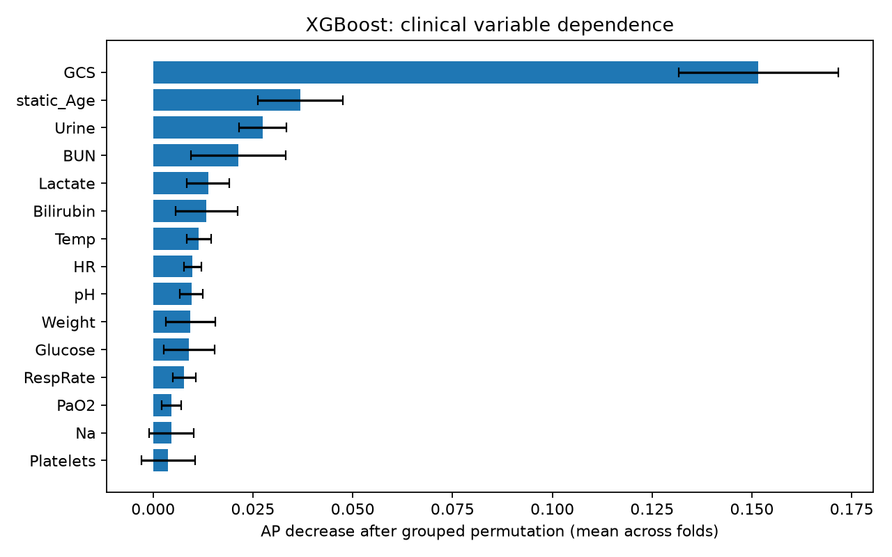

# ICU 住院死亡預測：程式與重現入口

<!-- P64_START -->
## KEDGN 實作稽核（P64）

原作者切分的五種子 AP 平均 **0.56771**，接近論文 **0.571**；共同 Set C 的 **0.54569** 是固定作者架構／參數的 **A+B 適配版**，不是同一切分的復現。已確認解析修復影響 A/B189筆、Set C90筆，另有病例保留、共同輪次及驗證分數定義差異。原始cell全量重播與現有主分數在微小數值誤差內一致，未發現錯權重或GPU改寫造成大幅評分錯誤。選模與訓練解析對差距的獨立貢獻仍未隔離，不能據此宣稱全面勝過充分調優的KEDGN。

原400列逐種子與80列平均／SD不變；沒有新正式訓練或跨種子集成。

[完整差異／數值核對／重跑](reports/P64_kedgn_implementation_audit.md) · [稽核證據](reports/P64_kedgn_implementation_audit.json)。下方歷史敘述若稱整體前處理完全一致，應以本次全量核對的界線為準。
<!-- P64_END -->

<!-- P63_START -->
## 報告六模型的共同標準（P63）

**2026-11-28 報告統一口徑：每個種子分別評估，再列五次指標算術平均 ± 樣本標準差（ddof=1）。** AP、AUROC、Brier 與固定0.5敏感度全部遵循同一規則；不平均不同種子模型的機率、不挑最好種子。

六組主模型為 Full、P22、P62 MA-AP Full＋GCS60、P28、KEDGN A+B 與 R1 論文參數版。P28 的既定表格混合是其模型架構，每個種子分別執行；它不額外跨種子集成。

本次只統一展示，400列逐種子指標、80列平均／SD、權重、病例及前處理完全不變，新增擬合0次。六模型四指標CSV共30列，涵蓋三種 Set C 情境及 Demo 兩種取樣。下方其他階段結果為歷史紀錄，不直接帶入本次六模型主表。

Full／Elastic、GCS-only、R1 及 MA 六程序的五次逐筆預測相同，SD=0 如實保留；這不代表五份獨立測試。Set C／Demo 已反覆查看，外部改善仍未獨立確認。

[四指標結果／重跑](reports/P63_report_five_seed_results.md) · [統一口徑](reports/P63_reporting_standard.md) · [六模型四指標CSV](reports/P63_main_model_metrics.csv) · [驗收](reports/P63_verification.json)。模型與逐筆預測留在 Git 排除的 `artifacts/p63_report_five_seed/`。
<!-- P63_END -->

<!-- P62_START -->
## 最新補強：相同容量 MA-GBT

全部新模型固定 300 棵、深度 3、學習率 0.05；同作者程式的無懲罰 GBT／MA-GBT 使用相同前處理、三折與 GCS60 加權副本。兩種 MA 選模口徑都只用 A/B，全部候選公開。

[P62 結果與限制](reports/P62_ma_gbt_matched_results.md) · [事前規格](reports/P62_ma_gbt_matched_protocol.md) · [全部 A/B 候選](reports/P62_ab_candidates.csv) · [全部遮蔽](reports/P62_all_stress_metrics.csv)。程式入口為 `src/train_ma_matched.py`、`src/resume_ma_matched_parallel.py`、`src/evaluate_ma_matched.py`（或核對後的 `src/evaluate_ma_matched_fast.py`）及 `src/publish_ma_matched.py`；依結果文件選一個訓練入口，不能同時啟動兩個。相同名義容量仍不代表作者 GBT 與 XGBoost 為相同演算法；機制判斷優先看同作者無懲罰消融。這輪固定 seed42，沒有五種子或 P61 時間區段重跑。測試已反覆查看，Demo 亦非獨立完整版驗證。
<!-- P62_END -->

<!-- FINAL_REPORT_START -->
P0–P61 於 **2026-11-23** 完成彙整；**2026-11-26** 新增 P62 MA-GBT 容量與懲罰消融，沒有製作簡報。

**先讀：** [專案目標與核心結果](../README.md) · [完整階段索引](reports/研究進度總覽.md)。完整報告草稿與 PDF 目前僅保留本機，暫不公開。

研究區分完整資料排序、指定缺失下的退化，以及跨資料庫轉移。五種子 P33 未遮蔽／GCS 全遮／六欄全遮的 Set C AP 為 **0.60084 ± 0.00214／0.53111 ± 0.00249／0.48999 ± 0.00358**。各情境五次均高於 Full；CNN 相對 P28 在六欄全遮及 Demo 有穩定取捨。部分缺失遮蔽後 AP 較高不等於掉分較少，外部 AP 改善仍不確定。
<!-- FINAL_REPORT_END -->

## 現行 pipeline 與文件

固定清理與跨庫欄位／死亡標籤對齊 → 表格摘要、時間摘要及逐小時序列 → GCS 缺失增強與 P26 分流 → P28 表格 log-odds 混合 → P33 的 75% 表格／25% CNN 機率混合。選參及輪次依 A/B 決定，凍結後評估 Set C 與 Demo；多次查看測試的限制見[研究故事](reports/研究結論與故事.md)。

| 入口 | 內容 |
| --- | --- |
| [研究故事](reports/研究結論與故事.md) | 目標、結果、取捨與主張邊界 |
| [階段總覽](reports/研究進度總覽.md) | P0–P61 階段索引，保留原單一凍結模型歷史 |
| [五種子](reports/P60_five_seed_stability_results.md) | 固定種子 42–46、全部 200 列指標、不挑最佳種子 |
| [漸進與區段缺失](reports/P61_progressive_block_results.md) | 39 案例、全部 1,560 列指標、預定配對區間 |
| [文獻定位](reports/文獻定位與可比性.md) | MA-GBT 與 KEDGN 的重現範圍、共同評估與限制 |
| [研究重跑與驗收](reports/研究重跑與驗收.md) | 主環境、原固定模型、重播與完整資料要求 |
| [P60/P61 重跑](reports/P60_P61_reproduction.md) | 五種子與缺失程序、恢復入口及彙總驗收 |
| [報告編排工具](reporting/README.md) | 圖表使用公開彙總；文字與 PDF 另需本機草稿範本 |

`src/` 保留原始表格準備、開發與 Set C 評估入口；`related_work/` 包含後續對齊、缺失與序列實驗；`reporting/` 只做定稿編排。依各階段 protocol 使用相應環境，MA-GBT CPU 與 KEDGN 環境分開。資料、環境、cache、權重、parquet/joblib/npz 及逐筆分數由根目錄 `.gitignore` 排除；不把 PhysioNet／eICU 原始資料提交 Git。

P33 等舊階段數字保留為歷史；目前六模型報告以 P63 的逐種子指標平均／SD 為準。以下 P0–P6 為開發歷史，正式期末報告相關檔案仍不納入 Git。

## 原表格基準與開發歷史

以下保留 2026-10-13 的早期文件。其階段狀態與「未評估 C」等描述不代表目前整個專案進度；目前結論以首頁、研究故事及 P60/P61 結果為準。

<!-- C_EVALUATION_START -->
## 後續已完成 C 評估（2026-10-13）

[P7：C資料集凍結模型評估](reports/P7_C資料集_凍結模型評估.md)：4,000筆、死亡585筆。Full AP 0.5798／AUROC 0.8749；Elastic AP 0.5713／AUROC 0.8743。使用原凍結模型與前處理，新增訓練0次，總訓練量維持158次。此後C已看過模型表現；後續方法仍應在A/B開發。

下方保留原P0–P6開發成果；「未評估C」的描述是該階段歷史狀態。
<!-- C_EVALUATION_END -->

以下是 2026-10-13 的 P0–P6 歷史結果。當時的模型分數來自 A/B 開發交叉驗證，後續序列與外部增補見上方的階段報告。

## 核心結果

- 開發資料8,000筆，死亡1,122筆（14.025%）。三組原始特徵數150／292／435。
- 選定 **XGBoost** 作後續表格基準。完整F2三折AP **0.5450 ± 0.0321**、AUROC **0.8656**。
- 三折精簡策略 **Elastic**：AP **0.5385 ± 0.0406**；相對完整平均差 **-0.0065**。此策略按開發結果選取，分數仍可能偏樂觀。
- 最後以全部A/B重新fit的完整／精簡模型，輸入分別 **435／322** 欄。這和三折平均欄數可能不同；P0–P6尚未評估C；後續結果見頂端P7連結。
- 對增補時間摘要與觀測模式的收益，LR與boosting不完全一致，支持繼續保留共同設定下的消融。

## 各階段報告

| 階段 | 報告 | 主要產出 |
|---|---|---|
| P0 | [資料與特徵重建](reports/P0_資料與特徵重建.md) | 原始序列、規則、字典、對齊與質量稽核 |
| P1 | [基準模型](reports/P1_基準模型.md) | Dummy與四種方法的三折性能／成本 |
| P2 | [有限調參](reports/P2_有限調參.md) | 18組候選配置，最高分與完整配置影響 |
| P3 | [特徵家族](reports/P3_特徵家族.md) | 基本摘要、變化、觀測模式的消融 |
| P4 | [特徵篩選](reports/P4_特徵篩選.md) | 品質／Elastic Net／Top10／Top20比較 |
| P5 | [變數關係與解釋](reports/P5_變數關係與解釋.md) | 相關、有效n、分組置亂、LR與SHAP |
| P6 | [穩定性與敏感性](reports/P6_穩定性補充.md) | 同一開發集五折、成人限定三折 |

## 五折及成人敏感性

| strategy | nfold | adult | AP | AP_SD | AUROC | n |
|---|---|---|---|---|---|---|
| Elastic | 3 | True | 0.5369 | 0.0304 | 0.8613 | 316.3333 |
| Elastic | 5 | False | 0.5551 | 0.0392 | 0.8692 | 319.0000 |
| Full | 5 | False | 0.5515 | 0.0383 | 0.8678 | 435.0000 |

五折／成人限定屬於開發集穩定性補充。成人分析重新切分，不能與原三折做嚴格成對推論；沒有作患者身分層級隔離。不能用平均±SD宣稱95%信賴區間或臨床有效性。

## 哪些變數值得後續研究

下面是完整boosting模型在驗證折的group permutation依賴排名；數值是AP下降，並非死亡風險增加幅度，也不是因果重要性。

| variable | clinical_name_zh | mean_AP_drop | fold_SD |
|---|---|---|---|
| GCS | 昏迷指數 | 0.1516 | 0.0200 |
| static_Age | 年齡 | 0.0369 | 0.0106 |
| Urine | 每次記錄尿量 | 0.0275 | 0.0060 |
| BUN | 血中尿素氮 | 0.0213 | 0.0119 |
| Lactate | 乳酸 | 0.0138 | 0.0053 |
| Bilirubin | 膽紅素 | 0.0134 | 0.0078 |
| Temp | 體溫 | 0.0115 | 0.0030 |
| HR | 心率 | 0.0099 | 0.0022 |
| pH | 動脈pH | 0.0096 | 0.0029 |
| Weight | 體重時間序列 | 0.0093 | 0.0062 |

高相關且可替代的變數，單項置亂可能低估依賴；已保存相關簇聯合置亂結果。另有數值摘要與missing/count的不同意義，需一起對照LR係數與原始分布。



## 銜接深度學習

- 候選通道（本機檔案：`artifacts/candidate_variables_for_dl.csv`） 與 候選欄位（本機檔案：`artifacts/selected_features.csv`） 是訓練內selector的跨折穩定性記錄，**不能直接視為深度模型的最佳輸入**。
- 原始序列 observations_AB.parquet（本機檔案：`artifacts/observations_AB.parquet`） 仍包含所有原始變數、值、時間與清理旗標。Weight admission與動態序列有重疊，資料字典已揭露。
- 後續應比較深度模型完整／精簡通道，保留原始時間、mask與可得靜態資訊，不把手工summary等同於時間序列。
- 已保存共同RecordID切分與完整／精簡表格pipelines。深度模型也只在A/B選方案，最後凍結後再共同評估C。
- 時間／缺失／變數關係的探索只能提供設計假說，不證明attention／graph一定優於本輪表格模型。

## 稽核與實際成本

- 總計 **158** 次fit，其中正式修正版 **120** 次，初版欄名除錯 **38** 次不納入結果。
- 正式版本fit耗時合計 **319.0秒**；這不包含特徵提取、相關性、SHAP／置亂等成本。實際牆鐘時間不可用此合計代替。
- 最高採樣RSS **458.3MB**；所有正式版本fit收斂警告 **0** 個。
- 初版官方縮寫TropI/TropT未對到原始TroponinI/TroponinT，已修正重建並重跑；除錯紀錄（本機檔案：`artifacts/superseded_debug_fits.json`） 保留，沒有混入最終分數。
- 驗證結果（本機檔案：`artifacts/study_validation.json`）：唯一鍵、標籤對齊、OOF全覆蓋及AP重算、肌鈣蛋白欄位、模型保存讀回與C原壓縮檔雜湊均已檢查。

## 限制與下一步

未做外部驗證、統計顯著或臨床因果宣稱。保留非負極端值與部分生理零值，這些仍可能包含紀錄問題；資料清理與先前EDA不同。C先前已被EDA探索，後續須揭露此限制。

建議先審查候選清單及資料質量，再決定深度方法與外部增補來源。本輪已提供實際表格基準，可用於後續共同切分比較。


## 重現與審閱

[深度學習銜接備忘錄](reports/深度學習銜接備忘錄.md)說明序列、mask、時間間隔與共同切分。精簡模型最終322欄，**仍包含全部37個動態變數**；候選表已補上選擇依據、跨折排名範圍、缺失率與保留理由。

專案專屬環境位於`.venv`，套件固定於[requirements-lock.txt](requirements-lock.txt)。以下命令從專題根目錄執行，已完成配置會使用現有快取，不必重新訓練。重建輸入可能使資料雜湊改變；若要完整重跑應先另存目前成果，保留訓練預算與來源紀錄。

```powershell
ML/.venv/Scripts/python.exe ML/src/prepare.py
ML/.venv/Scripts/python.exe ML/src/study.py baseline
ML/.venv/Scripts/python.exe ML/src/study.py tune
ML/.venv/Scripts/python.exe ML/src/study.py families
ML/.venv/Scripts/python.exe ML/src/study.py selection
ML/.venv/Scripts/python.exe ML/src/explain.py
ML/.venv/Scripts/python.exe ML/src/study.py confirm
ML/.venv/Scripts/python.exe ML/src/finalize.py
ML/.venv/Scripts/python.exe ML/src/complete_reports.py
```

訓練量已按本次追加核准設為最多170次；目前158次。調參、selector與最終模型保存皆計入。最高RSS數字僅涵蓋訓練採樣，不代表SHAP／序列讀取的整個流程峰值。


## Windows 本機設定

本機以 `DSP` 為專題根目錄，`ML` 和 `data` 位於同一層。建立新環境時，從 `DSP` 的 PowerShell 執行：

```powershell
uv venv .\ML\.venv --python 3.12
uv pip sync --python .\ML\.venv\Scripts\python.exe .\ML\requirements-lock.txt
uv pip check --python .\ML\.venv\Scripts\python.exe
```

PhysioNet 2012 的本機資料路徑如下。A/B 的個案文字檔直接放在各自的目錄內。

```text
data/predicting-mortality-of-icu-patients-the-physionet-computing-in-cardiology-challenge-2012-1.0.0/
├── set-a/*.txt
├── set-b/*.txt
├── Outcomes-a.txt
├── Outcomes-b.txt
├── set-c.tar.gz
└── Outcomes-c.txt
```

`prepare.py` 以 A/B 重建開發特徵，並讀取 C 壓縮檔以記錄筆數與 SHA-256。匯入的 `ML/artifacts/` 已含 A/B 特徵與執行快取，可先從 `study.py baseline` 驗證既有流程。從原始資料重建前，請在獨立副本保留原本的 `ML/artifacts/`、報告和圖表，因為程式會寫回這些位置。

重跑已凍結模型的 C 評估時，需備妥上述所有檔案及 `ML/artifacts/final_models/`。C 壓縮檔需符合 `preparation_manifest.json` 中的原始 SHA-256，程式也會先驗證 A/B 特徵。

```powershell
.\ML\.venv\Scripts\python.exe .\ML\src\evaluate_c.py
```

原始資料與逐筆預測、快取、模型等 `ML/artifacts/` 產物保留在本機。從 Git 取回程式後，如需查閱已保存的實驗產物，可從原 Drive 專案補入 `ML/artifacts/`。
