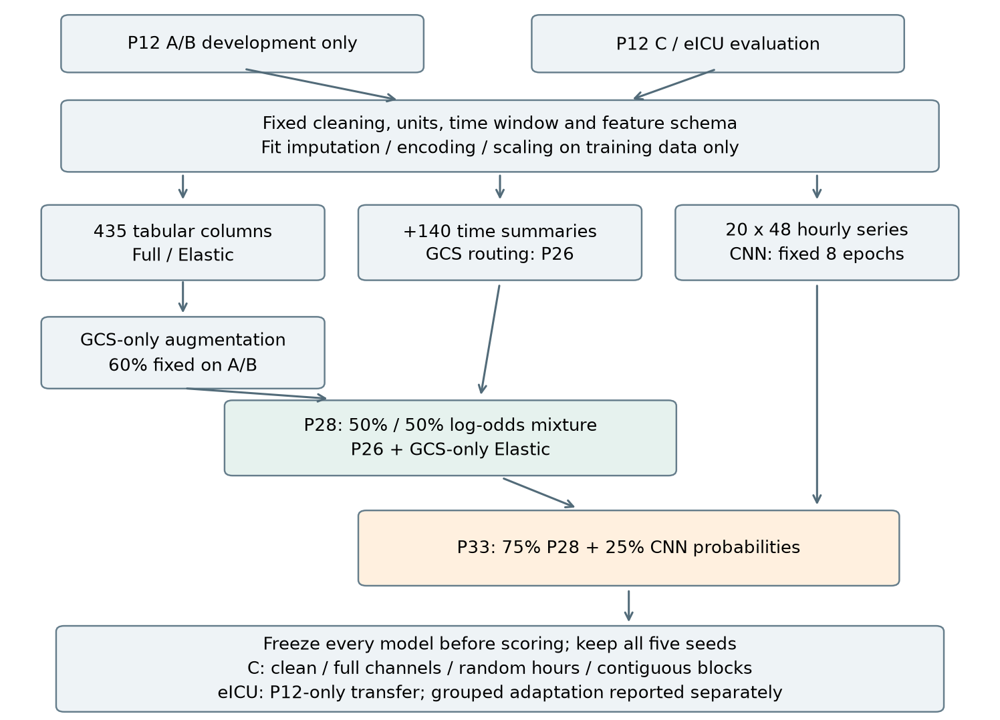
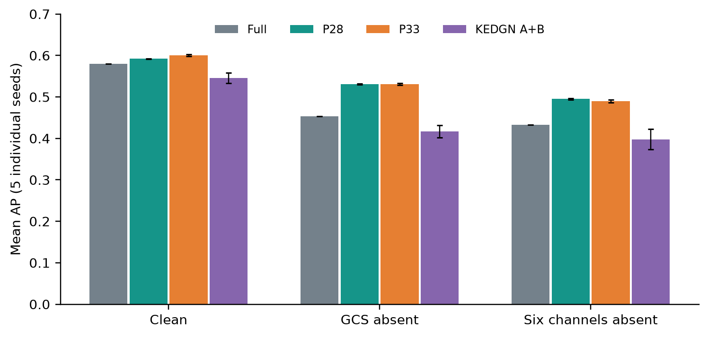
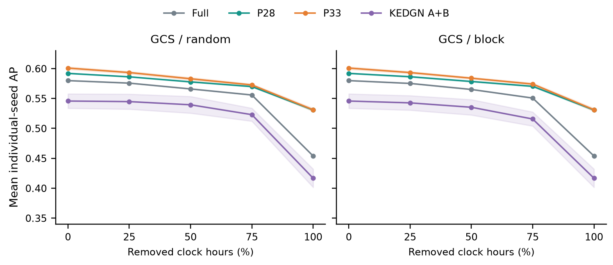
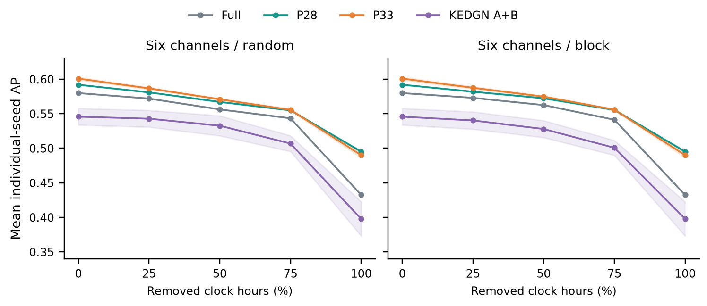

# ICU 住院死亡預測完整研究報告

觀測資訊、缺失型態與跨資料庫轉移

資料科學研究專案｜定稿日期 2026-11-23｜涵蓋 P0 至 P61

實驗結果版本：863dff1。本文整合已保存的實驗與驗收紀錄，本次只編寫報告及圖表，沒有新增模型訓練或選參。原 P51 報告保留為[歷史版](期末研究報告_P51歷史版.md)。

## 摘要

本研究以 ICU 入住初期的量測預測本次住院死亡，區分三個問題：完整資料下的風險排序、指定缺失型態下的退化，以及跨資料庫轉移。主要開發資料為 PhysioNet Challenge 2012 的 A/B 8,000 次住院，以固定三折選擇設定，再在 Set C 4,000 次住院評估；公開 eICU Demo 則用於欄位對齊、凍結轉移及分組折外增強分析。48 小時是主線，24 小時是另行建立風險集的延伸。

我們以 XGBoost Full／Elastic 為基準，依序加入 GCS 缺失增強、時間窗摘要、依 GCS 可得性分流，以及輕量 CNN 混合。主模型 P33 在固定五種子的未遮蔽 Set C AP 為 0.60084 ± 0.00214，三個完整／整欄全遮情境均五次優於 Full。惟 CNN 相對其表格成分 P28，在六欄全遮及兩種 Demo 取樣均五次較低，顯示成分間有穩定取捨。

漸進與連續時間缺失共完成 39 個案例。四個預定的 50% 時鐘缺失情境，P33 五種子集成的 AP 均有配對區間支持高於 Full；但沒有情境支持其相對未遮蔽的退化更少，其中六欄連續 24 小時反而有較大退化的區間支持。eICU 的 AP 增益仍未確認；24 小時 P52 對 P49 的 Brier 誤差下降則有支持。研究因此支持有條件的域內改善，並指出排序、退化幅度、補值依賴與外部機率誤差必須分開驗證。

**關鍵詞：** ICU 住院死亡、平均精確率、缺失增強、時間序列、跨資料庫評估、MA-GBT、KEDGN。

<!-- PAGEBREAK -->
## 1 研究目標與主張範圍

### 1.1 三個研究問題

第一，時間與觀測資訊能否提高完整資料的死亡風險排序？第二，重要通道消失或部分時段沒有量測時，模型是否仍有較高分數，且相對自身完整資料的損失是否較小？第三，這些域內收益能否轉移到另一個資料庫？

研究評估的是住院死亡分類，不是死亡時間預測，也未評估臨床介入效益。特徵遮蔽用來檢查模型依賴與穩定性；移除一個通道後的分數變化不代表該量測的臨床因果效果。

### 1.2 報告主線

主線為 Full → GCS-only → 時間摘要與 GCS 分流 P26 → 表格混合 P28 → CNN 混合 P33。MA-GBT 是減少補值依賴的方法對照；KEDGN 是實際重現並在共同病例上比較的不規則序列基準。P26 保留為重度缺失的專家消融，不依不同測試情境事後替換主模型。

P33 作為本報告整合主角，屬已進行多輪比較後的研究敘事。雖然各階段參數依 A/B 決定，Set C 與 Demo 已反覆查看，因此不能把整體研究稱為全程未查看測試集的確認性研究，也不能以本結果宣稱通用 SOTA。

### 1.3 結論的層級

| 研究問題 | 目前答案 | 適用範圍 |
| --- | --- | --- |
| 完整資料排序 | P33 對 Full 的改善在五種子維持 | 本研究固定 P12 Set C |
| 整欄資訊失去 | P26／P28／P33 有較強遮蔽後表現，原固定 P33 有較小退化的證據 | 指定整欄介入，不代表全部缺失機制 |
| 部分時間缺失 | P33 的 50% 遮蔽後 AP 高於 Full，但較小退化未普遍成立 | 固定時鐘缺失與三組位置 |
| 跨資料庫 AP | 尚未確認改善；CNN 相對 P28 有取捨 | 同一公開 Demo，沒有獨立完整版驗證 |
| 機率誤差與補值依賴 | 部分改善有支持，但不可替代 AP 結論 | 各自的指標與比較設定 |

<!-- PAGEBREAK -->
## 2 資料集與死亡標籤

### 2.1 研究隊列

{{COHORTS}}

P12 的結果為官方住院死亡標籤；48 小時主線沿原 A/B/C 全體紀錄，不在本輪依結果重新挑選病例。官方資料使用 ICU 初期 48 小時的臨床量測，原始來源及拆分背景見參考文獻 [1]。本專案將 A/B 合併開發、C 作留出比較，與 2012 年挑戰當時的訓練／測試安排不同。

eICU 以每次 ICU 住院為評估單位，將 hospitaldischargestatus 的 Expired／Alive 對齊為 1／0，排除其他狀態。48 小時隊列限定成人、單次住院內第一個 ICU stay、ICU 停留至少 2,880 分鐘，且住院結局晚於 2,880 分鐘。24 小時使用相應的 1,440 分鐘條件。不同住院仍可能來自同一人，外部重抽及分折使用患者鍵。

eICU 年齡「> 89」以 90 作下界近似。單次住院內第一個 ICU stay 並不等於資料庫內第一個人生住院。出院狀態、出院時間、住院天數、識別鍵與 APACHE 分數不進研究模型輸入。具有登錄／修訂時間的表，僅保留在觀察窗內可取得的紀錄；相關規則見 [P8](P8_eicu_demo_protocol.md) 與 [P49](P49_24h_landmark_protocol.md)。

### 2.2 資料來源核對與院鍵問題

本機使用的 12 個 Demo 壓縮表格已逐一符合官方 SHA-256。發布表包含 2,520 次 ICU stay、1,841 名患者與 186 個 hospital 鍵；官方文字描述與院鍵數存在出入。來源相符確認了檔案身分，沒有解決院鍵的實際醫院含義，因此本文使用「院鍵」而不把它當成確定的醫院數。[來源核對](資料來源核對.json)；官方資料見 [2]。

48 小時 Demo 評估含 719 名患者；24 小時含 1,237 名患者。分組折外增強把同一患者連結的院鍵合併成區塊，讓同折訓練／測試的患者及院鍵互斥。這仍是同一 Demo 的折外適應估計，不等於取得全新醫院資料的獨立驗證。

### 2.3 觀察時鐘與 24 小時風險集代理

P12 的住院／存活時間以整天表示，部分結果時間和量測分鐘不一致。P41 發現 Set C 中部分 Survival 為 0 或 1 的死亡病例仍有 24 或 36 小時後的量測，無法據現有欄位重建精確事件時間。因此 24 小時 P12 隊列以成人、住院天數及 Survival 條件形成風險集代理，不能宣稱精確的前瞻性 landmark。

較保守的第 3 天回溯敏感度子集為 3,774 次住院／463 次死亡。原凍結 P33 對 Full 的未遮蔽 AP 差仍為 +0.01826，95% 區間 [+0.00226, +0.03408]；P26 對 GCS-only Full 的 GCS 全遮差為 +0.02311 [+0.00254, +0.04541]。這支持主要方向，卻沒有消除時鐘限制；該子集亦使用住院後資訊篩選。[P41 完整稽核](P41_p12_outcome_timing_results.md)

## 3 固定前處理與跨庫欄位對齊

### 3.1 原始清理與特徵

前處理將負哨兵、非有限值、無效類別與不符已記錄欄位值域的值轉為缺失。其餘非負極端值及部分生理零值沿既有規則保留，不因測試結果再清理。48 小時表格／CNN 視圖保留 0 至 2,880 分鐘，端點量測歸入最後一小時。

Full 的 435 欄包含五個入院欄位與 37 個動態變數的摘要、次數、missing 與統計量 defined 旗標。Elastic 的全 A/B 最終集合為 322 欄，仍涵蓋全部 37 個動態變數；它不是移除到只剩少數臨床通道。原 XGBoost 的數值補值、類別缺失處理與編碼由訓練資料估計，各折不得使用驗證折估計統計量。

時間模型另有 20 通道的 140 欄摘要。每個通道以每小時中位數作等權單位，使用早段均值、晚段均值／極值、晚減早、距最後觀測與有觀測的小時數。48 小時的早／晚段分別為前／後 12 小時；24 小時則為前／後 6 小時。

CNN 使用相同 20 通道的 48 格小時序列，以及編碼後靜態資訊；保留數值與觀測旗標。以訓練中位數中心化，以 1-99 百分位截尾後估計的標準差作尺度，再把標準化值限制在 [-8, 8]。缺值不被當成有效零量測。這類保留觀測模式的設計與臨床序列基準、缺失感知模型的研究脈絡相近 [3,4]，但本文沒有把本組 CNN 當成 GRU-D 的重現。

### 3.2 主要欄位映射

{{ALIGNMENT}}

整點模式將指定監測來源依小時取中位數；原始間隔模式保留較密集的監測時點。兩者都沿固定欄位與單位規則，不能把採樣差異當成兩個獨立外部資料集。血氧動脈檢驗與監視器 SpO2 不混作同一檢體。P12 原始單位、Mg 的可比性、ICU 類型的未知類別、GCS 的紀錄習慣都保留為限制。

P8 的尿量原先留缺失；P23 後使用明確 mL 事件更新。主模型比較採尿量對齊版本，P59 也把 MA-GBT 更新到相同尿量映射，避免直接比較不同輸入版本。P32 的 GCS 分項／通氣探索沒有顯示額外 AP 優勢，未據此追改主分析映射。[P23/P24](P21-P25_predictive_performance_results.md)；[P32](P32_eicu_ventilation_results.md)

<!-- PAGEBREAK -->
## 4 Pipeline 與模型設定



圖 1 將資料處理、模型組裝與評估邊界分開。A/B 決定設定後凍結模型；外部增強是另一條明確使用 Demo 訓練折的分支。

### 4.1 原表格對照與缺失增強

Full／Elastic 沿原 XGBoost 設定：300 棵樹、深度 3、學習率 0.05、hist 方法。GCS-only 用 A/B 選定的 60% 強度，對部分原有 GCS 的訓練病例加入缺失副本。原病例與副本拆分權重，不增加原病例或死亡類別的總權重。尿量-only、GCS＋尿量及後續 MA-GBT 增強各有獨立消融紀錄。

早期 A/B 三折的 Full AP 為 0.5450 ± 0.0321，Elastic 為 0.5385 ± 0.0406；此處是折間 SD，與後文五種子 SD 不同。A/B 分組置亂分析的 AP 下降以 GCS 0.1516 最大，尿量為 0.0275，因此先檢查這些通道的缺失依賴。置亂不是因果重要性，也不能據此把測試遮蔽結果當成新的選參依據。[P4](P4_特徵篩選.md)；[P5](P5_變數關係與解釋.md)

### 4.2 P26 GCS 分流

P26 在目前輸入仍有 GCS 時使用 temporal XGBoost；GCS count 為 0 時使用 blind LightGBM。路由只依目前可得的觀測旗標，不讀取被遮掉的 GCS 或標籤。XGBoost 使用 650 棵、深度 3、學習率 0.035；無 GCS 分支使用 650 輪、15 leaves、min child samples 35 的 LightGBM。兩者的 row／column 採樣及正則化沿原 A/B 選擇，blind 分支以 GCS 全缺失及固定跨庫模擬訓練。[P26](P26-P27_gcs_routing_results.md)

### 4.3 P28 與 P33 混合

P28 將 P26 與 GCS-only Elastic 作 50%／50% 對數勝算混合。輸入機率先限制於 [10^-7, 1-10^-7]，再平均 logit 並轉回機率。原 A/B 選出的有／無 GCS 權重皆為 0.5。

P33 使用固定機率混合：p(P33) = 0.75 × p(P28) + 0.25 × p(CNN)。CNN 為兩層 24 通道一維卷積，kernel 5，第二層 dilation 2；每 12 小時取平均與最大池化，再與靜態值及其觀測旗標合併，接 48 維隱層與 dropout 0.2。固定 AdamW、learning rate 0.0015、weight decay 0.005、batch 128、8 epochs，沒有使用 Set C／Demo 選輪次。

P56 重現原三折 CNN，再比較 32 個依 GCS 可得性調整混合的規則；最佳仍等於原 P33，加權目標增益 0，未達事前 0.001 門檻，因此沒有新規則的測試集選擇。[P28](P28_robust_ensemble_results.md)；[P33](P33_hourly_sequence_protocol.md)；[P56](P56_observation_mixture_results.md)

### 4.4 MA-GBT 方法對照

MA-GBT 使用作者固定版本，在本組前處理上比較 alpha=1000／10 及逐欄缺失增強，追蹤預測路徑是否使用補值。其 10 棵、深度 2 的容量與主 XGBoost 不相同，選擇目標也包括補值依賴，不應把 AP 差直接解讀為整個 MA 框架的普遍優劣 [5]。

五欄增強固定 GCS 45%、ICU 類型 75%、尿量 75%、乳酸 25%，膽紅素強度只在 A/B 比較，最終為 75%。所有膽紅素候選均未通過原 GCS 全遮門檻，依事前備用排序完成，而非在測試集挑候選。[P20](P20_ma_gbt_alpha10_bilirubin_results.md)

### 4.5 KEDGN 文獻基準

KEDGN 使用變數文字知識、變數特有參數與密度感知動態圖 [6]。本機完成作者 P12 第五折完整五種子排程：3,198／400／399 筆 train／validation／test，各種子 10 輪，以驗證表現選 checkpoint。作者測試的本機 AP 為 56.8% ± 1.7%、AUROC 88.0% ± 0.8%，接近所用論文變體的 57.1%／87.9%；這不是 Set C 成績，也不是原論文全部資料集的全面復現。

共同 A+B 版本使用原三折，在第 1-10 輪依合併折外 AP 選 9 輪，再以 seed 0-4 各訓練一次。保留原平衡採樣及有效訓練 batch 256。輸入為作者 36 動態通道、9 靜態值與正值 mask，觀測時間採 minute < 2,880，與本組清理／端點規則仍有差異。

GPU 批次實作已與作者 CPU 輸出／梯度核對；P61 後段僅以 A/B 數值等價與速度調整推論 batch，最大差約 1.49×10^-7。推論批次不是訓練 batch，也未用測試 AP 選參。作者表示差異、模型容量、採樣和五種子集成仍是可比性限制。[KEDGN 實作與重跑](../related_work/KEDGN/README.md)

<!-- PAGEBREAK -->
## 5 實驗設計與統計口徑

### 5.1 開發與測試邊界

各階段超參數、增強強度、輪次及混合規則依原 A/B 三折決定，再以全 A/B 重訓。Set C 不參與這些擬合。因研究已多輪查看 Set C／Demo，本文把結果視為探索性整合；各次保留集比較的區間未涵蓋整段歷史模型搜尋，也未校正全部歷史多重比較。

P60 固定 seed 42-46，各重訓六個樹元件及一個 CNN，共 35 次元件擬合，組裝七個本組模型。原選欄、增強位置與混合權重固定，僅改模型初始化／採樣種子。全部模型先封存來源與權重雜湊，再讀取新測試結果；沒有保留最好的一次。五組 CNN 實際均以 CPU 完成。KEDGN 重用既有 seed 0-4，不增加訓練；其種子索引不能與本組假裝配對。

### 5.2 指標

主指標 AP 為 average precision，依精確率與召回率增量加權，沿 sklearn 計算，並非任意梯形插值的 PR 面積。AUROC 補充全排序；Brier 為機率與二元結果的平方誤差；固定 0.5 敏感度說明原門檻下檢出死亡的比例。低 Brier 不等於所有意義的校準已完成，高 AP 也不等於固定門檻或臨床決策效益較好。

AP 受死亡比例與病例組成影響，因此 C 與 Demo、24h 與 48h 的原始 AP 不直接作同分布差距解讀。比較優先使用同病例、同觀察窗、同映射的配對差。

### 5.3 三種不能混用的結果

{{ESTIMANDS}}

樣本 SD 使用五個訓練種子的 ddof=1。Full 原設定沒有隨機 row／column 抽樣，跨種子完全相同是可預期結果；不能把相同分數複製成五份獨立患者測試。P26、P28、P33 共享元件，種子差值亦具相依性。

原整欄比較沿 2,000 次住院配對重抽；外部比較沿 1,000 次患者重抽，另檢查患者連結院鍵區塊。P61 的 50% 比較使用五種子機率集成、1,000 次住院配對重抽；每次先算三個位置各自的 AP 再平均，不把同一病例重複堆成更大測試集。這些區間均為固定模型的病例抽樣變異。

### 5.4 缺失設計

原 P9 使用六個通道的單欄、覆蓋率匹配與聯合遮蔽，P55 加入兩版 KEDGN 的相同整欄端點。P61 則對 GCS 單欄與原六欄聯合，各移除隨機 12／24／36 個時鐘小時，或同長度連續區段，對應 25%／50%／75% 時鐘長度。

每種部分缺失三組位置；同 repeat 的較強集合包含較弱集合。聯合六欄使用相同時段，模擬共同中斷。位置由固定 RNG 與住院順序產生，不依標籤或模型分數。加入 clean、GCS 全遮與六欄全遮後，共 39 個案例。

每個案例先移除原始目標事件，再重算表格摘要、次數／missing／defined、時間摘要、逐小時中位數及觀測旗標。其他通道與靜態欄位保持不變。KEDGN 在相同小時把目標值歸零，保留作者時間網格和長度。移除同比例時鐘不代表移除同比例有效量測，實際刪除比例亦保存。[P61 固定規格](P61_progressive_block_protocol.md)

<!-- PAGEBREAK -->
## 6 Set C 完整資料與整欄缺失結果

### 6.1 五種子主結果

{{SEED_TABLE}}

表中為五次指標平均 ± 樣本 SD。P33 對 Full 在三個情境皆 5/5 正向。對 P28 則是未遮蔽 5/5、GCS 全遮 3/5、六欄全遮 0/5。這顯示整套 P33 相對簡單基準的優勢穩定，但 CNN 在重度資訊失去時沒有維持相對其表格成分的收益。



圖 2 為個別種子 AP 的平均與樣本 SD，不是五種子機率集成，也不是患者抽樣的 95% 區間。KEDGN 的個別種子平均與其集成分數差異較大，後續比較另列。

### 6.2 未遮蔽的其他指標

{{SECONDARY_METRICS}}

各種子的所有隊列結果均保存，而不是只挑 AP 較高者。完整 200 列含 AP、AUROC、Brier、@0.5 敏感度。[P60 全部種子](P60_all_seed_results.csv)

### 6.3 原單一凍結模型的配對證據

{{ORIGINAL_MASK_TABLE}}

上表沿原 P33 單一凍結模型，與五種子平均分開。原 P33 在 GCS／六欄全遮相對自身 clean 的 AP 損失，分別較 Full 少 0.05368 [+0.03663, +0.07163]、0.03203 [+0.01214, +0.05118]。因此「整欄資訊失去時退化較少」有固定模型證據，但只適用於這些指定端點。[P58](P58_joint_objectives_results.md)

### 6.4 KEDGN 的訓練量與集成

{{KG_TRANSFER}}

Set A 版與 A+B 版除了訓練病例數，亦有 checkpoint／共同輪次選擇方式的差異，不能把全部收益歸因於訓練量。原作者測試的五種子指標平均、共同 Set C 的個別種子平均、以及共同 Set C 的五種子機率集成，都是不同量。[P53](P53_kedgn_frozen_transfer_results.md)；[P54](P54_kedgn_ab_transfer_results.md)

原 A+B KEDGN 集成在 GCS／六欄全遮 AP 為 0.44486／0.43713；原凍結 P33 相對它的 AP 差區間分別為 [+0.06193, +0.11394]／[+0.02505, +0.07889]。這些共同病例端點支持本組方法較高，但不能據此宣稱所有部分缺失情境都勝過 KEDGN。[P55](P55_kedgn_missingness_results.md)

<!-- PAGEBREAK -->
## 7 漸進與連續時間缺失

### 7.1 全部曲線





圖 3、4 的內部點為五種子 × 三位置的 AP 平均，0%／100% 端點各只有一種遮蔽配置。色帶是各種子先平均位置後的樣本 SD；不是患者 95% 區間，也不是五種子機率集成。相同移除時鐘長度仍可能刪掉不同量的有效觀測。

{{MASK_CURVE_TABLE}}

### 7.2 預定 50% 比較

以下使用全部五種子機率平均的模型，對三個位置各算 AP 後平均，與圖中個別種子指標平均分開。差值均為 P33 減 Full。「少退化的 AP」定義為兩模型的遮蔽後 AP 差，再減去其 clean AP 差；正值表示 P33 的 AP 損失較少。

{{PARTIAL_CI}}

四個 AP 差區間均高於零；但少退化的 AP 為 0/4 有正向支持，1/4 有反向支持。六欄連續 24 小時的損失差為 -0.00884 [-0.01742, -0.00056]，代表 P33 雖然遮蔽後分數仍較高，其相對自身 clean 的退化卻較 Full 大。**不能把「遮蔽後仍較高」替換成「對所有缺失都更穩」。**

{{PARTIAL_COMPARATORS}}

對 P28 與 KEDGN 集成的四個 50% AP 差區間均跨零。P33 對 P28 的相對退化差在四種情境都不利於 P33；CNN 的 clean 收益縮小，沒有形成普遍的額外缺失韌性。KEDGN 的種子集成收益亦說明，不能直接拿其個別種子平均曲線宣稱集成模型已被擊敗。

### 7.3 連續區段是否較困難

{{BLOCK_RANDOM}}

八個固定模型／目標的差值區間均跨零，無法確認連續 24 小時普遍較難。連續缺失可能留下較長完整片段，隨機缺失可能打散時序，且兩者影響的有效量測不完全相同；這些是可檢驗的解釋，不是已證實的因果機制。完整 1,560 列種子×案例結果、實際刪除比例與變異分解均保留。[P61 全部結果](P61_all_seed_mask_results.csv)

<!-- PAGEBREAK -->
## 8 eICU Demo 的轉移與適應

### 8.1 48 小時純轉移

{{SEED_DEMO_TABLE}}

表中是 P12-only 訓練的五次指標平均 ± SD，兩種取樣是同一批 782 次住院／91 次死亡。P33 對 Full 的五次點估計皆較高，但對 P28 兩種取樣皆 0/5 正向；五個種子不是五個新外部資料集，不能據此宣稱跨庫 AP 已確認改善。

原單一凍結 P33 的患者重抽結果如下。它和新五種子平均是不同口徑，保留用來說明病例抽樣的不確定性，而非冒充新集成模型的區間。

{{TRANSFER_TABLE}}

P28 的外部點估計較高，但其相對 Full／Elastic 的收益仍有不確定性。eICU 的患者組成、死亡比例、觀測介面、未映射欄位、量測頻率與 ICU 類型都不同；域內 AP 較高不能取代外部確認。

### 8.2 使用真實 Demo 病例的外部增強

P44／P45 把部分 Demo 病例加入訓練，必須與純遷移分開。Demo 分數來自患者連結院鍵區塊五折的折外預測，同折訓練與測試的患者／院鍵區塊互斥。P45 僅替換有 GCS 分支，無 GCS 分支保留 P28，因此 GCS／六欄全遮時沿用 P28 分數。

| 48h 尿量對齊 | 凍結 P28 AP | P45 有 GCS 分支增強 AP | 配對 AP 差與患者 95% 區間 |
| --- | ---: | ---: | --- |
| 整點 | 0.50144 | 0.51115 | +0.00971 [-0.01335, +0.03271] |
| 原始間隔 | 0.49916 | 0.50653 | +0.00736 [-0.01525, +0.03220] |

點估計上升但區間跨零，不能確認真實外部增強帶來 AP 提升。適應模型使用 Demo 訓練折標籤，因此不是 P12-only 轉移，也不是完整 eICU 的新資料驗證。既有確認入口可以排除 Demo 患者，但沒有資料便不生成正式結果。[P45](P45_augmentation_branch_ablation_results.md)；[P46](P46_eicu_adaptation_confirmation_protocol.md)

### 8.3 MA-GBT 補值依賴與尿量映射

P59 固定三組 MA-GBT、Full／Elastic、權重及統計，先重現舊分數，再更新到主分析相同的尿量 mL 映射。下表列整點結果，其他指標與原始間隔完整保留於來源。

{{MA_TABLE}}

部分原版模型的補值依賴率大幅下降，AP 變動卻小且配對區間跨零；五欄增強版的尿量映射前後分數完全不變。這支持將補值依賴、排序與機率誤差分開評估，不能把依賴率下降當成 AP 必然提高。P20 的 Elastic 膽紅素依賴亦可降至零，但 GCS 全遮表現有下滑；沒有隱藏這個代價。[P59](P59_ma_alignment_results.md)

<!-- PAGEBREAK -->
## 9 24 小時延伸與 APACHE 比較

### 9.1 觀察窗與模型

24 小時重新截取原始輸入並形成風險集代理，不能只把 48 小時模型分數改名。P49 為 24h 分流基準；P50 用 Demo 訓練折增強有 GCS 分支；P52 只用 P12 A/B，在有 GCS 時混合 50% CatBoost 與 50% P49，無 GCS 時逐值沿用 P49。

P52 的 A/B 選擇與比例均先封存。Set C 24h 未遮蔽 AP 從 P49 的 0.46555 升至 0.48012，差 +0.01457 [+0.00417, +0.02599]；GCS 全遮 AP 均為 0.41539；跨庫模擬視圖由 0.44040 升至 0.45277。這些是同隊列內改善，不代表 24h 應有與 48h 相同的 AP。[P52](P52_24h_catboost_blend_results.md)

### 9.2 全 Demo 隊列

{{H24_TABLE}}

{{H24_AP_CI}}

P52 對 P50／P49 的 AP 差，在兩種取樣及兩種重抽均跨零。相較之下，P52 對 P49 的 Brier 差區間在兩種取樣、患者與院鍵區塊重抽下均低於零，支持這個 Demo 上的機率平方誤差下降。

{{H24_BRIER_CI}}

Brier 的改善是獨立於 AP 的結論，不能改寫成 AP 假設成功，也不能單靠 Brier 宣稱機率校準與臨床效益已充分驗證。

### 9.3 APACHE IVa 共同隊列

{{APACHE_TABLE}}

共同隊列為 1,166 次住院／100 次死亡。整點 P52 相對 APACHE IVa 的 AP 差為 +0.02150，患者區間 [-0.06488, +0.11712]；原始間隔差亦不確定。P52 的整點 0.5 敏感度為 8%，APACHE 為 28%，不能只憑 AP 點估計宣稱全面較佳。APACHE 的一般定義使用前 24 小時，但發布表無法確認每筆分數實際何時可得，仍有可得性限制。[P57](P57_demo_paired_results.md)

原 48h 模型對 24h APACHE 的比較受觀察窗差異影響，本文把 24h 共同隊列列為較貼近同窗問題的比較。無 GCS 的 437 次住院／30 次死亡中，P49/P50/P52 分數逐值相同；沒有據子群測試表現另選模型。

<!-- PAGEBREAK -->
## 10 消融與文獻復現的完整狀態

### 10.1 沒有增益的實驗也構成證據

| 實驗方向 | 已觀察結果 | 研究含義 |
| --- | --- | --- |
| GCS＋尿量、尿量-only 增強 | 有增強設定提高遮蔽分數但損失 clean；部分候選未通過門檻 | 增強強度不是越大越好，備用選擇規則須揭露 |
| MA-GBT 逐欄增強 | 尿量、乳酸、膽紅素依賴可降低；AP 並未同步穩定提高 | 少用補值與提高排序是不同目標 |
| 四小時序列與觀測分布模擬 | 部分域內／外部有點估計收益，仍有取捨 | 採樣頻率可能重要，但不能據單點宣稱機制 |
| 移除量測頻率、依觀測量改權重、通道別增強 | 多輪 A/B 未勝過原配置 | 保留既有模型是有效的負向消融結果 |
| 序列種子與平均 P39 | 某些通道移除的差值跨種子換方向；三網路平均未達接受條件 | 細微單次差距不宜當作穩定收益 |
| 條件混合 P56 | 32 規則最佳仍為原 P33，目標增益 0 | 不用 C／Demo 翻案選新規則 |
| 新五種子與部分時間缺失 P60/P61 | clean 收益穩定；六欄全遮／外部對 P28 有穩定取捨，部分缺失不保證少掉分 | 收窄「韌性」主張，分清成分貢獻與缺失型態 |

各方向的配置、門檻及全部結果見 [P0 至 P61 索引](研究進度總覽.md)，不把失敗候選刪除或改列為未完成。

### 10.2 已完成與未完成的論文工作

MA-GBT 完成的是作者固定實作在本組資料與評估的對照及增強，不是原論文所有資料集逐項重做。KEDGN 完成作者 P12 第五折完整排程、Set A 凍結轉移、A+B 共同重訓，以及本組缺失測試。兩者是本文主要文獻實驗對照。

Warpformer 的完整排程止於首種子第 17 輪；ViTST 完成第一折影像但微調未結束；ATENet／WaveGNN 只有流程測試或未完成完整排程。使用者已停止這些背景重跑，R1 亦取消；本文僅把相關方法作背景，不列為共同隊列完整成績。不同作者的 split、模型變體與標籤都須核對；部分 Raindrop 作者切分的訓練集含本組 Set C，不能拿來當作同一 A/B→C 比較。[文獻定位](文獻定位與可比性.md)

Warpformer 的多尺度不規則建模 [7]、ViTST 的影像表示 [8] 與 WaveGNN 的圖／序列結合 [9] 提供方法脈絡，但本文沒有根據其原表數字建立跨切分 SOTA 排名。

## 11 研究故事與貢獻

### 11.1 可支持的主線

第一，臨床量測的數值、時間分布與觀測模式共同影響排序；時間與缺失資訊的組合，在固定 P12 留出隊列上可以超過原表格基準。第二，這種域內優勢具有條件：整欄消失、零散時段缺失、連續中斷與真正跨庫是不同問題，不能用一個壓力測試代表全部。第三，複雜成分的增加不保證所有情境都受益；CNN 提高 clean 排序，但重度缺失與 Demo 的收益主要需要回到表格與分流成分判讀。

研究貢獻在於建立可重跑的共同病例比較、分離多種缺失與不確定性來源，並以實際文獻對照與外部適應揭露取捨。它是完整的實證研究，不需要把所有假設寫成成功，也不以模型數量或單一最高分代替證據。

### 11.2 改善與代價

| 可以說的改善 | 同時必須交代的代價或邊界 |
| --- | --- |
| P33 對 Full 的完整 C AP 改善跨五種子維持 | 原單點 0.60447 不等於五次平均 0.60084，也不能代表全程未看測試的確認結果 |
| 指定整欄全遮時有更高分數與較小退化證據 | 部分時間缺失的較小退化未普遍成立 |
| 有些補值依賴明顯降低 | AP 未必提高，MA-GBT 容量及目標不同 |
| Demo 增強／24h 混合有較高 AP 點估計 | AP 區間仍跨零；Brier 的支持不能替代排序主張 |
| KEDGN 已作實際共同資料對照 | 表示、前處理、採樣、種子集成與容量仍不同，不是架構因果比較 |

### 11.3 結論

在固定 P12 留出隊列，時間與缺失資訊的組合穩定改善完整資料排序，並在指定整欄失去時保留較強表現。然而，部分時間缺失不一定有較小退化，CNN 也有重度缺失與外部取捨。跨資料庫 AP 增益目前未確認。死亡排序、機率誤差、補值依賴與缺失損失需要各自驗證，域內改善不能取代獨立外部確認。

<!-- PAGEBREAK -->
## 12 限制與後續驗證邊界

**重複查看與選擇偏差。** Set C／Demo 已反覆用於比較，整體研究主角的收斂亦屬探索性整合。固定模型 bootstrap 不涵蓋全部歷史搜尋；未對整個研究做巢狀選模或全面多重比較修正。

**訓練與位置變異有限。** 五個種子固定原欄位、增強位置、參數及切分，只衡量指定初始化／採樣變異。三組遮蔽位置有限，種子×位置為交叉設計，不是 15 個獨立測試集。模型共享成分，差值彼此相依。

**缺失型態有限。** 人工刪除時鐘並未完整重現病況、臨床決策、儀器介面及非隨機缺失。刪掉相同時鐘比例不等於相同有效事件比例。保留靜態欄位與非目標通道，是本測試的明確條件。

**外部資料有限。** 僅有同一公開 Demo；沒有獨立完整版。48h 只有 91 次死亡，24h 共同 APACHE 隊列只有 100 次死亡，差值區間寬。院鍵的實際醫院含義尚不清楚，不能聲稱已完成新版獨立跨院確認。

**時間與測量不完全可比。** P12 的整天結果時間和量測時鐘有不一致，24h 為風險集代理。eICU 使用入組及登錄時間規則仍受發布欄位限制。兩庫的採樣、試劑、單位、通道可得性與病例組成均可能影響表現。

**方法比較有容量與表示差異。** MA-GBT 的樹數與選模目標、KEDGN 的正值 mask／動態圖／文字表示、原 XGBoost 的摘要、CNN 的時鐘網格不同。這些比較有實務意義，但不隔離單一架構因素。

**外部資訊接觸須揭露。** eICU 未標籤分布與字典曾用於對齊和缺失設計，P12-only 指沒有用 Demo 標籤擬合該模型，不表示完全未接觸目標資料。P45/P50 則明確使用訓練折的 Demo 標籤，僅報分組折外估計。

**指標不等於部署效益。** 沒有前瞻性部署、決策曲線或介入試驗，固定 0.5 門檻亦未充分反映臨床代價。本文不作臨床採用或通用 SOTA 宣稱。真正擴大外部主張，需要事先封存方案及新的合法獨立資料，不能只在現有測試集繼續追分。

## 13 重跑方式與資料治理

### 13.1 專案與環境

專案根目錄為 DSP，主要程式在 ML/src，文獻與補強入口在 ML/related_work。表格／統計使用主 Python 與 P21 CPU 套件；MA-GBT、原 CNN CPU 與 KEDGN GPU 分別有固定環境。P0 至 P53 使用 CPU；P54 訓練及後續 KEDGN 推論在獲授權後使用 GPU。P60 的五組 CNN 實際都以 CPU 訓練。

資料、折外分數、逐筆預測、遮蔽位置、權重與環境均留在 Git 排除的 data/、ML/dataset/、ML/artifacts/。GitHub 僅保存程式、規格、彙總 CSV／JSON、圖與本報告；沒有把 PhysioNet／eICU 原始紀錄提交 Git。

### 13.2 已完成產物的驗收

從 ML 執行下列既有產物核對入口。它驗證來源、權重與統計、39 個輸入、同步遮蔽、每個公開 AP 及全部列數，會更新驗收紀錄但不重新訓練。

```powershell
$env:PYTHONDONTWRITEBYTECODE='1'
$env:PYTHONPATH=Join-Path (Get-Location) 'artifacts/p21_cpu_packages/site'
& .venv/Scripts/python.exe related_work/verify_p60_p61.py
```

目前的驗收結果為 35 次元件擬合、七個本組管線×五種子、既有 KEDGN 五種子、39 案例與兩種乾淨 Demo 取樣；200／1,560 列公開指標完整，沒有選最佳種子或測試配置。驗收不要求實驗必須正向。[P60/P61 驗收](P60_P61_verification.json)

### 13.3 完整重播與報告重建

完整模型重播依 [研究重跑入口](研究重跑與驗收.md)、[P60/P61 操作](P60_P61_reproduction.md) 及逐階段 protocol。新電腦須先取得合法資料、安裝固定環境、產生前置產物；缺少私有模型時，不能靠 GitHub 的彙總檔重建逐筆分數。既有完成檔會阻止覆寫，應在獨立副本或新輸出目錄重播並保留原版本。

報告本身只讀公開彙總，可不接觸原始資料重建。從 ML 執行：

```powershell
python reporting/plot_final_report.py
python reporting/build_final_report.py compose
python reporting/build_final_report.py pdf
python reporting/build_final_report.py check
```

圖表使用既有 Matplotlib，PDF 使用含中文字型的 ReportLab；依 [報告重建說明](../reporting/README.md) 準備相應環境。PDF 與 Markdown 由同一內容產生，數值來源雜湊、口徑檢查、頁數與輸出雜湊另有紀錄。[報告來源清單](final_report_sources.json)

<!-- PAGEBREAK -->
## 14 文獻與資料來源

1. Silva I, Moody G, Mark R, Celi LA. PhysioNet/Computing in Cardiology Challenge 2012，資料版本 1.0.0。[官方資料](https://physionet.org/content/challenge-2012/1.0.0/)。
2. Johnson A, Pollard T, Badawi O, Raffa J. eICU Collaborative Research Database Demo，版本 2.0.1，2021。DOI 10.13026/4mxk-na84。[官方資料](https://physionet.org/content/eicu-crd-demo/2.0.1/)。完整 eICU 資料背景：Pollard 等，Scientific Data，2018，DOI 10.1038/sdata.2018.178。
3. Harutyunyan H, Khachatrian H, Kale DC, Ver Steeg G, Galstyan A. Multitask learning and benchmarking with clinical time series data. Scientific Data 6, 96, 2019。[原文](https://doi.org/10.1038/s41597-019-0103-9)。
4. Che Z, Purushotham S, Cho K, Sontag D, Liu Y. Recurrent Neural Networks for Multivariate Time Series with Missing Values. Scientific Reports 8, 6085, 2018。[原文](https://doi.org/10.1038/s41598-018-24271-9)。
5. Stempfle L, Matsson A, Mwai N, Johansson FD. Prediction models that learn to avoid missing values. ICML，PMLR 267，56899-56919，2025。[原文](https://proceedings.mlr.press/v267/stempfle25a.html)；[作者固定版本](https://github.com/Healthy-AI/malearn/tree/fbbdd0ca2c9d0d8072f49d82ad35f4391098863f)。
6. Luo Y 等. Knowledge-Empowered Dynamic Graph Network for Irregularly Sampled Medical Time Series. NeurIPS，2024。[原文](https://proceedings.neurips.cc/paper_files/paper/2024/file/7c04aea54c2a60a632a47bd451cd2849-Paper-Conference.pdf)；[作者實作](https://github.com/qianlima-lab/KEDGN)。
7. Zhang J 等. Warpformer: A Multi-scale Modeling Approach for Irregular Clinical Time Series. KDD，2023。[原文](https://arxiv.org/abs/2306.09368)。本組完整排程未完成，不作共同隊列結果。
8. Li Z, Li S, Yan X. Time Series as Images: Vision Transformer for Irregularly Sampled Time Series. NeurIPS，2023。[原文](https://arxiv.org/abs/2303.12799)。須區分 VisionText 等變體，本組未完成完整微調。
9. Hajisafi A 等. WaveGNN: Integrating Graph Neural Networks and Transformers for Decay-Aware Classification of Irregular Clinical Time-Series. IEEE BigData 2025，最終線上出版 2026。[作者稿與出版資訊](https://pmc.ncbi.nlm.nih.gov/articles/PMC13068137/)。本組只有流程驗證，沒有完整共同測試。

外部書目與資料頁於 2026-11-23 核對；詳細變體、原報值與本機進度見[文獻定位與可比性](文獻定位與可比性.md)。文獻數字只在其原隊列核對重現，不與本組 Set C 建立跨切分排名。

## 附錄 A 階段索引

{{STAGE_INDEX}}

原 P0 至 P61 的逐階段索引、全部規格與負向結果見[完整研究進度](研究進度總覽.md)。下表只整理閱讀路徑，不把取消排程或尚缺資料的確認入口改列成已完成實驗。

## 附錄 B 結果與驗收檔案

{{RESULT_INDEX}}

CSV 每列都是模型／情境的整體指標，並非患者資料。P60 與 P61 的端點有重疊，不能把列數相加當作獨立實驗或獨立病例數。原始資料與逐筆模型產物不在 Git，公開來源雜湊只用於核對身分與版本。
