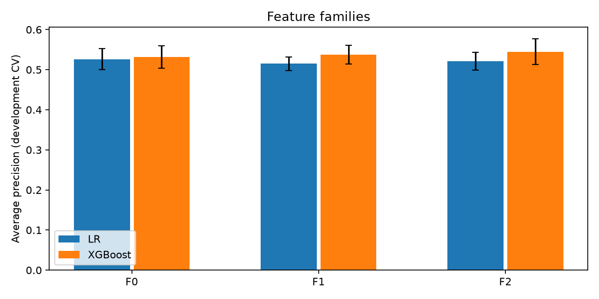

# P3：特徵家族消融

日期：2026-10-13。全部為 A＋B 開發結果，C 未評估。

F0基本摘要，F1增加變化，F2增加觀測模式。每種模型共用在F2選定的參數，不宣稱每組特徵已獨立最佳化。

| model | family | strategy | nfold | adult | AP_mean | AP_std | AUROC_mean | Brier_mean | input_n_mean | fit_s_mean |
|---|---|---|---|---|---|---|---|---|---|---|
| XGBoost | 2 | Full | 3 | False | 0.5450 | 0.0321 | 0.8656 | 0.0875 | 435.0000 | 1.5185 |
| XGBoost | 1 | Full | 3 | False | 0.5378 | 0.0232 | 0.8633 | 0.0882 | 292.0000 | 1.2208 |
| XGBoost | 0 | Full | 3 | False | 0.5317 | 0.0277 | 0.8587 | 0.0886 | 150.0000 | 0.6560 |
| LR | 0 | Full | 3 | False | 0.5261 | 0.0262 | 0.8509 | 0.0897 | 150.0000 | 1.9370 |
| LR | 2 | Full | 3 | False | 0.5215 | 0.0222 | 0.8535 | 0.0901 | 435.0000 | 6.1923 |
| LR | 1 | Full | 3 | False | 0.5150 | 0.0168 | 0.8480 | 0.0910 | 292.0000 | 4.3948 |

平均±SD是折間描述，不是獨立測試成績或95%信賴區間。

## 對照與解讀

- LR：F1−F0=-0.0111，F2−F1=+0.0065。
- XGBoost：F1−F0=+0.0061，F2−F1=+0.0072。
新增摘要並非對每個模型都有一致收益；沒有把折間差異當成顯著性證明。

