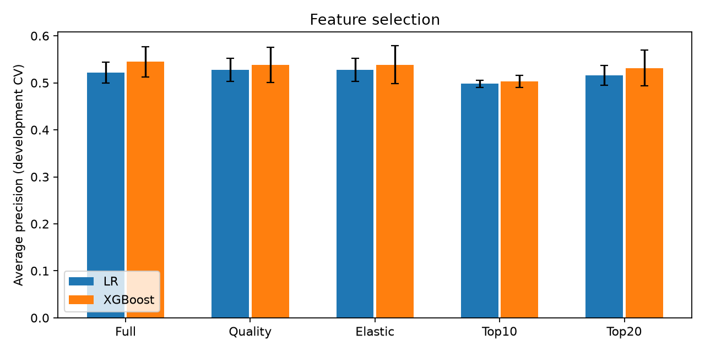

# P4：特徵篩選報告

日期：2026-10-13。全部為 A＋B 開發結果，C 未評估。

所有selector只fit訓練折。暫定AP容忍差0.01；以符合者中較少欄位為優先，選定boosting精簡策略 **Elastic**。未把驗證importance排名用來重訓並在同一折評估。

| model | family | strategy | nfold | adult | AP_mean | AP_std | AUROC_mean | Brier_mean | input_n_mean | fit_s_mean |
|---|---|---|---|---|---|---|---|---|---|---|
| XGBoost | 2 | Full | 3 | False | 0.5450 | 0.0321 | 0.8656 | 0.0875 | 435.0000 | 1.5185 |
| XGBoost | 2 | Elastic | 3 | False | 0.5385 | 0.0406 | 0.8642 | 0.0880 | 317.6667 | 0.9844 |
| XGBoost | 2 | Quality | 3 | False | 0.5378 | 0.0376 | 0.8633 | 0.0882 | 325.3333 | 1.0568 |
| XGBoost | 2 | Top20 | 3 | False | 0.5313 | 0.0380 | 0.8596 | 0.0889 | 237.0000 | 0.7652 |
| LR | 2 | Elastic | 3 | False | 0.5277 | 0.0246 | 0.8541 | 0.0897 | 317.6667 | 6.9718 |
| LR | 2 | Quality | 3 | False | 0.5277 | 0.0246 | 0.8541 | 0.0897 | 325.3333 | 7.2727 |
| LR | 2 | Full | 3 | False | 0.5215 | 0.0222 | 0.8535 | 0.0901 | 435.0000 | 6.1923 |
| LR | 2 | Top20 | 3 | False | 0.5157 | 0.0209 | 0.8524 | 0.0903 | 237.0000 | 4.5597 |
| XGBoost | 2 | Top10 | 3 | False | 0.5036 | 0.0129 | 0.8492 | 0.0917 | 119.0000 | 0.4436 |
| LR | 2 | Top10 | 3 | False | 0.4980 | 0.0077 | 0.8443 | 0.0921 | 119.0000 | 3.4636 |

平均±SD是折間描述，不是獨立測試成績或95%信賴區間。

## 對照與解讀

| model | strategy | AP | AP_delta | n |
|---|---|---|---|---|
| LR | Elastic | 0.5277 | 0.0062 | 317.6667 |
| LR | Full | 0.5215 | 0.0000 | 435.0000 |
| LR | Quality | 0.5277 | 0.0062 | 325.3333 |
| LR | Top10 | 0.4980 | -0.0235 | 119.0000 |
| LR | Top20 | 0.5157 | -0.0058 | 237.0000 |
| XGBoost | Elastic | 0.5385 | -0.0065 | 317.6667 |
| XGBoost | Full | 0.5450 | 0.0000 | 435.0000 |
| XGBoost | Quality | 0.5378 | -0.0071 | 325.3333 |
| XGBoost | Top10 | 0.5036 | -0.0414 | 119.0000 |
| XGBoost | Top20 | 0.5313 | -0.0137 | 237.0000 |

Top10／20指動態臨床變數，還有預先保留的靜態欄位；每折選擇不同，應與selected.csv及穩定性清單一起看。

