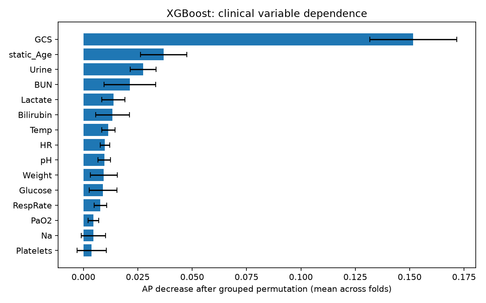
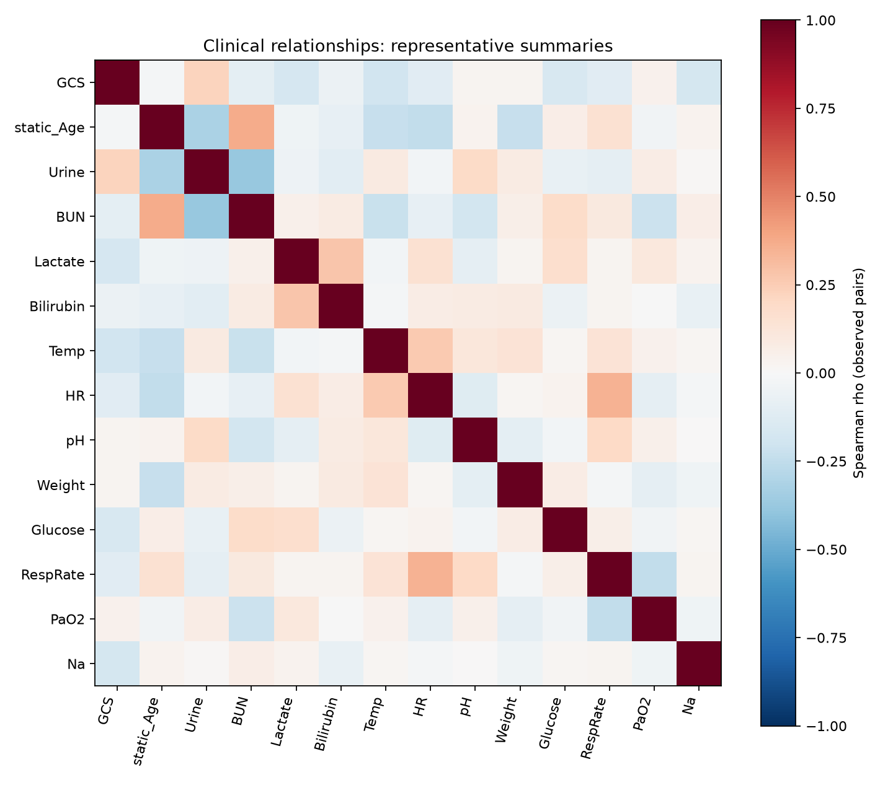
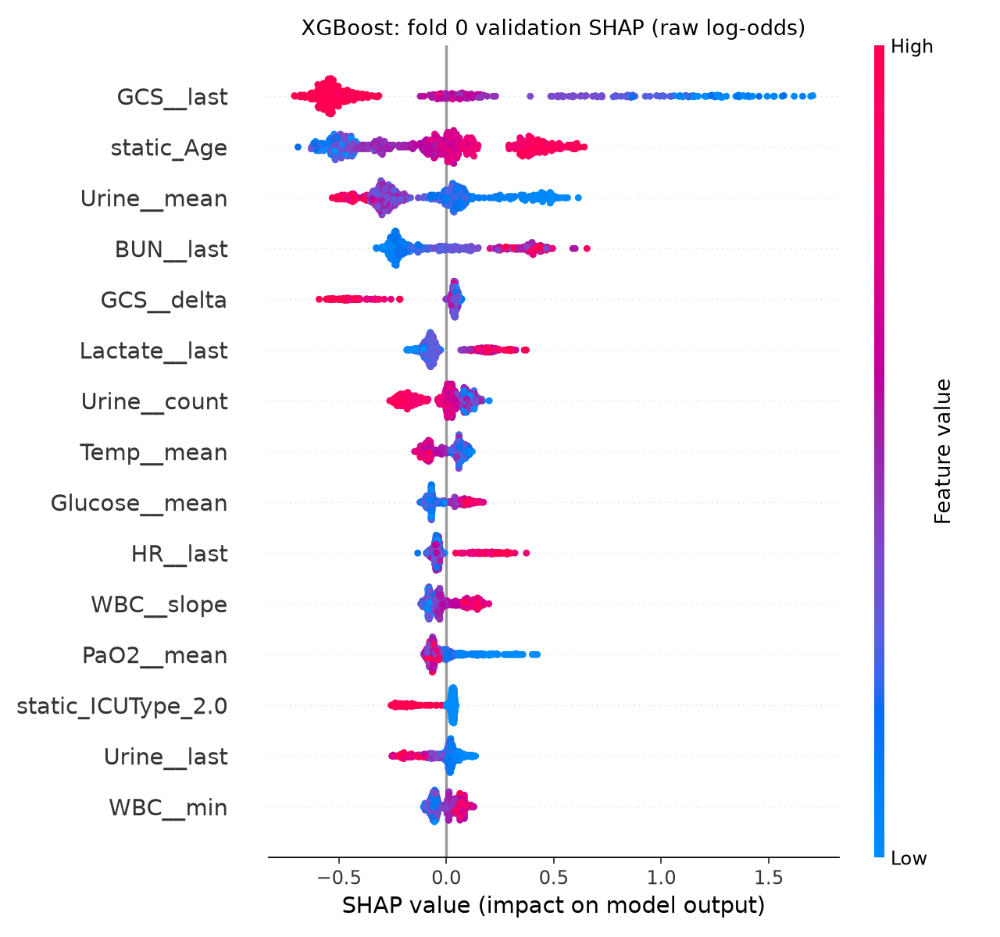
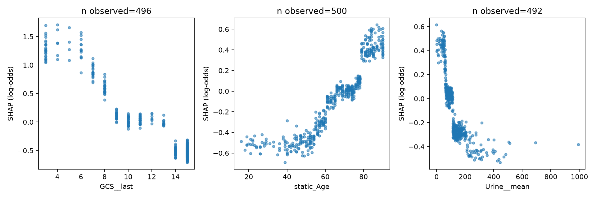
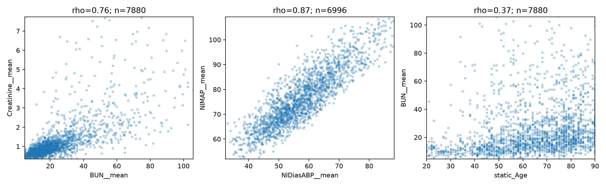

# P5：臨床變數關係、重要性與穩定性報告

日期：2026-10-13。僅使用A/B；C未評估。重要性屬於模型依賴，無因果宣稱。所有探索結果是開發假說。

## 驗證折分組置亂重要性

模型 **XGBoost**；每折固定分層子樣本1500筆，每組5次置亂。同一變數全部摘要、missing/count一起置亂；另測試 |rho|>=0.90 的跨變數相關簇。數值為AP下降，不是死亡機率增幅。折間SD不是信賴區間。

| variable | mean_AP_drop | fold_SD | folds |
|---|---|---|---|
| GCS | 0.1516 | 0.0200 | 3 |
| static_Age | 0.0369 | 0.0106 | 3 |
| Urine | 0.0275 | 0.0060 | 3 |
| BUN | 0.0213 | 0.0119 | 3 |
| Lactate | 0.0138 | 0.0053 | 3 |
| Bilirubin | 0.0134 | 0.0078 | 3 |
| Temp | 0.0115 | 0.0030 | 3 |
| CLUSTER:Weight+static_Weight | 0.0111 | 0.0057 | 3 |
| HR | 0.0099 | 0.0022 | 3 |
| pH | 0.0096 | 0.0029 | 3 |
| Weight | 0.0093 | 0.0062 | 3 |
| Glucose | 0.0090 | 0.0064 | 3 |
| RespRate | 0.0078 | 0.0029 | 3 |
| PaO2 | 0.0046 | 0.0024 | 3 |
| Na | 0.0046 | 0.0057 | 3 |

## 數值關係與資料覆蓋

使用未補值的代表摘要，至少100個共同有效樣本。高度相關變數可能互相替代；所有成對n和rho都已保存。相關簇整體置亂可輔助理解單項的重要性被分攤。

| variable1 | variable2 | rho | observed_n |
|---|---|---|---|
| static_Weight | Weight | 0.9691 | 7327 |
| NIDiasABP | NIMAP | 0.8662 | 6996 |
| DiasABP | MAP | 0.8288 | 5589 |
| NIMAP | NISysABP | 0.8247 | 6996 |
| ALT | AST | 0.8112 | 3447 |
| BUN | Creatinine | 0.7614 | 7880 |
| MAP | SysABP | 0.7048 | 5589 |
| NISysABP | SysABP | 0.6314 | 4765 |

## 與死亡的描述性關聯

下表是有效觀測上的分布差異，正的rank-biserial表示死亡組較高，不表示因果。沒有p-value特徵篩選或多重比較顯著性宣稱；缺失率和有效樣本數必須一起看。

| feature | alive_n | death_n | alive_median | death_median | rank_biserial |
|---|---|---|---|---|---|
| GCS__last | 6765 | 1106 | 15.0000 | 9.0000 | -0.4937 |
| BUN__last | 6762 | 1118 | 18.0000 | 31.0000 | 0.3811 |
| Urine__mean | 6701 | 1086 | 117.9310 | 74.4936 | -0.3804 |
| BUN__mean | 6762 | 1118 | 18.0000 | 29.0000 | 0.3623 |
| Urine__last | 6701 | 1086 | 100.0000 | 50.0000 | -0.3087 |
| HCO3__last | 6746 | 1117 | 25.0000 | 22.0000 | -0.2970 |
| Lactate__last | 3601 | 797 | 1.5000 | 1.9000 | 0.2774 |
| HCO3__mean | 6746 | 1117 | 24.0000 | 22.0000 | -0.2530 |
| Creatinine__mean | 6762 | 1118 | 0.9000 | 1.2225 | 0.2498 |
| Creatinine__last | 6762 | 1118 | 0.9000 | 1.2000 | 0.2474 |

## 非線性與共同變化

既有fold0模型，在500筆固定驗證樣本作Tree SHAP。使用tree-path-dependent、raw輸出，SHAP值單位為log-odds，而非風險百分點。尚未作重新校準。

散點選擇 GCS__last, static_Age, Urine__mean，只畫實際有值的觀測，缺失補值對預測的作用仍包含在模型中。另以F0–F2重訓消融與LR方向一致性表輔助解讀。這些圖不能決定臨床門檻或證明一個變數改變另一個變數。

共同變化圖使用真實未補值的成對觀測；為顯示縮放採p01–p99範圍，不刪除統計資料，每圖最多抽取2000點。有效n及抽樣規則在joint_relationships.csv。數值與觀測模式的差異主要以F0–F2的實際重訓消融與LR不同statistic係數解讀；未作數值／missing旗標分開置亂，以免打破其資料一致性。

## 候選清單

精簡策略 **Elastic** 的三折欄位聯集 330 欄；這是穩定性候選，不等於三折或最終模型都用同一份欄位。臨床群組 41 個，至少兩折入選 41 個。詳見 [欄位清單](../artifacts/selected_features.csv)、[深度學習候選通道](../artifacts/candidate_variables_for_dl.csv)。低排名變數仍保留於原始序列；驗證重要性未回灌同折selector。

方法參考：[Permutation importance](https://scikit-learn.org/stable/modules/permutation_importance.html)、[SHAP因果解讀限制](https://shap.readthedocs.io/en/latest/example_notebooks/overviews/Be%20careful%20when%20interpreting%20predictive%20models%20in%20search%20of%20causal%20insights.html)。

## 補充：方向、排名與量測模式

GCS最後一次有效值在存活／死亡組的中位數為15／9；BUN最後值為18／31 mg/dL；每次記錄尿量的平均摘要為117.93／74.49 mL。這些分布差異與SHAP方向可互相對照，但尿量不是每天或48小時總尿量。年齡中位數為66／74歲。

以下是最佳LR（C=0.1、Elastic Net比例0.5）的標準化連續欄位係數。same_sign_folds=3表示三折同方向且非零，低於3表示有零係數或方向不一致；係數已受正則化及其他相關輸入影響。

| feature | clinical_name_zh | statistic | mean | std | direction | same_sign_folds |
|---|---|---|---|---|---|---|
| BUN__last | 血中尿素氮 | last | 0.1444 | 0.0444 | 正 | 3 |
| GCS__count | 昏迷指數 | count | 0.2024 | 0.0179 | 正 | 3 |
| GCS__last | 昏迷指數 | last | -0.5404 | 0.0460 | 負 | 3 |
| Lactate__count | 乳酸 | count | 0.0227 | 0.0397 | 正 | 1 |
| Lactate__last | 乳酸 | last | 0.1414 | 0.0311 | 正 | 3 |
| Lactate__missing | 乳酸 | missing | -0.0089 | 0.0136 | 負 | 2 |
| Urine__mean | 每次記錄尿量 | mean | -0.1452 | 0.1663 | 負 | 3 |
| static_Age | 年齡 | admission | 0.4074 | 0.0082 | 正 | 3 |

類別欄位採one-hot並drop first。本輪最佳LR三折均以Gender缺失碼−1作參考、ICUType=1作參考；例如Gender_0和Gender_1係數不能直接互相比較來宣稱性別因果效應。實際逐折編碼見[參考類別](../artifacts/category_encoding.csv)。

數值摘要與count／missing可有不同方向；count反映量測次數，不能解讀為生理改善。沒有再據此調整selector。

| variable | clinical_name_zh | selected_folds | selector_rank_min | selector_rank_max | validation_rank_min | validation_rank_max | development_no_observation_rate |
|---|---|---|---|---|---|---|---|
| GCS | 昏迷指數 | 3 | 1.0000 | 1.0000 | 1.0000 | 1.0000 | 0.0161 |
| static_Age | 年齡 | 3 |  |  | 2.0000 | 2.0000 | 0.0000 |
| Urine | 每次記錄尿量 | 3 | 3.0000 | 15.0000 | 3.0000 | 3.0000 | 0.0266 |
| BUN | 血中尿素氮 | 3 | 2.0000 | 4.0000 | 4.0000 | 10.0000 | 0.0150 |
| Lactate | 乳酸 | 3 | 16.0000 | 27.0000 | 5.0000 | 8.0000 | 0.4502 |
| Bilirubin | 膽紅素 | 3 | 2.0000 | 5.0000 | 5.0000 | 11.0000 | 0.5693 |
| Temp | 體溫 | 3 | 8.0000 | 11.0000 | 5.0000 | 10.0000 | 0.0161 |
| HR | 心率 | 3 | 8.0000 | 21.0000 | 7.0000 | 11.0000 | 0.0160 |
| pH | 動脈pH | 3 | 14.0000 | 17.0000 | 6.0000 | 12.0000 | 0.2414 |
| Weight | 體重時間序列 | 3 | 4.0000 | 12.0000 | 4.0000 | 17.0000 | 0.0770 |

selector排名只使用訓練折數值摘要係數；validation排名來自既有模型的分組置亂，兩者方法不同，不應要求相同。缺失率指整段無有效觀測的紀錄比例。完整排名見[訓練排名](../artifacts/selector_variable_ranks.csv)及[驗證排名](../artifacts/validation_variable_ranks.csv)。

以乳酸為例，各ICUType的量測覆蓋與死亡率如下；這些組別不是不同醫院，不能直接當外部驗證或因果比較。其他核心變數的count與缺失率見[完整量測表](../artifacts/ICUType_measurement_patterns.csv)。

| ICUType | n | deaths | mortality_rate | no_observation_rate | median_valid_count |
|---|---|---|---|---|---|
| 1.0000 | 1167 | 153 | 0.1311 | 0.5938 | 0.0000 |
| 2.0000 | 1656 | 77 | 0.0465 | 0.5085 | 0.0000 |
| 3.0000 | 2917 | 561 | 0.1923 | 0.4344 | 1.0000 |
| 4.0000 | 2260 | 331 | 0.1465 | 0.3540 | 1.0000 |

完整[分布表](../artifacts/outcome_associations.csv)含存活／死亡有效n、median、q25／q75及缺失率。

本輪Elastic精簡保留全部37個動態變數，主要刪除重複或係數為零的摘要。不能把這次結果寫成「已找出少數最佳深度學習通道」。Top10／20在XGBoost三折都超過原定0.01 AP損失容忍值，後續如再精簡通道需重新驗證。
