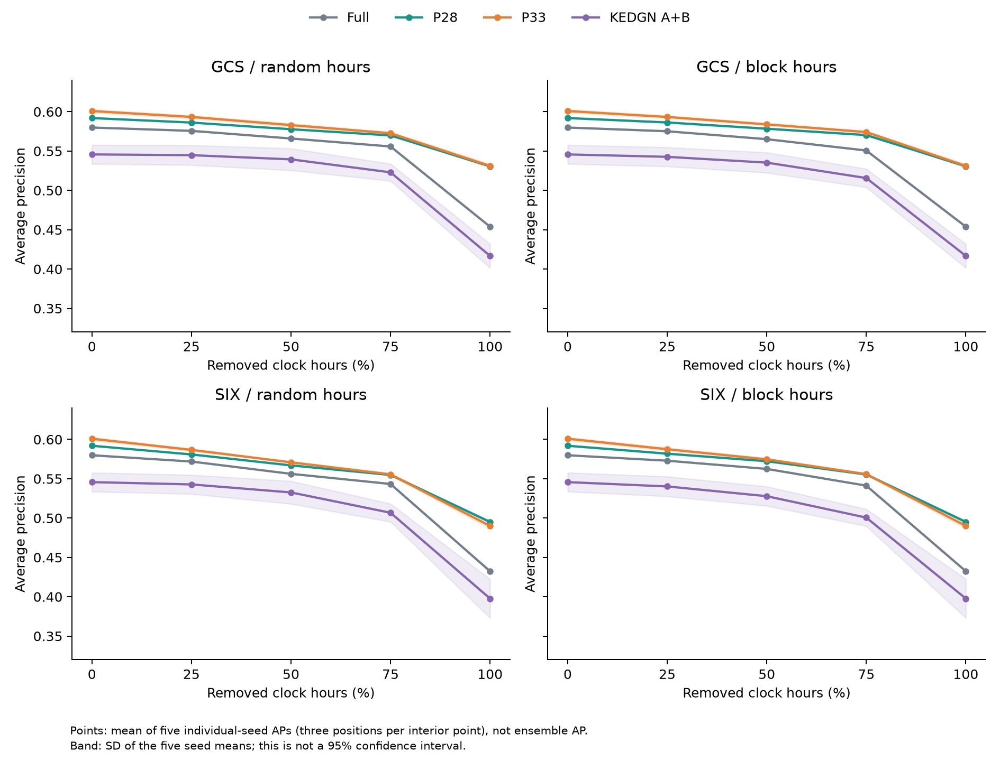

# P61：漸進缺失與連續區段缺失

固定Set C 4,000／585，39個案例、每種部分缺失三組位置；本組七模型各五種子與既有A+B KEDGN五種子全部列入，新增擬合0次。隨機小時與連續區段具有相同移除時鐘長度；真實刪除觀測比例仍不同，完整保存在總表。

## AP 曲線摘要：五種子 × 三位置平均

| 目標 | 設計 | 移除時鐘小時 | Full | P28 | P33 | KEDGN |
| --- | --- | ---: | ---: | ---: | ---: | ---: |
| gcs | random | 12 | 0.57565 | 0.58618 | 0.59333 | 0.54474 |
| gcs | random | 24 | 0.56593 | 0.57773 | 0.58294 | 0.53942 |
| gcs | random | 36 | 0.55580 | 0.56983 | 0.57263 | 0.52293 |
| gcs | block | 12 | 0.57514 | 0.58633 | 0.59329 | 0.54262 |
| gcs | block | 24 | 0.56505 | 0.57838 | 0.58391 | 0.53527 |
| gcs | block | 36 | 0.55066 | 0.57027 | 0.57407 | 0.51566 |
| six | random | 12 | 0.57185 | 0.58089 | 0.58666 | 0.54278 |
| six | random | 24 | 0.55623 | 0.56700 | 0.57086 | 0.53259 |
| six | random | 36 | 0.54336 | 0.55485 | 0.55555 | 0.50677 |
| six | block | 12 | 0.57292 | 0.58186 | 0.58750 | 0.54022 |
| six | block | 24 | 0.56248 | 0.57230 | 0.57469 | 0.52782 |
| six | block | 36 | 0.54122 | 0.55545 | 0.55586 | 0.50061 |

圖與JSON另分解訓練種子SD（各種子先平均三個位置）及遮蔽位置SD（各位置先平均五個種子）。平均曲線沒有挑最好種子，也不把15組結果當15個獨立測試。0%／100%端點及所有8模型的逐種子結果完整列於CSV。

## 預定50%比較：五種子機率平均的配對區間

| 情境 | P33 對照 | ΔAP | 95%區間 | 少退化的AP | 95%區間 |
| --- | --- | ---: | --- | ---: | --- |
| gcs_random_24 | Full | +0.01876 | [+0.00661, +0.03249] | -0.00429 | [-0.01088, +0.00182] |
| gcs_random_24 | P28 | +0.00604 | [-0.00120, +0.01282] | -0.00412 | [-0.00808, -0.00006] |
| gcs_random_24 | KEDGN A+B | +0.01539 | [-0.00648, +0.03712] | -0.01249 | [-0.01976, -0.00544] |
| gcs_block_24 | Full | +0.02046 | [+0.00807, +0.03377] | -0.00260 | [-0.00883, +0.00369] |
| gcs_block_24 | P28 | +0.00624 | [-0.00125, +0.01324] | -0.00391 | [-0.00771, -0.00014] |
| gcs_block_24 | KEDGN A+B | +0.02052 | [-0.00231, +0.04223] | -0.00737 | [-0.01425, -0.00058] |
| six_random_24 | Full | +0.01645 | [+0.00386, +0.02936] | -0.00660 | [-0.01495, +0.00123] |
| six_random_24 | P28 | +0.00471 | [-0.00247, +0.01175] | -0.00544 | [-0.01031, -0.00103] |
| six_random_24 | KEDGN A+B | +0.00929 | [-0.01348, +0.03235] | -0.01859 | [-0.02768, -0.00943] |
| six_block_24 | Full | +0.01421 | [+0.00153, +0.02707] | -0.00884 | [-0.01742, -0.00056] |
| six_block_24 | P28 | +0.00345 | [-0.00316, +0.00979] | -0.00671 | [-0.01067, -0.00259] |
| six_block_24 | KEDGN A+B | +0.01949 | [-0.00339, +0.04270] | -0.00839 | [-0.01748, +0.00066] |

## 相同24小時長度：連續區段減隨機小時

| 目標 | 模型 | 區段減隨機 ΔAP | 95%區間 |
| --- | --- | ---: | --- |
| gcs | Full | -0.00087 | [-0.00750, +0.00514] |
| gcs | P28 | +0.00062 | [-0.00443, +0.00578] |
| gcs | P33 | +0.00082 | [-0.00370, +0.00520] |
| gcs | KEDGN A+B | -0.00431 | [-0.00942, +0.00137] |
| six | Full | +0.00626 | [-0.00199, +0.01446] |
| six | P28 | +0.00528 | [-0.00230, +0.01309] |
| six | P33 | +0.00401 | [-0.00237, +0.01061] |
| six | KEDGN A+B | -0.00618 | [-0.01390, +0.00137] |

區間來自1,000次同住院配對重抽，每次先對各位置算AP再平均，不把重複病例疊成更大隊列。這裡評估的是五模型等權機率集成；前表則是五次指標平均，兩者不能混為一談。區間只反映固定模型的病例抽樣，未校正歷史多重比較。

連續缺失可能保留較長的完整片段，隨機缺失可能打散序列；實際哪個較難由結果判讀，不預設連續一定更差。人工缺失無法完整反映臨床決策、介面與跨院分布差異。

[事先規格](P61_progressive_block_protocol.md) · [全部1560列](P61_all_seed_mask_results.csv) · [完整JSON](P61_progressive_block_summary.json) · [五種子穩定性](P60_five_seed_stability_results.md)

<!-- INTERPRETATION -->
## 綜合判讀與原結論的修正

四個事先固定50%情境，P33五種子集成對Full的AP差有4/4個區間高於零；但少退化的AP僅0/4有正向支持，1/4反而有較大退化的區間支持。**遮蔽後分數較高，不等於相對自身未遮蔽掉分更少。** 整欄全遮的韌性證據不能直接延伸至所有部分時間缺失。

P33對P28的50% AP差區間均跨零；相對clean的優勢縮小，四種情境的退化差均不利於P33。這與P60的六欄全遮及Demo取捨一致，支持把CNN的主要收益定位在域內完整資料排序，而非宣稱普遍增加缺失韌性。

連續24小時對隨機24小時的八組AP差區間均跨零；目前不能確認哪種設計普遍較難。兩種設計都完整保留，不依結果選更好的一種。

曲線是個別種子AP平均；配對表是五種子機率平均的集成。KEDGN受益於種子集成，不能拿曲線中的個別種子平均直接當作其集成表現：其clean平均AP為0.54569，集成為0.57502。P33對KEDGN集成在四個50%情境的AP差區間亦均跨零，不能宣稱在這些情境確定勝過KEDGN。
