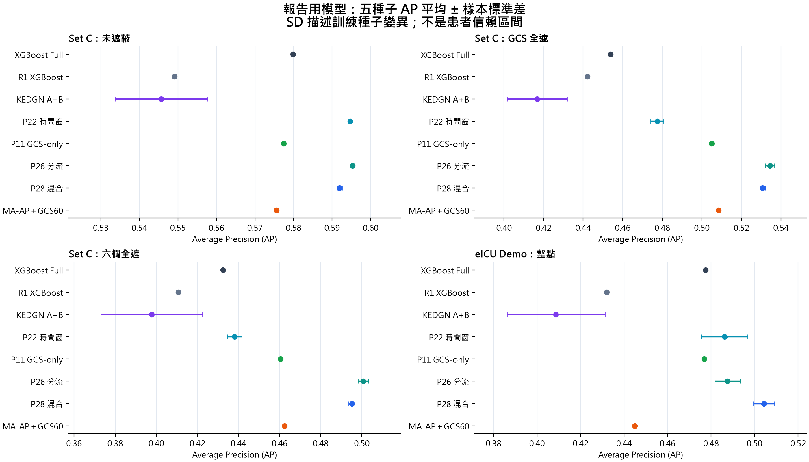

# P63：報告用固定五種子結果

本輪補齊報告用六組主模型與必要控制組，總共 **16 個固定預測程序 × 五種子權重 × 五個主要情境**。全體權重先封存後評估，沒有重選參數／alpha／種子。主表為 **先各算一次指標，再取五次算術平均 ± 樣本標準差（ddof=1）**。標準差不是患者信賴區間。

新增 24 次 MA Full 與八次 R1 最終 A+B 擬合，共 **32 次正式擬合**；另有 12 次 A/B 三樹數值診斷，與正式結果分開。其餘重用既有權重，沒有重訓 KEDGN。新增訓練沿原 CPU 演算法；使用者允許 GPU，本輪沒有為裝置更換演算法。



## 六組主模型：AP 平均 ± 種子 SD

| 模型 | Set C 未遮蔽 | Set C GCS 全遮 | Set C 六欄全遮 | Demo 整點 | Demo 原始間隔 |
| --- | --- | --- | --- | --- | --- |
| 原 XGBoost Full | 0.57985 ± 0.00000 | 0.45383 ± 0.00000 | 0.43246 ± 0.00000 | 0.47750 ± 0.00000 | 0.47924 ± 0.00000 |
| P22 時間窗 XGBoost | 0.59466 ± 0.00025 | 0.47744 ± 0.00332 | 0.43809 ± 0.00353 | 0.48618 ± 0.01071 | 0.48607 ± 0.01379 |
| P62 MA-AP Full＋GCS60 | 0.57557 ± 0.00000 | 0.50839 ± 0.00000 | 0.46246 ± 0.00000 | 0.44488 ± 0.00000 | 0.44570 ± 0.00000 |
| P28 表格混合 | 0.59192 ± 0.00063 | 0.53069 ± 0.00138 | 0.49512 ± 0.00144 | 0.50431 ± 0.00483 | 0.50213 ± 0.00606 |
| KEDGN A+B 重訓 | 0.54569 ± 0.01202 | 0.41672 ± 0.01524 | 0.39776 ± 0.02474 | 0.40869 ± 0.02251 | 0.39718 ± 0.02370 |
| R1 XGBoost 論文參數版 | 0.54911 ± 0.00000 | 0.44212 ± 0.00000 | 0.41068 ± 0.00000 | 0.43199 ± 0.00000 | 0.42783 ± 0.00000 |

## 支持組與 MA 機制控制

| 模型 | Set C 未遮蔽 | Set C GCS 全遮 | Set C 六欄全遮 | Demo 整點 | Demo 原始間隔 |
| --- | --- | --- | --- | --- | --- |
| 原 XGBoost Elastic | 0.57134 ± 0.00000 | 0.44681 ± 0.00000 | 0.42811 ± 0.00000 | 0.48957 ± 0.00000 | 0.47724 ± 0.00000 |
| P11 GCS-only Full | 0.57747 ± 0.00000 | 0.50492 ± 0.00000 | 0.46052 ± 0.00000 | 0.47680 ± 0.00000 | 0.47251 ± 0.00000 |
| GCS-only Elastic | 0.57097 ± 0.00000 | 0.49962 ± 0.00000 | 0.44758 ± 0.00000 | 0.48842 ± 0.00000 | 0.48548 ± 0.00000 |
| P26 GCS 分流 | 0.59532 ± 0.00041 | 0.53438 ± 0.00231 | 0.50064 ± 0.00253 | 0.48760 ± 0.00586 | 0.48557 ± 0.00591 |
| R1 XGBoost 容量對齊版 | 0.54656 ± 0.00000 | 0.44927 ± 0.00000 | 0.40935 ± 0.00000 | 0.43332 ± 0.00000 | 0.43845 ± 0.00000 |
| 同作者 GBT／無增強／無懲罰 | 0.57818 ± 0.00000 | 0.46047 ± 0.00000 | 0.43470 ± 0.00000 | 0.47073 ± 0.00000 | 0.47286 ± 0.00000 |
| P62 MA-AP Full／無增強 | 0.57683 ± 0.00000 | 0.45913 ± 0.00000 | 0.43512 ± 0.00000 | 0.48879 ± 0.00000 | 0.48272 ± 0.00000 |
| P62 MA-rho95 Full／無增強 | 0.54190 ± 0.00000 | 0.38776 ± 0.00000 | 0.38814 ± 0.00000 | 0.41840 ± 0.00000 | 0.37309 ± 0.00000 |
| 同作者 GBT／GCS60／無懲罰 | 0.57329 ± 0.00000 | 0.50667 ± 0.00000 | 0.46038 ± 0.00000 | 0.45120 ± 0.00000 | 0.44770 ± 0.00000 |
| P62 MA-rho95 Full＋GCS60 | 0.51965 ± 0.00000 | 0.46303 ± 0.00000 | 0.40084 ± 0.00000 | 0.32872 ± 0.00000 | 0.32193 ± 0.00000 |

## MA 補值依賴 rho：平均 ± 種子 SD

rho 是至少一條實際樹路徑直接讀到補值的病例比例。每個模型內跨樹取聯集；它不是資料缺失率，也不涵蓋 missing/count 旗標的間接使用。表內單位為百分比；原 XGBoost／R1 等未量測，不能補成零。

| 模型 | Set C 未遮蔽 | Set C GCS 全遮 | Set C 六欄全遮 | Demo 整點 | Demo 原始間隔 |
| --- | --- | --- | --- | --- | --- |
| 同作者 GBT／無增強／無懲罰 | 100.00% ± 0.00% | 100.00% ± 0.00% | 100.00% ± 0.00% | 100.00% ± 0.00% | 100.00% ± 0.00% |
| P62 MA-AP Full／無增強 | 100.00% ± 0.00% | 100.00% ± 0.00% | 100.00% ± 0.00% | 100.00% ± 0.00% | 100.00% ± 0.00% |
| P62 MA-rho95 Full／無增強 | 3.52% ± 0.00% | 100.00% ± 0.00% | 100.00% ± 0.00% | 93.48% ± 0.00% | 93.86% ± 0.00% |
| 同作者 GBT／GCS60／無懲罰 | 100.00% ± 0.00% | 100.00% ± 0.00% | 100.00% ± 0.00% | 100.00% ± 0.00% | 100.00% ± 0.00% |
| P62 MA-AP Full＋GCS60 | 100.00% ± 0.00% | 100.00% ± 0.00% | 100.00% ± 0.00% | 100.00% ± 0.00% | 100.00% ± 0.00% |
| P62 MA-rho95 Full＋GCS60 | 4.52% ± 0.00% | 4.52% ± 0.00% | 100.00% ± 0.00% | 94.63% ± 0.00% | 95.65% ± 0.00% |

## 種子與實際權重

| 模型 | 種子 | 權重套數 | 新增全 A+B 擬合 |
| --- | --- | --- | --- |
| 原 XGBoost Full | 42,43,44,45,46 | 5 | 0 |
| 原 XGBoost Elastic | 42,43,44,45,46 | 5 | 0 |
| P11 GCS-only Full | 42,43,44,45,46 | 5 | 0 |
| GCS-only Elastic | 42,43,44,45,46 | 5 | 0 |
| P26 GCS 分流 | 42,43,44,45,46 | 5 | 0 |
| P28 表格混合 | 42,43,44,45,46 | 5 | 0 |
| P22 時間窗 XGBoost | 42,43,44,45,46 | 5 | 0 |
| KEDGN A+B 重訓 | 0,1,2,3,4 | 5 | 0 |
| R1 XGBoost 論文參數版 | 42,43,44,45,46 | 5 | 4 |
| R1 XGBoost 容量對齊版 | 42,43,44,45,46 | 5 | 4 |
| 同作者 GBT／無增強／無懲罰 | 42,43,44,45,46 | 5 | 4 |
| P62 MA-AP Full／無增強 | 42,43,44,45,46 | 5 | 4 |
| P62 MA-rho95 Full／無增強 | 42,43,44,45,46 | 5 | 4 |
| 同作者 GBT／GCS60／無懲罰 | 42,43,44,45,46 | 5 | 4 |
| P62 MA-AP Full＋GCS60 | 42,43,44,45,46 | 5 | 4 |
| P62 MA-rho95 Full＋GCS60 | 42,43,44,45,46 | 5 | 4 |

P22 的五種子時間窗分支原已在 P60 訓練，本輪補其獨立評估。P26 與 P28 為可執行組合，重用相應種子的元件、固定分流與混合權重，不另擬合組合器。KEDGN 沿原0–4；其索引不等於其他模型的42–46。

已逐筆確認：Full／Elastic、GCS-only、R1 兩版及 MA 六程序，在五個情境中各自的五種子機率完全相同，SD=0 並非顯示位數造成。這些配置保留全行全欄訓練與固定增強位置；本輪未觀察到改變種子造成有效預測差異，不能推廣成 MA 永遠不受種子影響。沒有為製造變異新增抽樣，也不把相同結果當作五個獨立測試資料集。

## 機率集成另列：不是上方五次指標平均

| 模型 | 未遮蔽 C 五次 AP 平均 | 未遮蔽 C 機率集成 AP | Demo 整點五次 AP 平均 | Demo 整點機率集成 AP |
| --- | --- | --- | --- | --- |
| 原 XGBoost Full | 0.57985 ± 0.00000 | 0.57985 | 0.47750 ± 0.00000 | 0.47750 |
| P22 時間窗 XGBoost | 0.59466 ± 0.00025 | 0.59702 | 0.48618 ± 0.01071 | 0.48895 |
| P62 MA-AP Full＋GCS60 | 0.57557 ± 0.00000 | 0.57557 | 0.44488 ± 0.00000 | 0.44488 |
| P28 表格混合 | 0.59192 ± 0.00063 | 0.59275 | 0.50431 ± 0.00483 | 0.50651 |
| KEDGN A+B 重訓 | 0.54569 ± 0.01202 | 0.57502 | 0.40869 ± 0.02251 | 0.46375 |
| R1 XGBoost 論文參數版 | 0.54911 ± 0.00000 | 0.54911 | 0.43199 ± 0.00000 | 0.43199 |

全部16組、五情境的集成 AP／AUROC／Brier／敏感度均見獨立 CSV。不以比較高的一種統計口徑替換主表。

## 報告使用與限制

主表的每一列都已有五套實際權重與五次預測。均值／SD 描述模型初始化或抽樣變異，沒有包含重新切分、重新選參、不同缺失增強位置、醫院間變異。既有 seed42 的患者 bootstrap 區間不能直接貼到這張五次平均表。

Set C 固定4,000次住院／585次死亡；Demo固定782／91，尿量沿已修正明確 mL 映射。Demo兩種取樣是同一批住院，不能當兩個獨立外部資料庫。AP 跨隊列大小亦受死亡比例影響。

R1 保留148欄四項摘要、原訓練有效量測均值補值與兩套事前固定樹配置。重建資料先核對舊 A/B 計數與補值；五情境的 seed42 逐筆預測須精確重現匯入快照。此處是共同隊列 baseline，沒有宣稱逐一重現原文全部模型與切分。

所有 MA 的 alpha 沿 P62 原 A/B 選擇固定，沒有每個種子重做搜尋。因此本輪擴充既有 AP／rho95 程序，不包含中間 alpha 的新測試或完整 P9/P61 缺失矩陣。

Set C／Demo 先前已反覆使用，這輪為固定配置的種子補強，不是新的獨立跨院確認；表內較高平均不能單憑種子 SD 當作患者層級顯著改善。

## 檔案與重跑

[事前規格](P63_report_five_seed_protocol.md) · [400列逐種子指標](P63_all_seed_results.csv) · [80列平均與SD](P63_mean_sd_results.csv) · [80列機率集成](P63_probability_ensembles.csv) · [同索引種子差值](P63_seed_differences.csv) · [完整彙總](P63_report_five_seed_summary.json)

本機權重索引為 `ML/artifacts/p63_report_five_seed/frozen.json`；原始資料、權重、快取、逐筆預測和正式期末報告均不公開。來源依賴原 P60/P62/KEDGN 的本機產物及使用者提供的 R1 快照。

從 DSP 根目錄，主環境使用 `ML/.venv/Scripts/python.exe`，MA 使用 `ML/artifacts/ma_gbt_runtime/.venv/Scripts/python.exe` 並令 PYTHONPATH 指向 `ML/artifacts/ma_gbt_runtime/upstream`。依序執行：

```text
主環境：ML/src/train_report_r1_seeds.py
MA環境：ML/src/train_report_ma_seeds.py check
MA環境：ML/src/train_report_ma_seeds.py train --workers 6
主環境：ML/src/freeze_report_seed_study.py
MA環境：ML/src/evaluate_report_ma_seeds.py
主環境：ML/src/evaluate_report_seeds.py
主環境：ML/src/publish_report_seed_results.py
主環境：ML/src/verify_report_seed_results.py
```

已完成權重與快取會驗證來源後重用；原始來源或固定規格改變時拒絕沿用，應另設新輸出根目錄，不覆寫歷史成果。
