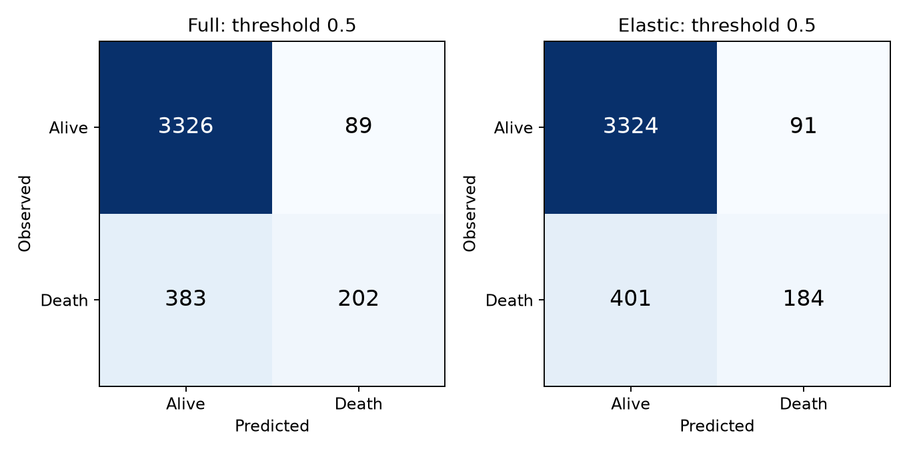
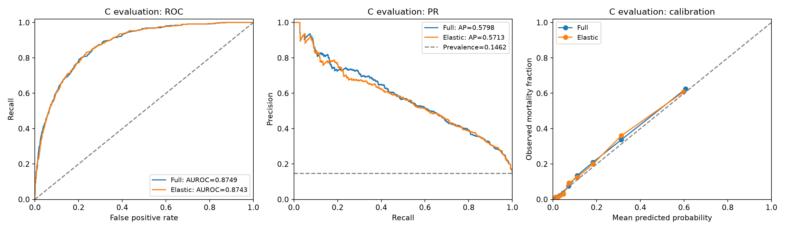

# C 資料集：凍結模型的表現評估報告

日期：2026-10-13。使用A+B全部8,000筆訓練後保存的兩個XGBoost模型，直接預測C。**新增模型訓練0次，沒有用C調參、重選特徵、重新補值／標準化或挑閾值。**

## 評估範圍與資料

- C共 **4,000筆**，死亡 **585筆（14.625%）**，存活3415筆。
- 使用0–48小時（含端點）觀測預測本次住院死亡；不是入ICU當下的預測。
- 年齡低於18有5筆，沒有有效動態觀測有1筆；主評估照原先規則保留。
- 完整Full輸入435欄，精簡Elastic輸入322欄；編碼後分別438／325欄。兩者仍包含全部37個動態臨床變數。
- C與A/B的RecordID零重疊；缺少跨住院病人識別，不聲稱病人身分層級隔離。
- 從原壓縮檔直接讀取，原始資料與凍結模型檔保持不變。共用的特徵提取已在全部8,000筆A/B與原保存矩陣逐欄核對一致，避免C採不同處理。

## 主要指標

| model | input_n | AP | AUROC | AUPRC_trapezoid | Brier | predict_s |
|---|---|---|---|---|---|---|
| Full | 435 | 0.5798 | 0.8749 | 0.5794 | 0.0874 | 0.0997 |
| Elastic | 322 | 0.5713 | 0.8743 | 0.5708 | 0.0881 | 0.0328 |

AP是主要指標，使用average_precision_score；AUPRC_trapezoid是PR曲線梯形積分，兩者數字不同且不得混稱。AP／AUROC越高越好，Brier越低越好。predict_s是一次4,000筆pipeline推論的實測，不含特徵建構與圖表，非穩定硬體benchmark。

固定A/B死亡率0.14025作常數預測的基準，其C AP等於C死亡率0.14625，AUROC=0.5；機率值沒有利用C死亡率擬合。詳見[常數基準](../artifacts/C_evaluation/constant_baseline_C.csv)。

### 固定模型的95% bootstrap區間

| model | metric | estimate | CI95_low | CI95_high |
|---|---|---|---|---|
| Full | AP | 0.5798 | 0.5380 | 0.6209 |
| Full | AUROC | 0.8749 | 0.8601 | 0.8883 |
| Full | AUPRC_trapezoid | 0.5794 | 0.5370 | 0.6201 |
| Full | Brier | 0.0874 | 0.0817 | 0.0936 |
| Elastic | AP | 0.5713 | 0.5286 | 0.6123 |
| Elastic | AUROC | 0.8743 | 0.8592 | 0.8878 |
| Elastic | AUPRC_trapezoid | 0.5708 | 0.5274 | 0.6114 |
| Elastic | Brier | 0.0881 | 0.0824 | 0.0943 |

以C的4,000次encounter為單位，有放回抽樣2000次，seed=20261013，採2.5／97.5百分位。兩個模型共用每次抽樣，未重新訓練。區間反映此測試樣本的抽樣不確定性，不涵蓋訓練隨機性、跨住院相依或換醫院的變異；AP亦受死亡比例影響。

## 完整與精簡的成對比較

| metric | Elastic_minus_Full | CI95_low | CI95_high |
|---|---|---|---|
| AP | -0.0085 | -0.0179 | 0.0009 |
| AUROC | -0.0006 | -0.0031 | 0.0018 |
| AUPRC_trapezoid | -0.0085 | -0.0179 | 0.0009 |
| Brier | 0.0007 | -0.0001 | 0.0016 |

差值方向都是Elastic−Full；AP／AUROC／AUPRC正值較好，Brier負值較好。精簡AP差 **-0.0085**。差值的95%區間包含0，這次樣本不足以支持兩者有明確的AP優劣。

原訂0.01 AP損失是工程容忍值，不是顯著性門檻。即使點估計符合容忍值，也不能據此保證精簡在所有資料上不劣；以差值區間一起判斷。本次C結果只用來評估已凍結方案，不據此修改原A/B選定的模型。

本次AP差的95%區間為 **[-0.0179, +0.0009]**：點估計損失小於0.01，但區間下界低於−0.01，尚不能確立「損失不超過0.01」。

## 固定閾值0.5的分類行為

| model | Precision | Recall | Specificity | F1 | Accuracy | Balanced_accuracy | MCC |
|---|---|---|---|---|---|---|---|
| Full | 0.6942 | 0.3453 | 0.9739 | 0.4612 | 0.8820 | 0.6596 | 0.4343 |
| Elastic | 0.6691 | 0.3145 | 0.9734 | 0.4279 | 0.8770 | 0.6439 | 0.4020 |

| model | TN | FP | FN | TP |
|---|---|---|---|---|
| Full | 3326 | 89 | 383 | 202 |
| Elastic | 3324 | 91 | 401 | 184 |

Full在585個死亡病例中的漏判數為383，Elastic為401。固定閾值結果描述目前決策行為，不代表0.5是適合任務的最佳門檻。Accuracy易受多數存活者影響，需連同死亡Recall與Precision看。若後續要挑閾值，回到A/B訓練內驗證，不能在C挑完再將同一份C當新測試。

完整模型Precision為 **69.42%**、死亡Recall為 **34.53%**。排序分數有辨識能力，不表示目前的固定門檻已能找出大多數死亡病例。Accuracy **88.20%**亦不能作為唯一成功判準。

## 曲線與機率校準

校準圖以10個等樣本數分箱描述平均預測機率與實際死亡比例，未重新校準。PR虛線是C死亡比例。單一校準曲線沒有提供分箱信賴區間，不能宣稱完成臨床校準驗證。

## 與先前A/B開發成績對照

| model | AB_3fold_AP | AB_5fold_AP | C_AP | C_minus_AB3_AP | AB_3fold_AUROC | C_AUROC |
|---|---|---|---|---|---|---|
| Full | 0.5450 | 0.5515 | 0.5798 | 0.0349 | 0.8656 | 0.8749 |
| Elastic | 0.5385 | 0.5551 | 0.5713 | 0.0328 | 0.8642 | 0.8743 |

A/B三／五折是較小訓練子集與多折平均，C是用全部A/B重新訓練後的單一模型測試。兩者訓練量、分布與統計方式不同，差值不是嚴格成對泛化效應，也不能單靠C較高或較低判定資料洩漏／過擬合。若要與Warpformer等文獻比較，仍需核對相同資料、切分、清理與AP/AUPRC定義；本報告不是SOTA排名。

## 成人限定的描述性補充

| model | n | deaths | AP | AUROC | Brier | Recall |
|---|---|---|---|---|---|---|
| Full | 3995 | 584 | 0.5802 | 0.8750 | 0.0873 | 0.3459 |
| Elastic | 3995 | 584 | 0.5716 | 0.8743 | 0.0880 | 0.3151 |

這是同一個凍結A/B模型在C的Age≥18子集評估，沒有訓練成人專用模型，不與先前成人三折當成同一protocol。

## 結論與後續使用

1. 取得可追溯的C結果：Full AP **0.5798**／AUROC **0.8749**；Elastic AP **0.5713**／AUROC **0.8743**。
2. 精簡摘要的效能與成本須一起看，仍未證明可以減少原始序列通道；兩個模型保持全部37個動態變數。
3. C已正式產生模型分數。未來深度模型仍只在A/B調方法，凍結後可用同一C共同對照；但本次分數及先前EDA已被看過，C不能再稱為完全未接觸的測試集。若依C結果改方案，該改動屬新開發，需另設獨立驗證或揭露反覆測試限制。

## 可重現產出

- [指標表](../artifacts/C_evaluation/metrics_C.csv)、[逐筆預測](../artifacts/C_evaluation/predictions_C.csv)。
- [評估規格](../artifacts/C_evaluation/evaluation_protocol.json)、[來源／凍結驗證](../artifacts/C_evaluation/evaluation_manifest.json)。
- [成對區間](../artifacts/C_evaluation/paired_difference_CI.csv)、[bootstrap明細](../artifacts/C_evaluation/bootstrap_samples.csv)。
- [C特徵](../artifacts/C_evaluation/features_C.parquet)、[品質旗標](../artifacts/C_evaluation/cohort_quality_flags_C.csv)。

從專題根目錄執行：`ML/.venv/Scripts/python.exe ML/src/evaluate_c.py`。此程式只提取、預測與評估，不呼叫fit；再次執行不增加模型訓練量。
