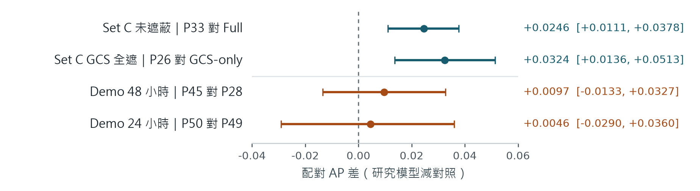

# ICU 住院死亡風險預測

> 歷史快照：本文與原 PDF 截至 P51（2026-11-17），當時採 CPU。後續 P52–P59、GPU KEDGN 及新配對分析見 [研究故事](研究結論與故事.md)、[最新進度](研究進度總覽.md) 與 [驗收](研究完成驗收.json)。依最新指示，本輪只完成實驗與故事，不另製作簡報或更新此歷史 PDF。

## 缺失韌性與跨資料集評估

資料科學專題　Fall 2026　｜　2026 年 11 月 17 日

### 摘要

本研究從 ICU 入住後的量測預測本次住院是否死亡，並檢驗兩個問題。時間序列能否提高風險排序，以及模型在 GCS（格拉斯哥昏迷指數）缺失或移到另一資料集時能否維持表現。我們以 PhysioNet Challenge 2012（P12）A/B 的 8,000 次住院開發，凍結模型後在官方 Set C 的 4,000 次住院評估，另用公開 eICU Demo 實際增強訓練和驗證。

在 Set C，逐小時卷積混合模型 P33 的未遮蔽 AP 為 **0.60447**，原凍結 XGBoost Full 為 0.57985，配對差為 **+0.02462**。GCS 全遮時，時間窗分流 P26 相對 GCS-only Full 的 AP 提升 **0.03241**。兩項的 95% 配對區間下界均大於零。較保守的第 3 天回溯子集仍保留同方向的差異。

eICU Demo 的 48 小時真實外部增強（P45）把整點 AP 從 0.50144 提至 0.51115，配對區間跨零。使用同為前 24 小時的資料時，增強模型 P50 在有 APACHE IVa 的共同隊列 AP 為 0.38863，APACHE IVa 為 0.38994，差異仍不確定。完整版 eICU 的獨立成效尚未驗證。

| 主要比較 | 對照 AP | 研究模型 AP | 配對 ΔAP［95% 區間］ |
| --- | ---: | ---: | ---: |
| Set C 未遮蔽，P33 對凍結 Full | 0.57985 | 0.60447 | +0.02462 [+0.01109, +0.03775] |
| Set C GCS 全遮，P26 對 GCS-only Full | 0.50492 | 0.53733 | +0.03241 [+0.01363, +0.05132] |
| Demo 48 小時整點，P45 對 P28 | 0.50144 | 0.51115 | +0.00971 [-0.01335, +0.03271] |
| Demo 24 小時共同隊列，P50 對 APACHE IVa | 0.38994 | 0.38863 | -0.00132 [-0.09271, +0.09874] |

### 研究範圍

AP 指平均精確率，重點在死亡個案的排序。研究以住院死亡為結果，另報 AUROC 與 Brier 機率誤差。所有模型實驗用 CPU。Set C 曾用於多輪比較，區間描述同一測試隊列的配對差。eICU Demo 的外部增強成績是同一資料來源的分組折外估計。

<!-- page -->

## 資料及原始處理流程

### 原有前處理

**圖 1　研究流程**　原始量測與住院死亡標籤 → 清理、時間截取及缺失旗標 → 表格、時間及序列特徵 → A/B 選參與凍結 → Set C 遮蔽與 eICU 配對評估。

每次 ICU 住院保留一筆標籤。P12 用官方 In-hospital death。eICU 用 hospital discharge status 的 Expired／Alive，對齊成同一住院死亡定義。識別鍵、出院資訊、結果相關時間與 SAPS-I、SOFA、APACHE IVa 不作預測欄位。

固定單位和欄位值域，將負哨兵、非有限值和無效類別轉成缺失。48 小時主流程保留入住後第 0 至 2,880 分鐘。表格有 5 個入院欄位和 37 個動態變數的統計摘要，共 435 欄，包含量測次數、缺失及統計量可計算旗標。凍結 XGBoost Full／Elastic 在訓練折內對數值作中位數補值、對類別作缺失編碼與 one-hot。Elastic 從 435 欄中保留 322 欄。

時間窗模型額外使用 20 個通道的 140 個時間摘要，例如早晚均值、較晚時段極值、距最後量測及有觀測的小時數。逐小時序列則保留同 20 個通道的 48 格中位數及缺失旗標。序列縮放由訓練折估計。

| 隊列 | ICU 住院次 | 住院死亡 | 用途 |
| --- | ---: | ---: | --- |
| P12 A/B 原切分 | 8,000 | 1,122 | 原三折開發、選參和最終擬合 |
| P12 Set C 原切分 | 4,000 | 585 | 凍結模型與遮蔽壓力測試 |
| eICU Demo 48 小時 | 782 | 91 | 外部對齊，增強另採分組五折 |
| eICU Demo 24 小時 | 1,398 | 121 | 同觀察窗、早期隊列和外部增強 |

eICU 納入成人及本次住院第一個 ICU stay，要求在觀察窗結束時仍符合 ICU 停留條件且住院結局晚於截止。依資料字典對齊化驗、監測、護理與輸出入，保留整點中位數和原始間隔。尿量對齊以明確尿量 mL 記錄為準。24 小時版重新擷取截至 1,440 分鐘的輸入，排除截止後才登錄或無已知登錄時點的相關列。P12 因結果時間按整天編碼，24 小時版使用成人與住院／存活天數定義風險集代理。

<!-- page -->

## 模型開發與評估設計

### 從基準到缺失分流

1. **表格基準。** 原 XGBoost Full／Elastic 由 A/B 三折選參，使用同一前處理測試 Set C 與 eICU。先以原版 MA-GBT 對照並做缺失遮蔽。GCS-only XGBoost 用 A/B 選定遮蔽強度，供後續韌性比較。

2. **時間窗分流 P26。** XGBoost 使用表格和時間摘要，有有效 GCS 時由一般分支預測，無 GCS 時由專用 LightGBM 預測。分支與門檻只用 A/B 的未遮蔽、GCS 全遮和跨庫缺失模擬選定。

3. **混合與序列。** P28 將 P26 與 GCS-only Elastic 的 log odds 等權混合。P33 使用 75% P28 機率加 25% 逐小時卷積機率。P38 的四小時序列移除尿量與呼吸率通道，保留為外部敏感度比較。

4. **真實外部增強。** P44 將 eICU Demo 住院確實納入訓練。P45 只替換有 GCS 的 48 小時分支，無 GCS 時沿用凍結 P28。P49 以同觀察窗重新訓練 24 小時模型，P50 沿用其設定並用 Demo 增強有 GCS 的分支。

### 缺失壓力測試與統計

Set C 用同一批住院與固定遮蔽位置比較各模型。主測試搭配 13 種情境與 32 次匹配抽樣，包含 GCS、乳酸、侵入式 MAP、鎂、尿量、機械通氣的個別與聯合缺失。遮蔽清除同一變數的統計值、可用狀態和序列通道。全遮蔽對照用 2,000 次住院次配對重抽。

eICU 凍結遷移與跨庫增強分開計分。增強用患者連結的院鍵區塊五折，同折訓練與測試患者及院鍵區塊互斥。每次住院的成績由其未參與訓練的折產生。eICU 區間以 1,000 次患者配對重抽，另檢查院鍵區塊變異。各比較的 AP 差均由相同病例和對應觀察窗的對照計算。

### MA-GBT 對照的發現

原版 MA-GBT 使用補值前的缺失矩陣，將補值依賴納入分裂目標。P13 未遮蔽 Set C 的 AP 為 0.4464，GCS 全遮降到 0.2465。P20 在 α=10、其他四項增強固定時，用 A/B 選出膽紅素 75% 遮蔽。eICU Elastic 的膽紅素補值依賴由 37.85% 降到 0%，任一補值依賴由 58.44% 降到 32.99%。整點 AP 由 0.3210 升到 0.3363，配對區間為 [-0.0304, +0.0600]。GCS 全遮 AP 仍小降。此結果把降低補值依賴與提高風險排序分開量化。

<!-- page -->

## Set C 的改善與敏感度

| 模型 | 未遮蔽 AP | GCS 全遮 AP | 六項全遮 AP |
| --- | ---: | ---: | ---: |
| 凍結 Full | 0.57985 | 0.45383 | 0.43246 |
| 凍結 Elastic | 0.57134 | 0.44681 | 0.42811 |
| GCS-only Full | 0.57747 | 0.50492 | 0.46052 |
| P26 時間窗分流 | 0.59592 | **0.53733** | **0.49937** |
| P28 分流混合 | 0.59216 | 0.53155 | 0.49477 |
| P33 逐小時序列混合 | **0.60447** | 0.53213 | 0.48911 |
| P38 四小時序列混合 | 0.59992 | 0.52744 | 0.49617 |



P33 在未遮蔽時較凍結 Full 多 0.02462 AP，也比 P28 多 0.01231，兩者的配對區間下界大於零。P26 在六項全遮時較 GCS-only Full 多 0.03885，95% 配對區間約 [+0.0148, +0.0629]。P26 遮蔽後的 AP 仍低於自身未遮蔽值。未遮蔽和重度缺失分別由不同配置得到最高點估計。

未遮蔽時，Full 到 P33 的 AUROC 由 0.87489 升至 0.88075，Brier 由 0.08736 降至 0.08512。GCS 全遮時，GCS-only Full 到 P26 的 AUROC 由 0.84562 升至 0.85539，Brier 由 0.09622 降至 0.09403。

### 時間及重複紀錄檢查

官方公開結果表有部分早期時間與觀測紀錄不一致。保守的第 3 天回溯子集保留 3,774 次住院和 463 次死亡。P33 未遮蔽較 Full 多 0.01826 AP，區間 [+0.00226, +0.03408]。P26 在 GCS 全遮較 GCS-only Full 多 0.02311，區間 [+0.00254, +0.04541]。P47 另查核 A/B 與 C 的相同及高度重疊輸入，在既定檢查條件下未找到跨開發／測試重疊。Set C 已多次用於方法比較，結果宜視為固定隊列證據。

<!-- page -->

## eICU Demo 的結果與限制

### 48 小時跨庫增強

| 尿量對齊設定 | 凍結 P28 AP | P45 折外 AP | P45 對 P28 ΔAP［95% 區間］ |
| --- | ---: | ---: | ---: |
| 整點 | 0.50144 | 0.51115 | +0.00971 [-0.01335, +0.03271] |
| 原始間隔 | 0.49916 | 0.50653 | +0.00736 [-0.01525, +0.03220] |

兩種取樣的點估計上升，區間均跨零。整點 AUROC 由 0.82946 升至 0.83666，Brier 由 0.08015 降至 0.07842。以相同整點及尿量對齊分層，583 次有 GCS 的住院中 AP 由 0.51974 變為 0.53188。199 次無 GCS 的住院逐筆沿用 P28，該組 AP 維持 0.46718。P45 的 Set C GCS 全遮結果也逐筆沿用 P28。

### 與 APACHE IVa 的同窗比較

P48 在有有效 APACHE IVa 的 660 次 Demo 住院中，48 小時 P28 的整點 AP 為 0.50101，APACHE IVa 為 0.37643。兩者使用的資料長度不同。P49 重做前 24 小時輸入，P50 在同窗加入真實病例。主要 24 小時共同隊列有 1,166 次住院和 100 次住院死亡。

| 24 小時整點設定 | 對照 AP | 評估模型 AP | ΔAP［95% 區間］ |
| --- | ---: | ---: | ---: |
| 全隊列，P50 對 P49 | 0.38057 | 0.38512 | +0.00455 [-0.02902, +0.03597] |
| 共同隊列，P49 對 APACHE IVa | 0.38994 | 0.37915 | -0.01079 [-0.10282, +0.08934] |
| 共同隊列，P50 對 APACHE IVa | 0.38994 | 0.38863 | -0.00132 [-0.09271, +0.09874] |

同窗比較未重現 48 小時模型相對 APACHE IVa 的 AP 優勢。P50 的 Set C 未遮蔽 AP 由 0.46555 升至 0.47362，配對區間跨零。GCS 全遮 AP 維持 0.41539。Demo 有效 APACHE 分數只覆蓋部分住院，個別 APACHE 預測實際可用的時間也未公開。

### 可支持的結論

P33 提升了固定 Set C 的未遮蔽排序，P26 在固定 GCS 和多欄位遮蔽時保留更多排序能力。人工遮蔽難以重現臨床量測決定與結果的所有關聯。eICU Demo 多輪用於對齊與探索，分組折外估計仍來自同一發布來源。完整版驗證需以 P46 凍結規格排除所有 Demo 患者後評估。

<!-- page -->

## 文獻與基準比較

### 同隊列臨床對照

P12 的 SAPS-I 和 SOFA 各自以 A/B 的同一批有效分數擬合單變量機率轉換。Set C 兩項均有效的 3,769 次住院中，P33、SAPS-I、SOFA 的 AP 分別為 0.59781、0.24797、0.25318。P33 相對同子集凍結 Full 的配對 AP 差為 +0.02302，區間 [+0.00807, +0.03739]。APACHE IVa 使用發布的住院死亡機率，僅在共同隊列做對照。

### 近年方法

| 研究 | 論文中的資料及結果 | AUROC／AUPRC（%） |
| --- | --- | ---: |
| Warpformer，2023 | 4,000 次 PhysioNet 住院死亡，五個種子 | 86.6／56.7 |
| ViTST | 11,988 次 P12 住院死亡，平均五個切分 | 85.1／51.1 |
| KEDGN，2024 | 3,997 次 Physionet 住院死亡，ChatGPT 變體 | 87.9／57.1 |
| WaveGNN，2025 | 11,988 次 P12 住院死亡，固定 80／10／10 切分 | 83.9／49.4 |
| ATENet，2025 | 11,988 次，原表 P12-M 住院死亡欄 | 85.54／53.31 |

文獻的病例、切分、訓練視窗及 PR 面積算法有所不同。KEDGN 附錄所列 11,988 次 P12 欄使用住院長短，因此表內取其 3,997 次的 Physionet 死亡欄。本研究以同隊列配對結果衡量改善，跨論文分數供方法和實驗背景比較。

### 參考資料

- Silva、Moody、Scott、Celi、Mark。Predicting In-Hospital Mortality of Patients in ICU。PhysioNet/Computing in Cardiology Challenge 2012。[資料、標籤與原論文](https://physionet.org/content/challenge-2012/1.0.0/)
- Johnson、Pollard、Badawi、Raffa。eICU Collaborative Research Database Demo v2.0.1，2021。[正式資料發布](https://doi.org/10.13026/4mxk-na84)　[APACHE 結果欄位](https://eicu.mit.edu/eicutables/apachepatientresult/)
- Pollard 等。The eICU Collaborative Research Database。Scientific Data，2018。[原論文](https://doi.org/10.1038/sdata.2018.178)
- Stempfle 等。Prediction Models That Learn to Avoid Missing Values。ICML 2025。[MA-GBT 原論文](https://proceedings.mlr.press/v267/stempfle25a.html)
- [Warpformer: A Multi-scale Modeling Approach for Irregular Clinical Time Series](https://arxiv.org/html/2306.09368)
- [Time Series as Images: Vision Transformer for Irregularly Sampled Time Series](https://arxiv.org/html/2303.12799)
- [Knowledge-Empowered Dynamic Graph Network for Irregularly Sampled Medical Time Series](https://proceedings.neurips.cc/paper_files/paper/2024/file/7c04aea54c2a60a632a47bd451cd2849-Paper-Conference.pdf)
- [WaveGNN: Integrating Graph Neural Networks and Transformers for Decay-Aware Classification of Irregular Clinical Time-Series](https://pmc.ncbi.nlm.nih.gov/articles/PMC13068137/)
- [Adaptive Time Encoding for Irregular Multivariate Time-Series Classification](https://pmc.ncbi.nlm.nih.gov/articles/PMC13345480/)

<!-- page -->

## 進度與重現方式

### 已完成的里程碑

P12 前處理、A/B 開發、Set C 留出評估、缺失增強與 MA-GBT 對照已完成。48 小時分流、序列混合、eICU Demo 真實增強，以及 24 小時 APACHE 同窗比較均已完成。P51 資料 ZIP 含 P12 的 12,000 次住院、兩套 eICU Demo 觀察窗、欄位、標籤、分折、遮蔽及來源授權。28 個檔案的雜湊、特徵列序及分折互斥已核對。

### CPU 重跑入口

在專案的 ML 目錄，使用原 P12、eICU Demo v2.0.1 和本機凍結產物。原資料依 prepare.py 所定路徑放置，以獨立副本重跑可保留既有輸出。環境為 Windows、Python 3.12.13、XGBoost 3.4.1、LightGBM 4.7.0、scikit-learn 1.9.1，序列模型另用 CPU Torch 2.1.2。安裝細節見 P21 和 P33 的 protocol 檔。

```powershell
$py = '.\.venv\Scripts\python.exe'
$env:PYTHONPATH = Join-Path (Get-Location) 'artifacts\p21_cpu_packages\site'
$env:CUDA_VISIBLE_DEVICES = '-1'
$env:PYTHONDONTWRITEBYTECODE = '1'
```

| 工作 | CPU 入口與前置產物 |
| --- | --- |
| 原表格資料及基準 | src/prepare.py → src/study.py → src/evaluate_c.py，保留原 A/B 三折 |
| Set C 48 小時主結果 | src/audit_p12_outcome_timing.py，載入凍結 P26、P28、P33、P38 與原遮蔽 |
| eICU Demo 48 小時增強 | src/audit_eicu_augmentation_branches.py，沿用 P44 產物並重擬原分組折 |
| 24 小時比較和增強 | src/evaluate_24h_landmark.py fit／evaluate，再執行 src/evaluate_eicu_24h_augmentation.py |
| 課程資料 ZIP | src/package_course_dataset.py，需要截至 P50 的本機產物 |

完整版有授權資料取得後，用以下入口載入凍結模型。正式模式先排除 Demo 患者才評估，主要對照為 P28 對原凍結 Elastic。P38、P45 是次要比較。演練已驗證輸入、排除及推論路徑。

```powershell
& $py src/evaluate_eicu_adaptation_confirmation.py --full-directory 'C:\path\to\eicu-crd-2.0'
```

本報告讀取已完成的 P7、P13、P20、P26、P28、P30、P33、P41、P43、P45、P46、P47、P48、P49、P50、P51 紀錄。未執行新的模型擬合或評估。原始資料、衍生住院資料、模型權重與資料 ZIP 保留在 Git 排除路徑。
