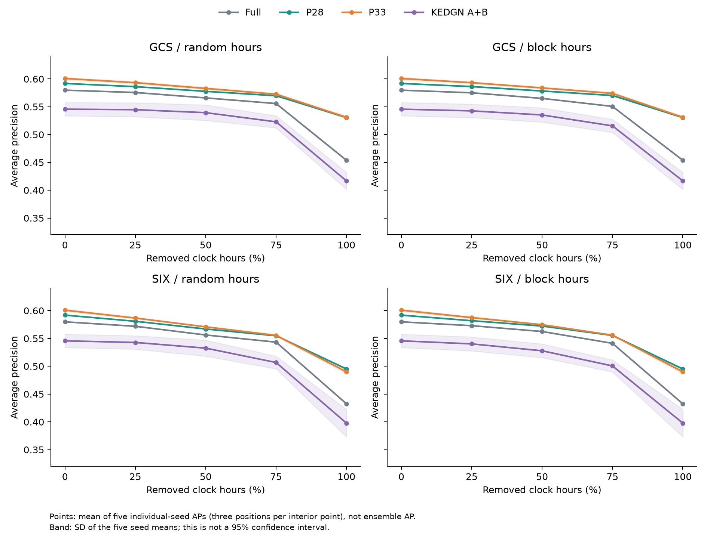
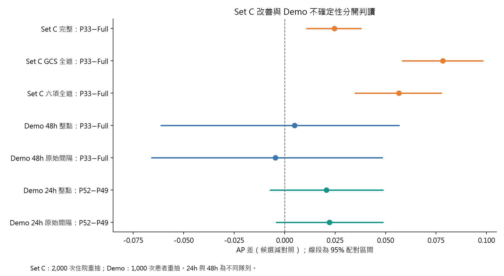

# 研究主線與結果敘事

<!-- P60_P61_START -->
**2026-11-23 完整定稿：** [報告](期末研究報告.md) · [PDF](期末研究報告.pdf)。整合 P0-P61、全部改善與取捨；下方保留階段證據。

## P60／P61 新增補強：五種子與時間缺失

2026-11-22，依後續要求補完，固定參數、不選最佳種子。新增35次元件擬合；七個本組模型各五種子，KEDGN沿既有A+B五種子。39個缺失案例與兩種乾淨Demo取樣全部完成。

P33在Set C未遮蔽／GCS全遮／六欄全遮的五種子AP平均±樣本SD為 **0.60084 ± 0.00214／0.53111 ± 0.00249／0.48999 ± 0.00358**；三個情境對Full均5/5正向。下方歷史P0–P59的0.60447等分數仍是原單一凍結P33，不能與本輪平均混稱。

### 收斂後的故事

**在整欄資訊失去時，缺失專家與表格混合提供韌性；CNN進一步改善域內完整資料排序，但有重度缺失與外部轉移取捨。** 五種子結果中，P33對P28在完整Set C為5/5正向；六欄全遮及Demo兩種取樣則均0/5。應保留這個分工與限制，不宣稱每一個模組在每一種情境都有收益。

P61比較隨機刪除12／24／36個時鐘小時，及同長度連續區段；GCS與六欄各三組固定位置，較強缺失包含較弱缺失的時段。原始目標事件移除後，表格、count/missing、時間摘要及CNN輸入同步重算。資料完整與部分缺失都不能只看單次最佳結果。

### 預定50%情境：P33對Full

以下為五種子機率平均模型，三組位置的AP差平均及1,000次住院配對區間；與上方五次AP平均分開判讀。

| 目標／設計 | ΔAP［95%區間］ | 少退化的AP［95%區間］ |
| --- | --- | --- |
| gcs_random_24 | +0.01876 [+0.00661, +0.03249] | -0.00429 [-0.01088, +0.00182] |
| gcs_block_24 | +0.02046 [+0.00807, +0.03377] | -0.00260 [-0.00883, +0.00369] |
| six_random_24 | +0.01645 [+0.00386, +0.02936] | -0.00660 [-0.01495, +0.00123] |
| six_block_24 | +0.01421 [+0.00153, +0.02707] | -0.00884 [-0.01742, -0.00056] |

四個50%情境的AP仍高於Full，但少退化的AP沒有一致支持，其中六欄連續24小時相對Full反而有較大退化的區間支持。因此研究故事必須區分「遮蔽後仍較高分」與「掉分較少」；整欄全遮的改善不能當成所有部分缺失的韌性結論。

P33對P28與KEDGN五種子集成的50% AP差均不確定；隨機24小時與連續24小時的差也未確認。這些是固定模型的病例抽樣區間；種子與位置波動另報，不把15組種子×位置當15個新測試集。Demo多種子仍不能消除患者數有限及反覆查看的限制。外部AP改善未由本輪證實，R1及其他已取消排程沒有恢復。

[五種子結果](P60_five_seed_stability_results.md) · [缺失曲線與全部比較](P61_progressive_block_results.md) · [全部種子CSV](P60_all_seed_results.csv) · [全部遮蔽CSV](P61_all_seed_mask_results.csv) · [驗收](P60_P61_verification.json) · [重跑](P60_P61_reproduction.md)

<!-- P60_P61_END -->

建議題目：**觀測資訊與缺失韌性的 ICU 住院死亡預測：從時間序列混合到跨資料庫驗證**。

## 一句話主張

研究聚焦於 ICU 量測不完整、量測流程改變或資料庫不同時，如何兼顧死亡風險排序與缺失韌性。時間摘要、缺失專家與輕量序列混合在固定 P12 留出集有效；外部 AP 的增益仍不確定，因此將機率誤差、補值依賴與跨庫表現分開評估。

## 主角與研究問題

主模型以 **P33** 為主：435 欄表格及 140 個時間摘要 → 有／無 GCS 的分流模型 P26 → 與 GCS-only Elastic 作 log odds 混合 P28 → 與 20 通道逐小時 CNN 作 75%／25% 機率混合。原 Full 是基準，GCS-only 是缺失增強對照，P26 是專家消融，MA-GBT 是補值依賴方法對照，KEDGN 是實際重現並在共同資料上重訓的競爭基準。

這樣主線保持一個明確可執行模型；P26 的某些遮蔽點估計更高，留作取捨分析，不按測試情境事後替換主模型。P56 額外檢查了條件混合，A/B 沒有勝過原 P33，所以保留既有規則。

### 問題一：時間與缺失表示的組合能否改善完整資料排序？

原 A/B 8,000 次住院／1,122 次死亡使用固定三折開發，縮放、補值和參數只由訓練部分估計；Set C 4,000／585 用凍結模型計分。P33 未遮蔽 AP 0.60447，高於 Full 0.57985，ΔAP +0.02462，95% 區間 [+0.01109, +0.03775]。KEDGN 的原作者五種子測試已核對，再用 A+B 三折選 9 輪，全 A+B 五種子重訓，Set C AP 0.57502。

這支持「在本研究共同留出設定中，這套時間與缺失表示有效」。KEDGN 與本組仍有表示、前處理、平衡採樣和模型容量差異，不能將結果包裝成打敗所有 SOTA。

### 問題二：完整資料較高，缺失時是否也較穩？

| Set C 情境 | Full AP | P33 AP | ΔAP［95% 配對區間］ |
| --- | ---: | ---: | --- |
| 未遮蔽 | 0.57985 | 0.60447 | +0.02462 [+0.01109, +0.03775] |
| GCS 全遮 | 0.45383 | 0.53213 | +0.07830 [+0.05838, +0.09808] |
| 六項全遮 | 0.43246 | 0.48911 | +0.05665 [+0.03491, +0.07753] |

同一 P33 的三種情境都有正向配對區間。更重要的是，扣除各自未遮蔽分數後，GCS 全遮的 AP 損失較 Full 少 0.05368［+0.03663, +0.07163］，六項全遮少 0.03203［+0.01214, +0.05118］。因此韌性結論同時有遮蔽後分數及較小退化的支持。

KEDGN A+B 的 GCS 全遮 AP 為 0.44486、六項全遮為 0.43713；完整八種情境與兩版 KEDGN 見 P55。這些是共同病例上的敏感度結果，不能解讀成 GCS 或其他變數的臨床因果效果。

在這兩種遮蔽中，P33 對 A+B KEDGN 的 ΔAP 分別為 +0.08728［+0.06193, +0.11394］及 +0.05199［+0.02505, +0.07889］。KEDGN 使用更多 A/B 病例後未遮蔽 AP 提高，但整欄缺失的 AP 退化沒有隨之消失；不規則序列建模能力與缺失韌性仍需要分別測試。

### 問題三：缺失韌性可以直接變成跨資料庫增益嗎？

eICU Demo 48 小時沿同一 782 次住院／91 次死亡，核對欄位、單位與住院死亡標籤。P33 對 Full 的整點 ΔAP +0.00498［−0.06114, +0.05663］，原始間隔 −0.00466［−0.06581, +0.04827］；兩者均未確認改善。P45 的真實 Demo 增強使用患者／院鍵區塊折外預測，對 P28 亦是點估計上升但區間跨零。

24 小時是另一個觀察窗與風險集，主要模型為 P52。P57 補齊它對 P50 外部增強的比較：P52 的 AP 點估計較高，患者與院鍵區塊區間都跨零。P52 對 P49 的 Brier 誤差下降則在兩種取樣及兩種重抽下都有支持。應說「本 Demo 的機率誤差改善」，不能替換成「外部 AP 已證實提升」。

MA-GBT 提供機制對照：尿量對齊後，一些原版模型的補值依賴大幅下降，但 AP 變化很小且區間跨零；五欄增強版的尿量對齊前後分數相同。這支持補值依賴與風險排序是不同研究目標，降低前者不保證提高後者。

## 主要實驗與補充實驗如何安排

1. 資料與前處理：兩個資料庫、住院死亡、觀測窗、單位、缺失旗標、訓練內估計統計與原始資料雜湊。
2. 主要模型：Full → GCS-only → 時間與分流 → P33，讓讀者理解每個成分解決哪一個問題。
3. 主結果：同一 P33 的 clean／GCS／六項全遮與損失差，使用 P58；以 P55 的競爭基準補完整性。
4. 外部結果：P12-only 轉移與 Demo 折外增強分開；用 P57 展示 AP 與 Brier 的結論差異。
5. 補充分析：MA-GBT α／增強／補值依賴、單欄遮蔽、P56 無增益、24h APACHE 同窗比較、時間與重複紀錄稽核。

## 可以主張的貢獻

- 建立可重跑、同病例、同遮蔽與來源可核對的 ICU 死亡分類比較，保留資料與選模邊界。
- 同一固定模型在 P12 未遮蔽與指定缺失情境同時改善，且缺失退化較小。
- 實際重現 MA-GBT 與 KEDGN，並把補值依賴、排序及機率誤差分開量化。
- 透過跨庫、映射修正與分組外部增強，指出域內韌性不能直接當作外部效能提升的證據。

## 必須主動交代的限制

Set C 與 Demo 已反覆用於比較；雖未將 Set C 放入擬合，仍不能稱為研究全程未查看的新測試。配對 bootstrap 只反映固定模型的抽樣差異，未涵蓋全部重新訓練與歷史模型搜尋變異。Demo 樣本與死亡事件有限；未取得完整版，故不主張新版獨立 eICU 驗證。

P12 的觀測時鐘與結果整天編碼有既有不一致；P41 保守時間子集仍支持主要改善，但 24 小時隊列仍屬風險集代理。48h 與 24h 的病例、死亡率和輸入不同，不能只比較 AP 大小。發布說明的醫院數與實際院鍵數不同；檔案已符合官方 SHA-256，但實際醫院數不由院鍵數推斷。

缺失是人工整欄介入，未完整重現臨床決策與介面缺失。eICU 的未標籤觀測分布與資料字典曾用於對齊／缺失設計，故稱 P12-only 訓練轉移，不稱完全未接觸目標資料的盲測。P45/P50 使用部分 Demo 標籤訓練，必須稱分組折外適應估計。

## 結論用語

「時間與缺失資訊的組合，在固定 P12 留出隊列同時改善死亡排序及指定缺失韌性；但跨資料庫 AP 增益仍未確定。模型對補值的依賴、排序品質與機率誤差需要分別驗證，域內改善不能取代外部確認。」

不把負向消融、未知外部效果或未完成的其他論文重跑藏起來。Warpformer、ViTST、WaveGNN 等可作方法背景，完整同隊列復現者只按實際完成狀態列出。

## 對照資料

[完成驗收](研究完成驗收.json) · [結果總表](研究結果總表.csv) · [P55](P55_kedgn_missingness_results.md) · [P56](P56_observation_mixture_results.md) · [P57](P57_demo_paired_results.md) · [P58](P58_joint_objectives_results.md) · [P59](P59_ma_alignment_results.md) · [文獻定位](文獻定位與可比性.md)
