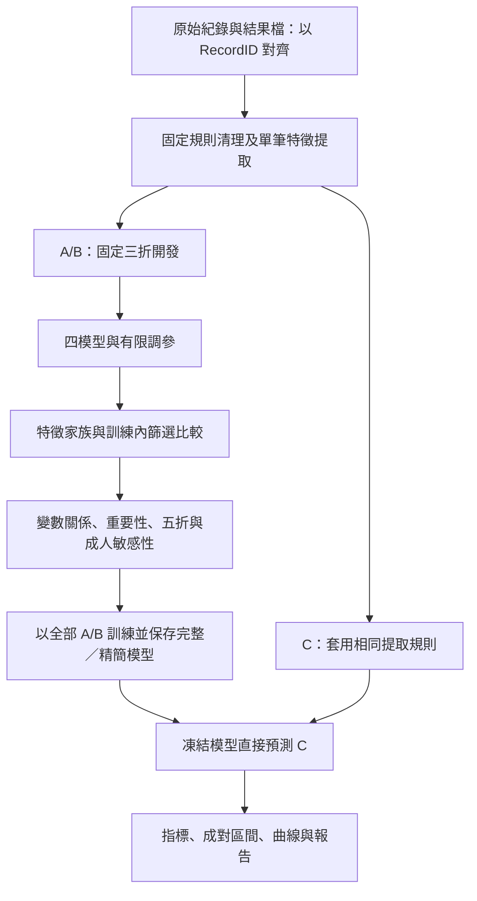
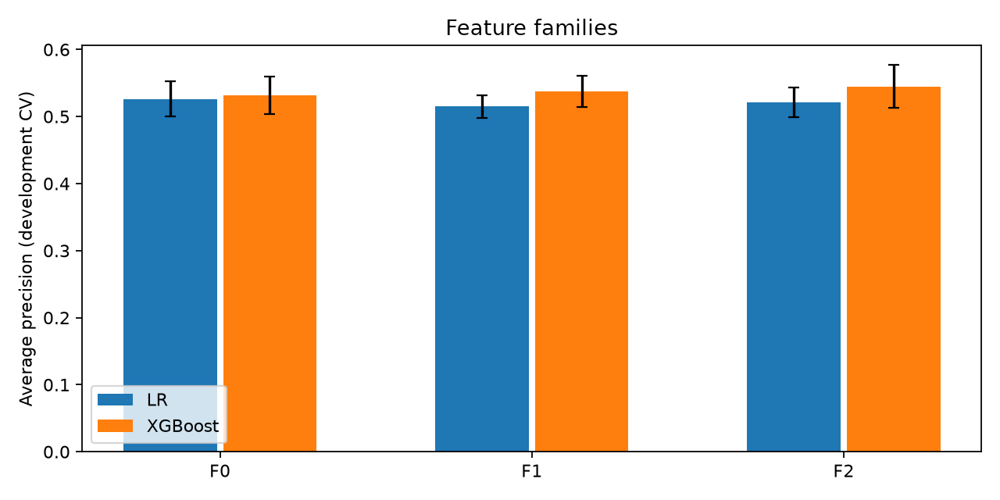
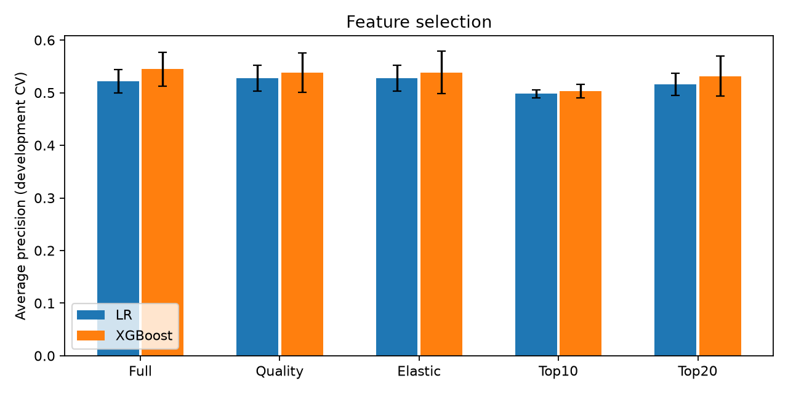
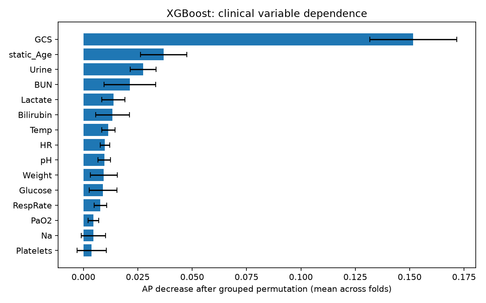
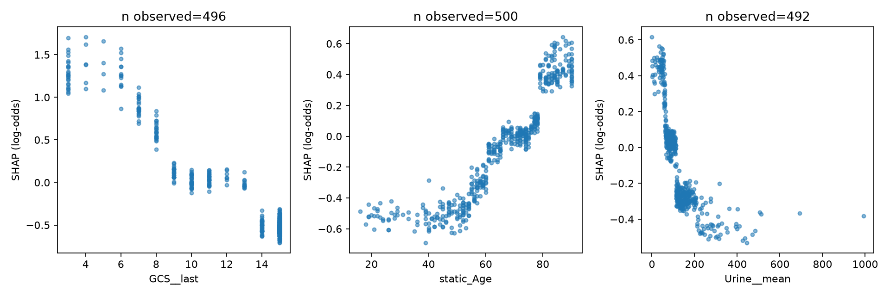
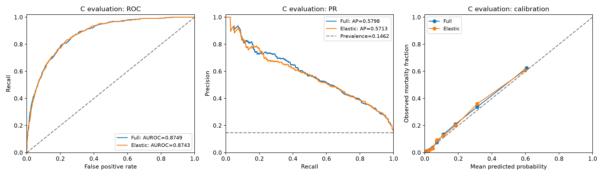
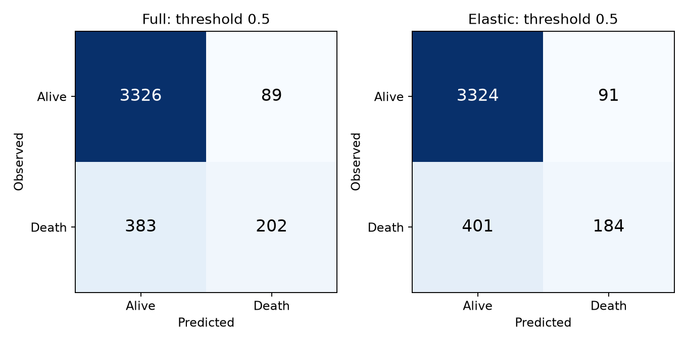

# ICU 住院死亡分類：前處理、方法與實驗結果

2026-11-17 更新。第 1–9 節保留原階段報告，第 10 節補上缺失韌性、MA-GBT、時間窗分流、混合模型與 eICU Demo 的結果。

文件版本：v1.0，2026-10-18。實驗日期：2026-10-13。用途：組內分享、結果審閱與後續重現。

本報告整理已完成的表格機器學習實驗與 C 評估，涵蓋前處理、方法、實驗設定、結果及討論。所有性能數字均來自既有實驗紀錄；撰寫本文件沒有新增訓練、調整模型或重新選特徵。

## 摘要

本研究使用 PhysioNet Challenge 2012 的 ICU 前 48 小時資料，預測本次住院是否死亡。目的有三個：建立後續深度學習的可重現基準、檢查摘要特徵是否能精簡，以及理解臨床變數與模型預測的關係。

A＋B 共 8,000 次紀錄用於開發，C 的 4,000 次紀錄用於已凍結模型的評估。依臨床變數語意建立基本狀態、變化及觀測模式三組特徵，分別有 150、292、435 個未編碼欄位。比較 Logistic Regression、Random Forest、XGBoost、LightGBM 後，依三折平均 AP 選定 XGBoost，並以品質／相關性篩選與 Elastic Net 建立精簡版本。

完整 XGBoost 的 A/B 三折 AP 為 **0.5450 ± 0.0321**、AUROC 為 **0.8656**。在 C 上，完整模型 AP 為 **0.5798**、AUROC 為 **0.8749**；精簡模型由 435 欄減為 322 欄，C AP 為 **0.5713**、AUROC 為 **0.8743**。精簡−完整的 AP 差為 −0.0085，95% 成對 bootstrap 區間為 [−0.0179, +0.0009]，尚不能確認明確優劣或建立損失不超過 0.01 的結論。

GCS、年齡、尿量、BUN、乳酸是完整模型較依賴的資訊。精簡主要移除冗餘摘要，仍保留全部 **37 個動態臨床變數**。本研究尚未實作深度模型或外部資料增補，因此結果不構成與文獻深度模型的共同設定比較。

## 1. 研究問題、範圍與整體流程

### 1.1 本輪回答的問題

1. 基本狀態摘要能提供多少預測能力？
2. 加入變化與觀測模式後，性能是否改善？
3. 刪除重複／高度相關或線性 selector 不使用的欄位，能否維持相近 AP？
4. 哪些臨床變數及其摘要值得後續研究？哪些資訊可能互相替代？
5. 開發資料的結果，在已凍結模型的 C 評估中如何呈現？

本輪以「臨床變數關係」為主要探索目標，超參數比較採有限搜尋。沒有以達到某個文獻分數為停止條件，也沒有將提高 C 分數作為調參依據。

### 1.2 已完成的流程



C 的資料與模型結果未回流到本輪模型訓練或選擇。先前 EDA 曾探索 C，且現在 C 的模型分數已知，後續研究需揭露這項接觸歷史。

## 2. 資料來源與任務定義

### 2.1 資料及分析單位

來源為 [PhysioNet/Computing in Cardiology Challenge 2012 v1.0.0](https://physionet.org/content/challenge-2012/1.0.0/)。一筆資料是一個 RecordID 對應的 ICU encounter／紀錄；原始格式為 `Time,Parameter,Value`。

| 項目 | A＋B：開發 | C：凍結模型評估 |
|---|---:|---:|
| 紀錄數 | 8,000 | 4,000 |
| 住院死亡數 | 1,122 | 585 |
| 存活數 | 6,878 | 3,415 |
| 死亡比例 | 14.025% | 14.625% |
| 年齡欄小於 18 的紀錄 | 14 | 5 |
| 無有效動態量測的紀錄 | 9 | 1 |

A/B 與 C 的 RecordID 沒有重疊。沒有可用的跨住院病人識別，所以本研究採 encounter 層級切分，不能聲稱同一人的不同住院已完全分開。

官方資料描述為成人 ICU 紀錄，且已排除 ICU 停留短於 48 小時的個案。本機仍有年齡欄小於 18 的數值，主分析保留並標記，另做成人限定分析；不能只根據這些數值認定資料一定包含真實兒童個案。

### 2.2 預測目標與可見資訊

- 輸入時間窗：入 ICU 起 `00:00 ≤ elapsed time ≤ 48:00`，即 0–2,880 分鐘，包含端點。
- 目標：結果檔中的 `In-hospital_death`，1 表示本次住院死亡，0 表示存活。
- 這是使用前 48 小時資訊的住院死亡分類，不是入院當下的預測，也不是「48 小時內死亡」分類。
- 靜態候選：Age、Gender、Height、ICUType、入 ICU 體重，共 5 欄。
- 動態序列：37 個變數，包含 Weight。體重同時具有 admission 與動態紀錄角色，詳見第 3 節。

RecordID 與 source_set 只作對齊／資料來源記錄，不作預測輸入。結果檔中的死亡標籤、Length_of_stay、Survival、SAPS-I、SOFA 均不作特徵。

## 3. 前處理與特徵建構

### 3.1 解析、對齊與時間規則

以檔名取得 RecordID，並核對檔內 RecordID 宣告及結果檔。原始參數名稱去除前後空白；時間解析為距入 ICU 的分鐘數。格式不合法、負時間或超過 2,880 分鐘的觀測不作有效輸入。

動態觀測依「時間、原始列順序」排序。同一變數在同一時間的多筆有效紀錄全部保留，沒有先平均或去重，因此 `count` 會計入這些紀錄，first／last 以原始列順序打破同時間的平手。這是本輪固定規則，不代表它是唯一合理的資料處理方式。

靜態欄位取 00:00 的第一個有效對應值；如果沒有有效值則保留缺失。動態 first／last 是觀察窗內第一筆／最後一筆**有效觀測**，不保證剛好在 00:00 或 48:00 有量測。

### 3.2 數值、類別與品質旗標

| 檢查 | 本輪處理 |
|---|---|
| 非有限數值、無法解析的數值 | 轉為缺失 |
| 負值 | 轉為缺失；紀錄為 negative_sentinel |
| Gender | 僅接受 0、1 |
| ICUType | 僅接受 1、2、3、4 |
| MechVent | 僅接受 0、1 |
| FiO2 | 接受 [0,1] |
| GCS | 接受 [3,15] |
| pH | 接受 [0,14] |
| SaO2、HCT | 接受 [0,100] |
| 未知／空白參數名稱 | 不生成該項動態特徵，保留品質統計 |
| 其他非負值，包括零與極端值 | 先保留，不作全資料 IQR／百分位裁切 |

明確範圍是本輪採用的資料規則，不是完整的臨床合理值清單。例如 pH 使用定義域檢查，不能因此把所有通過數值都視為生理合理。沒有自動轉換疑似單位錯誤，也沒有把所有零值當成缺失。完整單位與規則見 [cleaning_rules.csv](artifacts/cleaning_rules.csv)。

| 品質統計：原始解析列，不含 RecordID 宣告 | A＋B | C |
|---|---:|---:|
| 有效值 | 3,507,959 | 1,756,419 |
| 負值缺失碼 | 4,546 | 2,476 |
| 超出上述定義範圍 | 10 | 5 |
| 空白參數名稱 | 0 | 2,403 |
| 合計 | 3,512,515 | 1,761,303 |

以上列數包含靜態描述與動態觀測，不是獨立病人數。無有效動態觀測的紀錄仍保留靜態資料及可用觀測旗標，沒有採 complete-case 整筆刪除。

肌鈣蛋白原始名稱為 `TroponinI/TroponinT`，官方說明中的 `TropI/TropT` 是其別名。初版欄名對應問題修正後，相關資料與模型已重建；38 次修正前除錯訓練不納入本報告性能。

### 3.3 特徵的定義

對有效的時間／數值序列 `(t_i,x_i)`，時間 `t_i` 以小時計：

| 特徵 | 定義及條件 |
|---|---|
| min／max | 有效觀測的最小／最大值 |
| mean | 有效觀測的算術平均，沒有按觀測間隔加權 |
| first／last | 排序後第一筆／最後一筆有效值 |
| std | 樣本標準差，`ddof=1`，至少 2 筆觀測才定義 |
| delta | `last − first`；只有 1 筆時為 0，不代表整段穩定 |
| slope | 最小平方法斜率：`Σ[(t_i−平均t)(x_i−平均x)] / Σ[(t_i−平均t)²]`；至少 2 筆且時間不全相同 |
| count | 觀察窗內有效觀測筆數 |
| missing | count=0 時為 1，否則為 0 |
| std_defined／slope_defined | 對應摘要可計算時為 1，否則為 0 |

slope 的單位是原變數單位／小時，不是每次量測的變化。mean 與 std 是觀測值摘要，沒有在不規則觀測之間插值，也沒有按停留時間計算加權平均。

### 3.4 依變數語意調整摘要

| 動態變數類型 | F0 使用 | F1 新增 | 主要考量 |
|---|---|---|---|
| 多數數值變數 | min、max、mean、last | first、std、delta、slope | 描述狀態與全窗變化 |
| GCS | min、max、last | first、delta | 視為序數，未套用 mean／std／slope |
| MechVent | ever、last | first、observed_fraction | ever 為有效狀態最大值；observed_fraction 是觀測中為 1 的比例，不是通氣時數比例 |
| Urine | min、max、mean、last | first、std | 每次記錄量的摘要，不加總成每日／48 小時尿量，不產生 delta／slope |

每個動態變數在 F2 增加 count／missing；有 std／slope 的變數再增加其可計算性旗標。

Weight 的 00:00 紀錄可能同時用於 `static_Weight` 與 Weight 動態序列。兩者分開命名，但不是獨立來源資訊；其高相關性與冗餘已在分析中揭露。

### 3.5 特徵家族與輸入維度

| 家族 | 包含內容 | 未編碼欄數 |
|---|---|---:|
| F0 | 5 個靜態候選＋上述基本摘要 | 150 |
| F1 | F0＋變化摘要 | 292 |
| F2 | F1＋觀測／可計算性旗標 | 435 |

這些家族逐層累積。F0 已有 last，因此不是完全沒有時間資訊的對照。全窗摘要保留部分時序線索，但不保留完整路徑、短暫波動與所有跨變數時間落差。

原始序列、清理規則與摘要字典分開保存；表格篩選不會永久刪除原始變數。完整欄位定義見 [feature_dictionary.csv](artifacts/feature_dictionary.csv)。

### 3.6 模型前處理：只使用訓練部分估計

數值欄位使用訓練折中位數補值；LR 另以訓練折的 StandardScaler 標準化數值欄位，包含數值型的觀測旗標。樹模型不另作數值標準化，仍共用這套中位數補值流程，沒有另測原生缺失處理。

Gender、ICUType 缺失先填 −1，再作 one-hot，設定 `drop='first'`、`handle_unknown='ignore'`、dense 輸出。驗證／C 的未知類別不會重新建立編碼。最佳 LR 三折的 Gender 參考類別均為缺失碼 −1，ICUType 參考類別為 1，見 [逐折編碼](artifacts/category_encoding.csv)。

訓練折先排除全缺或所有列完全相同的欄位；SimpleImputer 設定 `keep_empty_features=True`。完整 F2 的本輪主要配置保留 435 欄，最終 one-hot 後為 438 欄。精簡模型的維度見第 6 節。

## 4. 方法：模型、特徵篩選與解釋

### 4.1 四個預測模型與常數基準

| 方法 | 目的 | 固定設定 |
|---|---|---|
| Dummy | 檢查是否優於無個體資訊的預測 | `strategy='prior'`，使用訓練部分的死亡比例 |
| Logistic Regression（LR） | 可解釋的正則化線性基準 | saga、max_iter=2000、tol=0.001、random_state=42 |
| Random Forest（RF） | 不同樹集成方式的對照 | 300 棵、max_features=sqrt、n_jobs=4、random_state=42 |
| XGBoost | 非線性表格基準 | 300 棵、learning_rate=0.05、hist、eval_metric=logloss、n_jobs=4、random_state=42 |
| LightGBM | 另一種 boosting 對照 | 300 棵、learning_rate=0.05、n_jobs=4、random_state=42、deterministic=True、force_col_wise=True |

其他未明列參數沿用固定套件版本的預設，不代表對所有資料都最佳。XGBoost 的 `eval_metric=logloss` 是模型設定；**本研究跨配置的選擇指標仍為 AP**。沒有使用 early stopping、SMOTE、class weight 或 C 導向的閾值調整。

### 4.2 有限超參數搜尋

| 模型 | 候選 | 組數 | 最佳三折平均 AP 配置 |
|---|---|---:|---|
| LR | C={0.1,1,10} × l1_ratio={0,0.5} | 6 | C=0.1、l1_ratio=0.5 |
| RF | max_depth={8,None} × min_samples_leaf={5,20} | 4 | max_depth=None、min_samples_leaf=5 |
| XGBoost | max_depth={3,5} × min_child_weight={1,10} | 4 | max_depth=3、min_child_weight=1 |
| LightGBM | num_leaves={15,31} × min_child_samples={20,50} | 4 | num_leaves=31、min_child_samples=20 |

共 18 組，每組使用相同三折；相同的初始基準配置重用既有訓練結果。LR 的 l1_ratio=0 對應 L2，0.5 對應 Elastic Net；較小 C 代表較強正則化。

四模型先完成 F2 基準及調參，後續分析集中於最佳 LR 與平均 AP 較高的一種 boosting。XGBoost 的最高平均 AP 比 LightGBM 高約 0.000063，依原訂規則選 XGBoost，不宣稱統計顯著優越。

F0／F1／F2 與精簡方案沿用在 F2 選出的預測模型參數，沒有各自重新全面調參。這使比較更集中於輸入差異，但不代表每組輸入都已達各自最佳性能。

### 4.3 品質與相關性篩選（Quality）

在每個訓練折內進行：

1. 排除全缺或無變化的欄位。
2. 對適用數值摘要計算未補值的 Spearman 關係；共同有效樣本至少 100，`|ρ|≥0.90` 視為高度相關。
3. 先依較低缺失率，再依預先指定的摘要優先序、欄名決定保留順序。摘要優先序包含 last／ever／admission、mean、max／observed_fraction、min、first、std、delta、slope。
4. 新欄位若與已保留欄位達高度相關即移除，保留對應關係與 rho。
5. count／missing／可計算性旗標與類別欄位不作上述摘要相關性篩選，但仍檢查完全重複欄位。

品質篩選沒有用驗證分數決定「哪個高度相關欄位應留下」。高缺失也不是整個變數必須刪除的唯一理由。

### 4.4 Elastic Net selector 與 Top10／Top20

Elastic 方案在 Quality 後，用固定 **C=1、l1_ratio=0.5** 的 LR 當 selector，於訓練折內補值、標準化及擬合。保留絕對係數大於 `1e-8` 的編碼欄位所對應的原始特徵；類別欄只要任一對應係數非零，就保留該原始欄位。

selector 的 C=1 與最佳預測 LR 的 C=0.1 是不同設定。前者固定用來選欄位，後者是預測模型調參結果。selector 未收斂或未選到欄位時記錄失敗，不反覆借用驗證資料調 sparsity。

Top10／Top20 使用同一個訓練內 selector：以每個動態變數的「數值摘要標準化係數平均絕對值」排名，排除 count／missing／可計算性旗標；取前 10／20 個動態變數，並預先保留靜態候選。這不是依驗證重要性挑出前幾名，也不是只保留 10／20 個表格欄位。

本輪比較 Full、Quality、Elastic、Top10、Top20。預先工程容忍值為平均 AP 相較 Full 下降不超過 0.01，符合者優先選平均欄數較少的方案。0.01 不是統計顯著或臨床可用性的界線。

### 4.5 臨床關係與模型解釋

| 分析 | 實作 | 限制 |
|---|---|---|
| 變數共同變化 | 數值靜態欄、動態代表摘要的 Spearman；至少 100 個共同有效樣本 | 代表摘要優先 mean，其次 last／ever；未補值，並保存每對有效 n |
| 存活／死亡差異 | median、IQR、缺失率、有效 n、rank-biserial | 描述性，不使用 p-value 篩欄，不推論因果 |
| LR 係數 | 最佳 LR 各折係數與方向一致性 | 受尺度、參考類別、正則化與相關替代影響 |
| 分組 permutation | 完整 XGBoost，各驗證折固定分層抽 1,500 筆，每組 5 次置亂 | 同一變數全部摘要及旗標一起置亂；分數是 AP 下降 |
| 跨變數簇 permutation | 代表摘要達 `abs(ρ)≥0.90` 的相關簇聯合置亂 | 輔助處理變數互相替代；分組設計仍是探索 |
| Tree SHAP | 既有 fold0 模型、500 筆分層驗證樣本、tree-path-dependent、raw output | 單位為 log-odds，不是死亡風險百分點 |
| 穩定性 | 三折入選次數、selector／驗證排名範圍、LR 方向 | 至少兩折入選只標為較穩定候選，不證明普遍重要性 |

驗證重要性只用於探索與解釋，未回灌同折 selector 重新選特徵並宣稱性能提升。缺失／count 與數值沒有分開置亂，以免破壞資料一致性；其差異主要以 F0–F2 重訓與 LR 係數輔助理解。

## 5. 實驗設定與評估程序

### 5.1 開發切分及資料界線

使用 `StratifiedKFold(n_splits=3, shuffle=True, random_state=42)`。RecordID 對應的切分保存於 [folds3.csv](artifacts/folds3.csv)。

| 驗證折 | 驗證紀錄數 | 驗證死亡數 | 訓練紀錄數 |
|---|---:|---:|---:|
| 0 | 2,667 | 374 | 5,333 |
| 1 | 2,667 | 374 | 5,333 |
| 2 | 2,666 | 374 | 5,334 |

每折的補值、標準化、相關性篩選、Elastic selector 與預測模型只使用該折訓練部分。單筆紀錄的固定統計可先抽取，不能用驗證資料估計跨樣本轉換。

本輪不是完整 nested CV：模型、超參數及精簡方案都曾依同一組三折開發分數選擇，因此其平均可能偏樂觀。五折仍是同一 A/B 的補充檢查。沒有跨病人身分群組切分或時間外／外院驗證。

### 5.2 各階段對照

| 階段 | 內容 | 評估方式 |
|---|---|---|
| P0 | 資料重建與品質核對 | 不訓練模型 |
| P1 | Dummy＋四模型初始 F2 | 共同三折 |
| P2 | 18 組有限參數 | 共同三折；相同配置重用 |
| P3 | LR＋XGBoost 的 F0/F1/F2 | 固定選定參數、共同三折 |
| P4 | LR＋XGBoost 的五種欄位策略 | 每折只用訓練資料選欄位 |
| P5 | 關係、置亂、SHAP、入選穩定性 | A/B 描述分析與既有驗證模型 |
| P6 | Full／Elastic 五折；Elastic 成人限定三折 | 仍在 A/B；成人 Age≥18 後重新切分 |
| P7 | 全 A/B 保存模型直接預測 C | 固定兩模型、固定閾值與成對 bootstrap |

### 5.3 評估指標與統計彙整

- **主指標 AP**：`average_precision_score`，用於模型與方案選擇。
- **AUROC**：`roc_auc_score`，補充正負類排序能力。
- **梯形 AUPRC**：`precision_recall_curve` 後以 `auc(recall, precision)` 積分，與 AP 分開保存。
- **Brier**：預測死亡機率與 0/1 結果的平均平方誤差，越低越好。
- **固定閾值指標**：死亡機率 ≥0.5 判為死亡，記錄 Precision、Recall、F1；C 另記 Specificity、Accuracy、Balanced accuracy、MCC 及混淆矩陣。
- 記錄欄位數、編碼後維度、fit／predict 時間、訓練過程 RSS 採樣與收斂警告。

本報告 CV 表格採各折指標的算術平均，± 為折間樣本 SD；不是把所有 OOF 預測混在一起重新算出的單一指標，也不是 95% 信賴區間。完整逐折、OOF 及配置檔保留於 [runs/](artifacts/runs/)。

### 5.4 C 凍結評估

選定模型與策略後，完整／精簡 XGBoost 分別用全部 A/B 的 8,000 筆重新訓練並保存。精簡版在全部 A/B 上重新擬合 selector 以取得最終欄位，未使用 C。

C 從原 `set-c.tar.gz` 直接讀取，不修改原始壓縮檔。共用的固定特徵提取先與全部 8,000 筆 A/B 既有矩陣逐欄核對一致，再套用已保存模型的欄位、補值與編碼；不對 C 擬合任何轉換或模型，不重新校準，不挑分類閾值。

固定模型的不確定性採一般 encounter bootstrap：每次對 C 的 4,000 筆有放回抽樣 4,000 筆，共 **2,000 次**，seed=**20261013**，兩模型共用同一組抽樣索引；以 2.5／97.5 百分位計算區間。它不是分層 bootstrap，也未在每次抽樣重新訓練，所以不包含訓練隨機性、跨住院相依或換院分布變化。

### 5.5 環境、成本與版本

實際記錄為 Windows、Python **3.12.14**、12 個邏輯 CPU、每模型最多 4 threads；交叉驗證各折依序執行，本輪使用 CPU，沒有使用 GPU 訓練。使用者提供的規劃設備為 R5 5500X3D、16GB RAM、RTX 2070，不把顯示卡規格當成本次已量測的 GPU 成本。

| 套件 | 固定版本 |
|---|---|
| NumPy／pandas／SciPy | 2.5.4／3.0.6／1.18.1 |
| scikit-learn | 1.9.1 |
| XGBoost／LightGBM | 3.4.1／4.7.0 |
| SHAP | 0.53.0 |
| PyArrow／joblib／Matplotlib | 26.0.0／1.6.0／3.11.2 |

完整依賴見 [requirements-lock.txt](requirements-lock.txt)。總 fit 158 次，其中正式修正版 120 次、已排除初版除錯 38 次，包含 selector、Dummy 與最終模型保存的訓練。正式 fit 時間合計約 319 秒，最高訓練採樣 RSS 約 458 MB，正式版本沒有收斂警告。

上述時間不含所有解析、相關性、置亂與 SHAP；RSS 也不是整個研究流程的完整峰值。沒有收斂警告不代表找到全域最佳模型。C 評估新增 fit 為 0，維持既有總訓練量。

## 6. 結果

### 6.1 初始基準與有限調參

| 模型 | 初始 F2 三折 AP | 選定配置 AP 平均 ± SD | 選定配置 AUROC | Brier |
|---|---:|---:|---:|---:|
| Dummy | 0.1403 | 0.1403 ± 0.0000 | 0.5000 | 0.1206 |
| LR | 0.5021 | 0.5215 ± 0.0222 | 0.8535 | 0.0901 |
| RF | 0.5008 | 0.5095 ± 0.0310 | 0.8446 | 0.0941 |
| XGBoost | 0.5450 | 0.5450 ± 0.0321 | 0.8656 | 0.0875 |
| LightGBM | 0.5449 | 0.5449 ± 0.0253 | 0.8639 | 0.0928 |

XGBoost 與 LightGBM 最佳配置恰與初始配置相同，不能把後續表格說成又有額外提升。兩者平均 AP 幾乎相同；LightGBM 的 Brier 較高，也說明主要指標相近不代表機率誤差相同。

在有限搜尋內，較複雜未必較好：XGBoost 深度 3、min_child_weight=1 的 AP=0.5450，深度 5、相同 min_child_weight 為 0.5306。LR 則以較強 Elastic Net 正則化的 C=0.1 較佳。這些只支持目前候選範圍的比較，不能概括成更深模型都不好。

### 6.2 特徵家族消融

| 模型 | F0 AP | F1 AP | F2 AP | F1−F0 | F2−F1 |
|---|---:|---:|---:|---:|---:|
| LR | 0.5261 | 0.5150 | 0.5215 | −0.0111 | +0.0065 |
| XGBoost | 0.5317 | 0.5378 | 0.5450 | +0.0061 | +0.0072 |

XGBoost 基本摘要已提供不少訊號，變化摘要與觀測模式再帶來額外 AP；但 LR 不隨欄位增加一致改善。不能把增加欄位直接等同增加效能，也不能用固定參數比較宣稱每組特徵各自的最優性能。



### 6.3 特徵篩選

| XGBoost 方案 | 三折平均原始欄數 | AP 平均 ± SD | AUROC | AP−Full |
|---|---:|---:|---:|---:|
| Full | 435.0 | 0.5450 ± 0.0321 | 0.8656 | 0 |
| Quality | 325.3 | 0.5378 ± 0.0376 | 0.8633 | −0.0071 |
| Elastic | 317.7 | 0.5385 ± 0.0406 | 0.8642 | −0.0065 |
| Top20＋靜態 | 237.0 | 0.5313 ± 0.0380 | 0.8596 | −0.0137 |
| Top10＋靜態 | 119.0 | 0.5036 ± 0.0129 | 0.8492 | −0.0414 |

Quality 與 Elastic 符合三折平均 AP 損失不超過 0.01 的工程規則；Elastic 欄數較少，因此選為精簡方案。Top10／Top20 都超出此規則，不視為已維持相近 AP。

| 容易混淆的數字 | 代表意義 |
|---|---|
| 317.7 欄 | 三折 Elastic 模型的平均原始輸入數 |
| 330 欄 | 三折入選特徵的聯集候選清單，不是某一個模型的固定輸入 |
| 322 欄 | 全部 A/B 重新擬合 selector 後的最終精簡模型輸入 |
| 438／325 欄 | 全 A/B 最終 Full／Elastic 經 one-hot 後的模型輸入維度 |
| 37 個動態變數 | 精簡模型仍保留的全部動態臨床變數 |

最終由 435 欄縮為 322 欄，少 113 欄，約 26.0%。這是摘要冗餘精簡，不能解讀為可以少量測 26% 的檢驗項目。LR 的 Quality／Elastic AP 均約 0.5277，較其 Full 0.5215 略高，亦顯示篩選收益與預測模型有關。



### 6.4 臨床變數關係與模型依賴

| 完整 XGBoost 的臨床變數分組 | 平均置亂 AP 下降 | 折間 SD |
|---|---:|---:|
| GCS | 0.1516 | 0.0200 |
| 年齡 | 0.0369 | 0.0106 |
| 每次記錄尿量 | 0.0275 | 0.0060 |
| BUN | 0.0213 | 0.0119 |
| 乳酸 | 0.0138 | 0.0053 |
| 膽紅素 | 0.0134 | 0.0078 |

GCS 在三折訓練 selector 與驗證置亂排名均居首。年齡也是重要靜態背景。乳酸整段無有效觀測約 45.0%、膽紅素約 56.9%，所以它們的解釋須同時考慮有效樣本與檢驗選擇，不能把有量到的病人當成所有病人的隨機樣本。

有效觀測中，存活／死亡組 GCS 最後值中位數為 15／9，年齡為 66／74 歲，BUN 最後值為 18／31 mg/dL，尿量平均摘要為 117.93／74.49 mL。這是群組描述，不是臨床門檻或個體風險公式。

最佳 LR 中，GCS 最後值與尿量平均係數方向為負，年齡與 BUN 最後值為正，三折方向一致；GCS count 的係數為正，提醒數值與量測次數可能表達不同資訊。係數仍受到其他輸入、正則化與相關替代影響。

變數間關係也提供冗餘與建模線索：

| 代表摘要關係 | Spearman ρ | 共同有效 n |
|---|---:|---:|
| 入 ICU 體重／體重序列代表摘要 | 0.9691 | 7,327 |
| 非侵入式舒張壓／平均血壓 | 0.8662 | 6,996 |
| ALT／AST | 0.8112 | 3,447 |
| BUN／Creatinine | 0.7614 | 7,880 |

重要性下降不是死亡風險增加，不能相加當成總訊號占比；也不等於刪除此變數後重新訓練會損失同樣的 AP。相關不等於因果，低單項重要性亦可能是其他輸入能替代它。





### 6.5 五折與成人敏感性

| A/B 檢查 | AP 平均 ± SD | AUROC | Brier |
|---|---:|---:|---:|
| Full 五折 | 0.5515 ± 0.0383 | 0.8678 | 0.0867 |
| Elastic 五折 | 0.5551 ± 0.0392 | 0.8692 | 0.0862 |
| Elastic，Age≥18 後三折 | 0.5369 ± 0.0304 | 0.8613 | 0.0883 |

三折 Full 略高、五折 Elastic 略高，表示兩者次序對切分敏感。五折不是新的獨立測試；成人限定又重新切分，不能把與原三折的分數差全部歸因於移除 14 筆年齡紀錄。

### 6.6 C 的凍結模型評估

| XGBoost | 原始／編碼後欄數 | AP | AUROC | 梯形 AUPRC | Brier |
|---|---|---:|---:|---:|---:|
| Full | 435／438 | 0.5798 | 0.8749 | 0.5794 | 0.0874 |
| Elastic | 322／325 | 0.5713 | 0.8743 | 0.5708 | 0.0881 |

以 A/B 死亡率 0.14025 作固定機率的常數基準，在 C 的 AP=0.14625、AUROC=0.5、Brier=0.12490。沒有使用 C 死亡率去擬合該機率。此常數模型的梯形 AUPRC=0.573125，與 AP 明顯不同，進一步說明兩種定義不能混用；不能因梯形值接近 0.57 就認為常數模型已有良好排序能力。

| C 固定模型指標 | Full 的 95% 區間 | Elastic 的 95% 區間 |
|---|---|---|
| AP | [0.5380, 0.6209] | [0.5286, 0.6123] |
| AUROC | [0.8601, 0.8883] | [0.8592, 0.8878] |
| Brier | [0.0817, 0.0936] | [0.0824, 0.0943] |

| 成對差值：Elastic−Full | 點估計 | 95% 區間 |
|---|---:|---|
| AP | −0.0085 | [−0.0179, +0.0009] |
| AUROC | −0.0006 | [−0.0031, +0.0018] |
| Brier | +0.0007 | [−0.0001, +0.0016] |

AP 差值區間包含 0，尚不能確認明確優劣；下界也低於 −0.01，因此不能建立「精簡損失不超過 0.01」的結論。未顯示明確差異，不等於已證明等效。

一次 4,000 筆 pipeline 推論實測 Full 約 0.100 秒、Elastic 約 0.033 秒；不含特徵提取，且非多次穩定 benchmark，不能直接宣稱固定三倍加速。



校準圖只作描述，未重新校準，也未提供各分箱信賴區間。C 成人子集的同一凍結模型評估，Full AP=0.5802、Elastic AP=0.5716；沒有訓練成人專用模型。

### 6.7 固定閾值 0.5 下的分類行為

| 模型 | Precision | 死亡 Recall | Specificity | F1 | Accuracy | Balanced accuracy |
|---|---:|---:|---:|---:|---:|---:|
| Full | 0.6942 | 0.3453 | 0.9739 | 0.4612 | 0.8820 | 0.6596 |
| Elastic | 0.6691 | 0.3145 | 0.9734 | 0.4279 | 0.8770 | 0.6439 |

| 模型 | TN | FP | FN | TP |
|---|---:|---:|---:|---:|
| Full | 3,326 | 89 | 383 | 202 |
| Elastic | 3,324 | 91 | 401 | 184 |

Full 在 585 個死亡病例中判中 202 個，漏判 383 個。AUROC 接近 0.875，不代表目前 0.5 閾值已能辨認多數死亡病例；Accuracy 88.20% 也需要和全部判存活即可達到的 85.375% 一起理解。閾值若要最佳化，應回到 A/B 的訓練內驗證，不能以 C 選門檻後再把同一 C 當成新的測試。



## 7. 討論

### 7.1 表格模型為何能取得具有競爭力的分數？

第一，輸入不是只有一列原始檢驗值。435 個欄位已把狀態、變化與量測模式整理成模型容易使用的表示。F0 AP 已有 0.5317，表示基本摘要已含不少訊號；這是本輪結果支持的觀察，但不證明完整序列沒有額外價值。

第二，XGBoost 能學習非線性區間與變數組合，不能把「非深度學習」等同只有線性能力。8,000 次紀錄與 1,122 個正類標籤，也不會因為有 351 萬列觀測就變成數百萬個獨立帶標籤樣本。摘要先驗可能降低學習難度，但本輪沒有深度模型或學習曲線，不能直接斷定深度模型會過擬合。

第三，模型同時利用年齡、ICU 類型、體重及 missing／count。年齡的重要性居前，觀測模式也帶來額外 AP。這些可能反映生理狀態，也可能反映量測流程、ICU 組成或照護行為；在同一來源內有用，不保證換機構仍可移植。

### 7.2 能否說與文獻的深度模型表現相當？

目前只能說**報告分數在相近量級**，不能說已在共同條件下達到或超越 Warpformer、KEDGN、ATENet、SMART、WaveGNN。

需要對齊的不只切分比例，還有死亡標籤、實際 RecordID、4,000／11,988 筆版本、靜態／動態輸入、體重是否納入、缺失與時間處理、AP 實作、checkpoint 選擇與搜尋預算。本輪 C 是用全部 A/B 訓練後的單一模型測試；文獻常是另一份資料版本多次 seed／split 平均。

同一 Warpformer 在不同研究被重報的分數也有明顯差異，不能只挑最低者作所有深度方法的能力門檻。部分作者程式的 AUPRC 實際為 AP，仍需逐項核對；本輪 Full 的 AP 與梯形 AUPRC 只差約 0.00049，因此也不能把所有跨文獻差距都歸因於指標名稱。

五篇方法與設定、原表來源，以及 KEDGN 的 P12 標籤文字敘述／公開程式差異，詳見 [綜合解釋與文獻查核報告](../11_ICU機器學習探索_綜合解釋報告與深度學習文獻比較.md)。本文件不將文獻值與本輪結果混成公平排行榜。

### 7.3 為何 C 分數比三折高？

Full 的 C AP 比 A/B 三折平均高約 0.0349，但無法只由這一點認定 C 較容易、模型沒有過擬合或發生洩漏。最終模型使用 8,000 筆訓練，各三折模型約只使用 5,333 筆；個案組成、事件比例、量測流程與抽樣變異也可能影響性能。

目前沒有以共同個案與不同訓練量實作學習曲線，無法分解各因素造成多少差距。C AP 的固定模型區間仍有相當寬度，應把點估計與不確定性一起呈現。

### 7.4 目前能支持與不能支持的結論

| 可以支持的描述 | 尚不能擴大的說法 |
|---|---|
| 在本輪設定中，boosting 建立了強於常數基準的表格基準 | 表格方法已普遍優於深度學習 |
| 摘要由 435 欄縮為 322 欄，C AP 點估計損失約 0.0085 | 已證明精簡不劣或損失一定不超過 0.01 |
| GCS／年齡等是此模型較依賴的資訊 | 已找出死亡因果因子或可直接設定臨床門檻 |
| 缺失與量測次數可能提供預測線索 | 這些線索在其他醫院一定有效 |
| 37 個動態變數仍全部保留 | 可以直接刪除大量檢驗通道 |
| C 是同一來源中另一組紀錄的凍結評估 | 已完成外院驗證或完全未接觸的盲測 |

### 7.5 後續研究建議：尚未執行

優先在共同 A/B 切分與可見資訊下比較一種序列模型和本輪 XGBoost，測試原始時間路徑能否提供額外 AP。可分別設計有／無靜態資訊、有／無觀測模式、完整／精簡通道的消融，避免一次同時改資料、架構與評估而無法解釋收益。

如序列模型需 early stopping，應在外層訓練部分另切內部驗證；不直接用外層被評估折決定 checkpoint。觀測資訊、超參數預算、分數定義與推論成本都需事先固定。

C 已被先前 EDA 與本輪性能評估接觸，後續方法仍只在 A/B 開發，凍結後才能作共同 C 對照。若反覆依 C 分數改方法，應另設獨立驗證或明確揭露探索性。外部資料增補、深度訓練、時間分窗、class weight、原生缺失敏感性、閾值最佳化及重新校準均尚未執行。

## 8. 限制、稽核與可重現性

### 8.1 研究限制

這是單一來源的回溯性分析，沒有跨住院身分隔離、外院或時間外驗證。非負極端值與部分零值仍可能有記錄／單位問題，資料品質尚未全面修復。多次開發比較會影響三折估計；SHAP 只使用單一驗證模型與 500 筆樣本，置亂也採固定驗證子樣本。

固定模型 bootstrap 不包含重新訓練造成的變異；折間 SD 不是信賴區間。重要性、分布差異與相關都不能直接當因果或臨床有效性證據。

### 8.2 已完成的核對

- RecordID 唯一性、原始檔與結果檔對齊、字典覆蓋、禁用欄位排除。
- 34 組正式配置的驗證預測覆蓋、標籤對齊與 AP／AUROC 重算。
- 修正後肌鈣蛋白欄位有效性、原始資料摘要抽查。
- C 評估前，全部 8,000 筆 A/B 的共用特徵提取等價核對。
- C 的 4,000 筆 ID、標籤、預測與分類指標重算；模型讀回預測與成對 bootstrap 區間核對。
- 凍結模型、A/B 特徵、C 原壓縮檔及訓練量未因 C 評估改變。

上述檢查支持已實作流程的可追溯性，不能作為完全不存在所有偏差的保證。開發階段 manifest 中的「C 未評估」是 P0–P6 歷史狀態，P7 以另立的 C manifest 記錄，不把舊紀錄覆寫為從未保留過 C。

### 8.3 組員如何查閱結果

| 要查的內容 | 位置 |
|---|---|
| 全階段入口 | [README](README.md) |
| 特徵欄位、單位與規則 | [字典](artifacts/feature_dictionary.csv)、[清理規則](artifacts/cleaning_rules.csv) |
| 三折 ID 與模型參數 | [folds3.csv](artifacts/folds3.csv)、[best_models.json](artifacts/best_models.json) |
| 超參數、特徵家族、精簡逐折結果 | [parameter_comparison.csv](artifacts/parameter_comparison.csv)、[family_folds.csv](artifacts/family_folds.csv)、[selection_folds.csv](artifacts/selection_folds.csv) |
| 候選清單與模型依賴 | [欄位候選](artifacts/selected_features.csv)、[通道候選](artifacts/candidate_variables_for_dl.csv)、[分組重要性](artifacts/group_permutation_summary.csv) |
| 最終模型與輸入欄位 | [final_models/metadata.json](artifacts/final_models/metadata.json)、`artifacts/final_models/Full.joblib`、`Elastic.joblib` |
| C 指標與逐筆預測 | [metrics_C.csv](artifacts/C_evaluation/metrics_C.csv)、[predictions_C.csv](artifacts/C_evaluation/predictions_C.csv) |
| C 區間與來源 | [bootstrap_CI.csv](artifacts/C_evaluation/bootstrap_CI.csv)、[paired_difference_CI.csv](artifacts/C_evaluation/paired_difference_CI.csv)、[evaluation_manifest.json](artifacts/C_evaluation/evaluation_manifest.json) |
| 核對結果 | [開發稽核](artifacts/study_validation.json)、[C 稽核](artifacts/C_evaluation/evaluation_validation.json) |
| 程式與環境 | [src/](src/)、[requirements-lock.txt](requirements-lock.txt) |

本報告使用相對連結，之後分享時需連同引用的圖表與必要紀錄保留對應目錄；只傳這份 Markdown 文字，圖片不會自動包含在檔內。

### 8.4 重現入口與順序

僅閱讀／核對結果可直接使用上表的 CSV、JSON 與已保存預測，不必重新訓練。若要完整重跑，需從官方資料來源取得原始資料，並保持專題根目錄的相對位置：

```text
專題根目錄/
├─ data/
│  └─ predicting-mortality-of-icu-patients-the-physionet-computing-in-cardiology-challenge-2012-1.0.0/
│     ├─ set-a/                 # 4,000 個原始紀錄
│     ├─ set-b/                 # 4,000 個原始紀錄
│     ├─ set-c.tar.gz
│     └─ Outcomes-a.txt、Outcomes-b.txt、Outcomes-c.txt
└─ ML/
   ├─ src/
   ├─ artifacts/               # 含預算、來源、切分及實驗紀錄
   ├─ figures/
   ├─ reports/
   └─ requirements-lock.txt
```

在新本機副本安裝 Python 3.12，從專題根目錄建立專案環境：

```powershell
py -3.12 -m venv ML/.venv
ML/.venv/Scripts/python.exe -m pip install -r ML/requirements-lock.txt
```

完整流程順序如下；這是重現說明，不是本次文件撰寫又執行一次：

```powershell
ML/.venv/Scripts/python.exe ML/src/prepare.py
ML/.venv/Scripts/python.exe ML/src/study.py baseline
ML/.venv/Scripts/python.exe ML/src/study.py tune
ML/.venv/Scripts/python.exe ML/src/study.py families
ML/.venv/Scripts/python.exe ML/src/study.py selection
ML/.venv/Scripts/python.exe ML/src/explain.py
ML/.venv/Scripts/python.exe ML/src/study.py confirm
ML/.venv/Scripts/python.exe ML/src/finalize.py
ML/.venv/Scripts/python.exe ML/src/complete_reports.py
ML/.venv/Scripts/python.exe ML/src/evaluate_c.py
```

程式會重用符合配置與特徵雜湊的現有結果；重建或改變輸入可能使快取失效。現有訓練紀錄已計 158 次、上限 170 次，不能假定在同一紀錄下完整重跑仍只需要剩餘 12 次。新的重跑應先另存原成果，另立適用的實驗紀錄與預算；原有訓練帳本與來源紀錄保留作本版依據。

目前程式依專題根目錄尋找資料，不是只複製 `ML/` 到任意位置就能直接訓練。套件版本、輸入雜湊與原始資料應一起核對；固定 seed 亦不保證跨平台逐位元完全相同。

## 9. 結論

本輪建立了可追溯的表格基準：完整 XGBoost 在 C 的 AP=0.5798、AUROC=0.8749；精簡版減少約 26% 摘要欄位，C AP=0.5713。基本狀態摘要已提供不少訊號，變化與觀測模式再帶來額外資訊，但大幅減少臨床通道的 Top10／Top20 方案未維持原定容忍範圍。

目前最有價值的成果是資料／切分／模型的共同基準，以及 GCS、年齡、尿量、BUN、乳酸等值得追蹤的變數線索。下一步可在相同可見資訊與評估規則下檢驗深度序列方法的增量；尚不能把跨論文數字接近當成性能等效，也不能把重要性當成因果作用。

本報告結束時的狀態：**實際完成表格探索與 C 評估；未實作深度學習與外部資料增補；未依 C 重新選模型、欄位或閾值。**

## 10. 缺失韌性與跨資料集評估

### 10.1 研究問題與評估界線

後續研究以相同 48 小時輸入窗預測住院死亡，評估模型能否在保留 P12 排序表現的同時，降低對 GCS 等經常缺失的量測依賴。P12 A/B 仍為唯一模型與混合權重的開發來源。Set C 的 4,000 次 stay 有 585 次死亡，eICU Demo 的 782 次 stay 來自 719 人，其中 91 次住院死亡。主要指標為 average precision（AP），另報 AUROC、Brier 與固定 0.5 門檻下的敏感度。兩評估隊列已用於多輪研究，估計區間只描述該配置和對照在現有隊列的抽樣不確定性。 [P12 官方資料](https://physionet.org/content/challenge-2012/1.0.0/) · [eICU Demo 官方資料](https://physionet.org/content/eicu-crd-demo/2.0.1/)

### 10.2 三項方法與對照

| 挑戰 | 做法 | 對照與證據 |
| --- | --- | --- |
| 量測存在與否會改變模型表現 | 在固定 Set C 模擬 eICU 的欄位覆蓋率，另做 GCS、尿量等通道全遮。以 A/B 訓練折的 GCS 遮蔽副本增強 XGBoost，維持每次 stay 的總權重。 | 同一遮蔽位置下，GCS-only Full 的 GCS 全遮 AP 為 0.5049，原凍結 Full 為 0.4538。[P9 遮蔽](reports/P9_missingness_results.md) · [P11 GCS-only](reports/P11_gcs_only_results.md) |
| 補值可能主導決策路徑 | 固定 P12 前處理，重現作者的 MA-GBT，改變 α 並加入缺失增強，追蹤樹路徑是否用到補過的欄位。 | 原版對照的未遮蔽 Set C AP 為 0.4464，GCS 全遮為 0.2465。膽紅素增強使 Demo Elastic 膽紅素補值依賴降到 0%、整體從 58.44% 降到 32.99%，其整點 AP 為 0.3363。此實驗固定模型容量，提供該配置的消融比較。[P13 原版](reports/P13_ma_gbt_results.md) · [P20 膽紅素](reports/P20_ma_gbt_alpha10_bilirubin_results.md) |
| 時間資訊與跨庫欄位語意有差異 | 用每小時中位數生成 20 個通道的前後窗摘要。GCS 無紀錄時切換到全程看不到 GCS 的 LightGBM。eICU 尿量以有明確 mL 語意的輸出事件恢復。 | 時間窗、分流、混合和尿量對齊分步比較。尿量對齊沿用入 ICU 48 小時的觀測與登錄時點，恢復 545／782 次 stay 的尿量資料。[P21–P25 時間窗與對齊](reports/P21-P25_predictive_performance_results.md) · [P26 分流](reports/P26-P27_gcs_routing_results.md) · [P28 混合](reports/P28_robust_ensemble_results.md) |

### 10.3 文獻對照

| 研究 | 與本研究的關聯 | 原文結果及比較界線 |
| --- | --- | --- |
| Stempfle、Matsson、Mwai、Johansson，ICML 2025 | MA-GBT 對分類樹增加補值依賴懲罰，提供可重現的缺失策略對照。 | 原文在多個資料集測得較低補值依賴，並保持與相應未正則化模型具競爭力的表現。本研究以固定 P12 前處理測試相同演算法，資料與訓練設定不同。[Prediction models that learn to avoid missing values](https://proceedings.mlr.press/v267/stempfle25a.html) |
| Xiao、Basso、Nejdl、Ganguly、Sikdar，AAAI 2024 | IVP-VAE 以連續時間模型處理不規則序列。 | IVP-VAE-Flow 在文中 P12 表 3 的 AUROC／AUPRC 為 0.771／0.362。文中 P12 隊列與本研究的固定 A/B／C 切分不同。[IVP-VAE](https://ojs.aaai.org/index.php/AAAI/article/view/29534) |
| van de Water 等，ICLR 2024 | YAIB 標準化多院資料的隊列、觀測與評估，檢查特徵和排除規則的影響。 | 表 8 的 eICU LightGBM AUPRC 在有／無動態特徵時為 0.360／0.325。該結果反映 YAIB 任務與隊列下的特徵消融。[Yet Another ICU Benchmark](https://proceedings.iclr.cc/paper_files/paper/2024/file/c26a89073d972f2e6643617b0f3a9e8a-Paper-Conference.pdf) |
| Yinghao Zhu 等，CIKM 2024 | PRISM 以原型患者表徵搭配缺失感知學習，研究高稀疏電子病歷。 | 作者用 70/10/20 分割及五個隨機種子比較住院死亡，另有組件消融。其切分與本研究不同。[PRISM 作者程式與論文](https://github.com/yhzhu99/PRISM) |
| Chloe Qinyu Zhu 等，JAMIA 2025 | GroupFasterRisk 用少量變數建立可解釋的住院死亡分數，並使用 eICU 評估。 | 論文的 GFR-15 在競爭性 eICU 比較中優於 SAPS II。該研究使用不同的 ICU 觀測窗、隊列與基準分數。[Fast and interpretable mortality risk scores for critical care patients](https://doi.org/10.1093/jamia/ocae318) |

以上文獻的任務、事件率、測試切分或 PR 指標算法有所差異。共同設定的主要比較以本研究凍結 XGBoost、GCS-only、作者原版 MA-GBT、時間窗與分流的消融為準。

### 10.4 主要結果

| 凍結模型 | Set C 未遮蔽 AP | Set C GCS 全遮 AP | eICU Demo 整點 AP，原對齊 | eICU Demo 整點 AP，尿量對齊 |
| --- | ---: | ---: | ---: | ---: |
| 原凍結 Full | 0.5798 | 0.4538 | 0.4621 | 0.4775 |
| 原凍結 Elastic | 0.5713 | 0.4468 | 0.4766 | 0.4896 |
| GCS-only Full | 0.5775 | 0.5049 | 0.4679 | 0.4768 |
| 原版 MA-GBT α=1000 | 0.4464 | 0.2465 | 0.3479 | — |
| P22 時間窗 | 0.5947 | 0.4719 | 0.4680 | 0.4769 |
| P26 時間窗與 GCS 分流 | 0.5959 | 0.5373 | 0.4730 | 0.4838 |
| P28 P26＋GCS-only Elastic | 0.5922 | 0.5316 | 0.4938 | 0.5014 |
| P33 P28＋逐小時卷積 | 0.6045 | 0.5321 | 0.4673 | 0.4825 |
| P34 P28＋四小時卷積 | 0.5987 | 0.5282 | 0.4827 | 0.4933 |
| P37 P28＋限制四小時卷積修正 | 0.6003 | 0.5286 | 0.4859 | 0.4897 |
| P38 P28＋移除尿量與呼吸率的四小時卷積 | 0.5999 | 0.5274 | 0.4915 | 0.5036 |

P26 相對原凍結 Full 的未遮蔽 AP 增加 0.0161，配對 95% 區間 [+0.0021, +0.0306]，在本研究的 Set C 中也有最高 GCS 全遮 AP。P28 在 eICU Demo 尿量對齊後有目前最高整點 AP，相對凍結 Elastic 的差為 +0.0119，95% 區間 [−0.0374, +0.0571]。P26 與 P28 的 Set C 結果支持 GCS 遮蔽下的預測韌性，eICU 的改善幅度還需要獨立驗證。[P26 結果](reports/P26-P27_gcs_routing_results.md) · [P28 結果](reports/P28_robust_ensemble_results.md)

固定遮蔽的回溯配對分析顯示，P26 對 GCS-only Full 在 GCS 全遮的 AP 差為 +0.0324，95% 區間 [+0.0136, +0.0513]。六項全遮的 AP 差為 +0.0388，區間 [+0.0148, +0.0629]。P28 與 P26 在這兩個情境的配對區間均包含零。 [P30 配對比較](reports/P30_full_mask_paired_results.md)

另一輪 A/B 消融中，移除 183 個量測次數、缺失旗標與時間覆蓋欄位後，最佳新增配置仍低於既有 P28 的選擇分數。因此保留 P28，Set C 和 eICU Demo 沿用已凍結的評估。 [P31 量測欄位消融](reports/P31_monitoring_ablation_results.md)

eICU 的 5,254 組同分鐘 GCS 分項均與原總分相符，未增加覆蓋。加入機械通氣明確標籤後覆蓋 10 次 stay，加入同分鐘正值設定後涵蓋 159 次 stay。P28 整點 AP 分別為 0.5014、0.5008，僅尿量對齊為 0.5014。 [P32 對齊比較](reports/P32_eicu_ventilation_results.md)

P33 只用 A/B 選出 25% 逐小時卷積加入 P28。Set C 未遮蔽 AP 相對 P28 增加 0.0123，配對 95% 區間 [+0.0036, +0.0211]。eICU 尿量對齊整點 AP 則下降 0.0190，區間 [−0.0452, +0.0082]。跨庫確認維持既定 P28。 [P33 序列結果](reports/P33_hourly_sequence_results.md)

P34 固定四小時表示後，eICU 尿量對齊整點 AP 相對 P33 增加 0.0108，配對 95% 區間 [−0.0086, +0.0332]。原未遮蔽 Set C 下降 0.0057，區間 [−0.0127, +0.0015]。原始量測分布核對顯示 eICU 的尿量、GCS 較稀疏，心率和呼吸率在有紀錄者中反而較密。 [P34 時間壓力與對齊結果](reports/P34_sequence_cadence_results.md)

按 eICU 觀測小時分布模擬時，P35 最佳的量測門檻加權分數 0.5434，仍低於 P34 固定權重的 0.5438。P36 的四小時增強將模擬 AP 從 0.5362 提高到 0.5381，但其未遮蔽 AP 未達事先設定門檻。兩輪均保留固定配置，沿用凍結評估。 [P35 量測權重](reports/P35_sequence_gate_results.md) · [P36 觀測分布增強](reports/P36_profile_sequence_results.md)

P37 用 A/B 三折選定限制四小時序列對 P28 的對數勝算修正幅度。Set C 未遮蔽 AP 比同一網路的 P34 高 0.00159，配對 95% 區間 [−0.00007, +0.00313]。eICU Demo 尿量對齊整點 AP 比 P34 低 0.00364，區間 [−0.01418, +0.00481]。P29 保留 P28 做獨立確認。 [P37 修正幅度](reports/P37_sequence_blend_results.md)

P38 依 A/B 選擇從四小時序列移除尿量與呼吸率。P28 表格輸入維持原樣。eICU Demo 尿量對齊整點 AP 為 0.5036，相對 P28 差 +0.00211，95% 區間 [−0.01970, +0.02448]。相對 P37，Set C 未遮蔽與 GCS 全遮 AP 分別低 0.00042 與 0.00115。 [P38 通道消融](reports/P38_sequence_channel_ablation_results.md)

### 10.5 可重現性與仍待確認的結論

CPU 重現入口與固定輸入詳見 [P21 環境](reports/P21_predictive_boosting_protocol.md)、[P26 規格](reports/P26_gcs_routed_temporal_protocol.md) 與 [P28 規格](reports/P28_robust_ensemble_protocol.md)。原始資料、個案分數和模型留在 Git 排除目錄。

跨院量測頻率、缺失型態與住院死亡事件率可能不同。Set C 的人工遮蔽保留原始隊列，也不會重現實際觀測流程的所有關聯。完整版的評估需要先核對來源版本和 Demo 識別鍵，排除所有已用過的 Demo 患者。現有完整版流程已用 Demo 試跑。本機尚無符合該條件的資料可供驗證。 [P27 規格](reports/P27_eicu_confirmation_protocol.md) · [PhysioNet 完整版](https://physionet.org/content/eicu-crd/2.0/)
