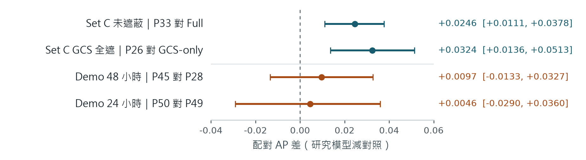

# ICU 住院死亡風險預測

資料科學專題（DSP）｜Fall 2026｜PhysioNet 2012 與 eICU Demo

本專題用 ICU 入住後前 48 小時或前 24 小時可得的資料，預測病人是否在**這次住院期間死亡**。主要評估模型能否把高風險住院排在前面，以及量測欄位缺失或換到另一個資料庫時，排序表現會下降多少。

## 研究目標

1. **比較表格與時間序列模型。** 以固定的 XGBoost Full／Elastic 為對照，檢驗時間窗摘要、逐小時序列與模型混合是否提高未遮蔽的 Set C 表現。
2. **量化缺失造成的影響。** 比較個別及聯合遮蔽，檢驗缺失增強、MA-GBT 與依 GCS 可用性分流，能否保留缺失時的排序能力。GCS（格拉斯哥昏迷指數）是主要遮蔽對象。
3. **檢驗跨資料集表現。** 對齊 P12 和 eICU 的欄位、單位與死亡標籤，分別評估凍結模型轉移與加入 eICU 病例訓練的效果。在相同 24 小時觀察窗和共同隊列上比較 APACHE IVa。

## 資料與評估

| 隊列 | 觀察窗 | ICU 住院次 | 住院死亡 | 用途 |
| --- | --- | ---: | ---: | --- |
| PhysioNet 2012（P12）A/B | 48 小時 | 8,000 | 1,122 | 固定三折開發、選參與最終擬合 |
| P12 Set C | 48 小時 | 4,000 | 585 | 凍結後的比較與遮蔽壓力測試 |
| P12 A/B／Set C 風險集代理 | 24 小時 | 7,817／3,906 | 1,071／549 | 24 小時模型與留出評估 |
| eICU Demo v2.0.1 | 48 小時 | 782 | 91 | 凍結轉移及外部病例增強 |
| eICU Demo v2.0.1 | 24 小時 | 1,398 | 121 | 同觀察窗比較及外部病例增強 |

上表以 ICU 住院次為單位。P12 採官方 `In-hospital_death` 標籤。eICU 以住院出院狀態 `Expired`／`Alive` 對齊，並以成人且本次住院第一個 ICU stay 為起點，依觀察窗末的 ICU 停留與住院結局時間篩選。24 小時 P12 的結局時間以整天表示，因此以成人和住院／存活天數建立風險集代理。 [P12 官方資料](https://physionet.org/content/challenge-2012/1.0.0/) · [eICU Demo 官方資料](https://physionet.org/content/eicu-crd-demo/2.0.1/) · [24 小時隊列規格](ML/reports/P49_24h_landmark_protocol.md)

主指標為 **AP（平均精確率）**，另報 AUROC 與 Brier 分數。模型在相同病例、觀察窗與遮蔽條件下比較 AP，並以配對 bootstrap 估計差值的 95% 區間。eICU Demo 增強採患者連結的院鍵區塊五折，同折訓練與測試的患者及院鍵區塊互斥。 [Set C 配對規格與結果](ML/reports/P30_full_mask_paired_results.md) · [eICU 分組方法](ML/reports/P44_real_eicu_augmentation_protocol.md)

## 前處理與模型

1. **整理原始量測。** 依 ICU 入住時間對齊並截取觀察窗。將非有限值、負哨兵和無效代碼轉為缺失，保留量測次數與缺失旗標。eICU 依欄位定義與單位對齊，並比較整點中位數與原始量測間隔。識別鍵、出院資訊、結局時間與臨床評分皆排除於模型輸入。 [P12 前處理規格](ML/reports/P0_資料與特徵重建.md) · [eICU 欄位對齊](ML/reports/P8_eicu_demo_protocol.md)
2. **建立共同輸入。** 48 小時表格 Full 有 435 欄，來自 5 個入院欄位和 37 個動態變數。Elastic 以 A/B 選定 322 欄，仍涵蓋全部 37 個動態變數。時間窗模型另用 20 個通道的 140 個時間摘要。序列模型以這 20 個通道的逐小時中位數與觀測旗標為輸入。補值、編碼與縮放均由訓練資料估計。 [凍結表格模型](ML/reports/P7_C資料集_凍結模型評估.md) · [逐小時序列規格](ML/reports/P33_hourly_sequence_protocol.md)
3. **建立基準與缺失對照。** 使用凍結的 XGBoost Full／Elastic、GCS-only 缺失增強，以及原版 MA-GBT。MA-GBT 利用補值前的缺失矩陣懲罰依賴補值的分裂，並追蹤預測路徑的補值依賴率。Set C 遮蔽涵蓋 GCS、乳酸、侵入式 MAP、鎂、尿量和機械通氣。 [遮蔽規格](ML/reports/P9_missingness_protocol.md) · [GCS-only 結果](ML/reports/P11_gcs_only_results.md) · [MA-GBT 規格](ML/reports/P13_ma_gbt_protocol.md)
4. **分流、混合與外部增強。** P26 以時間窗 XGBoost 預測有 GCS 的病例，以專用 LightGBM 預測無 GCS 的病例。P28 混合 P26 與 GCS-only Elastic 的對數勝算。P33 為 75% P28 機率加 25% 逐小時卷積機率。P45 加入 eICU Demo 病例重訓 48 小時有 GCS 分支。P49 重建 24 小時模型，P50 再以 Demo 增強其有 GCS 分支。 [P26 分流](ML/reports/P26-P27_gcs_routing_results.md) · [P28 混合](ML/reports/P28_robust_ensemble_results.md) · [P45 外部增強](ML/reports/P45_augmentation_branch_ablation_results.md) · [P50 24 小時外部增強](ML/reports/P50_24h_eicu_augmentation_results.md)

## 主要結果

ΔAP 為研究模型減對照。未遮蔽與全遮蔽的比較各自使用相同的 Set C 住院。

| 情境 | 研究模型 AP | 同隊列對照 AP | 配對 ΔAP（95% 區間） |
| --- | ---: | ---: | --- |
| Set C 未遮蔽 | P33 **0.60447** | 凍結 Full 0.57985 | **+0.02462** ［+0.01109, +0.03775］ |
| Set C GCS 全遮 | P26 **0.53733** | GCS-only Full 0.50492 | **+0.03241** ［+0.01363, +0.05132］ |
| Set C 六項全遮 | P26 **0.49937** | GCS-only Full 0.46052 | **+0.03885** ［+0.0148, +0.0629］ |
| eICU Demo 48 小時整點，尿量對齊 | P45 0.51115 | 凍結 P28 0.50144 | +0.00971 ［−0.01335, +0.03271］ |
| eICU Demo 24 小時共同隊列，1,166 次住院 | P50 0.38863 | APACHE IVa 0.38994 | −0.00132 ［−0.09271, +0.09874］ |

P33 提高了 Set C 未遮蔽的排序表現，P26 在兩種固定全遮蔽下優於 GCS-only Full。P26 自身仍會因遮蔽掉分。eICU Demo 的兩個主要差值區間均跨零，外部改善仍不確定。 [期末研究報告與完整結果](ML/reports/期末研究報告.md)

後續 24 小時 P52 在有 GCS 時加入 CatBoost。Set C 未遮蔽 AP 由 0.46555 升至 0.48012，配對差 +0.01457［+0.00417, +0.02599］。GCS 全遮 AP 為 0.41539。eICU Demo 整點 AP 由 0.38057 升至 0.40124，差值區間跨零。 [P52 結果與分層分析](ML/reports/P52_24h_catboost_blend_results.md)



## 解讀範圍與待驗證事項

- **Set C 是固定留出隊列。** 模型擬合與選參沿用 A/B，但 Set C 已看過多輪模型結果。依時間一致性條件限制至較保守的第 3 天回溯子集後，兩項主要 Set C 差值仍為正。 [時間敏感度](ML/reports/P41_p12_outcome_timing_results.md) · [切分重疊稽核](ML/reports/P47_p12_split_overlap_results.md)
- **人工遮蔽只涵蓋指定情境。** 模擬依通道覆蓋率及固定遮蔽設計進行，臨床上的是否量測還受病況、醫院流程及設備影響。 [缺失壓力測試](ML/reports/P9_missingness_results.md)
- **完整 eICU 的獨立驗證待執行。** Demo 折外成績仍來自同一版本資料。P46 已確認 CPU 載入、推論和患者排除流程，正式驗證須使用有授權的完整版 v2.0，排除所有 Demo 患者。 [確認規格](ML/reports/P46_eicu_adaptation_confirmation_protocol.md) · [完整版存取條件](https://physionet.org/content/eicu-crd/2.0/)

## 相關文獻復現

| 方法 | 本機進度 |
| --- | --- |
| MA-GBT | 已完成本專題 P12／eICU Demo 同流程的基準與缺失增強實驗。 |
| KEDGN | 作者的 PhysioNet 住院死亡設定已跑完完整切分一輪，測試 AP 34.95%、AUROC 73.91%，完整種子排程已啟動。 |
| ATENet、Warpformer、WaveGNN、ViTST | 作者程式已通過真實小樣本的 CPU 訓練、驗證與測試。完整論文成績、相容性修正與估計成本逐篇記錄。 |
| DBGL | 尚未查到作者公開 GitHub，待討論。 |

作者切分用來核對論文設定。例如 WaveGNN、ATENet 和 ViTST 所用的 Raindrop P12 第一折，訓練集包含本專題 Set C 的 3,201 筆病例。要與本專題比較，需統一病例、切分、標籤、觀察窗和指標。 [逐篇進度、GitHub 與論文](ML/related_work/README.md) · [文獻 CPU 重跑方式](ML/related_work/SETUP.md) · [作者同切分的 XGBoost 對照](ML/related_work/AUTHOR_SPLIT_COMPARISON.md)

## 本機 CPU 重跑

以下指令從 `DSP` 根目錄的 Windows PowerShell 執行。既有工作區可使用現成的 `ML/.venv`。建立新環境時，先安裝 `uv` 並使用 [套件鎖定檔](ML/requirements-lock.txt)。

```powershell
uv venv .\ML\.venv --python 3.12
uv pip sync --python .\ML\.venv\Scripts\python.exe .\ML\requirements-lock.txt
uv pip check --python .\ML\.venv\Scripts\python.exe
```

本機資料依下列路徑擺放。P12 的 A/B 需解壓，Set C 保留官方原壓縮檔。

```text
DSP/
├── data/predicting-mortality-of-icu-patients-the-physionet-computing-in-cardiology-challenge-2012-1.0.0/
│   ├── set-a/、set-b/
│   ├── Outcomes-a.txt、Outcomes-b.txt
│   └── set-c.tar.gz、Outcomes-c.txt
└── ML/
    ├── dataset/EICU/eicu-crd-demo-2.0.1/
    └── artifacts/
```

**重建原表格基準。** 在獨立副本執行，因為前處理和訓練會寫回報告與產物。`prepare.py` 重建 A/B 並核對 Set C 檔案資訊。下列 `baseline` 只跑起始比較。要完整重建 Full／Elastic，依階段索引續跑調參、欄位篩選和保存凍結模型。 [原表格基準完整步驟](ML/README.md#重現與審閱)

```powershell
$py = '.\ML\.venv\Scripts\python.exe'
$env:CUDA_VISIBLE_DEVICES = '-1'
$env:PYTHONDONTWRITEBYTECODE = '1'
& $py .\ML\src\prepare.py
if ($LASTEXITCODE -eq 0) { & $py .\ML\src\study.py baseline }
```

**重評原凍結模型。** 先備妥原 A/B 特徵、前處理清單、位於 `ML/artifacts/final_models/` 的 Full／Elastic，以及對應的原始資料。以下從 `DSP` 依序跑 Set C、eICU Demo 凍結轉移及 Set C 遮蔽。

```powershell
& $py .\ML\src\evaluate_c.py
& $py .\ML\src\evaluate_eicu_demo.py
& $py .\ML\src\stress_missingness_c.py
```

**重跑後續實驗。** 以下入口從 `ML` 目錄執行，各連結列出所需的前置產物與 CPU 環境。既有輸出請先另存，部分腳本遇到已存在的輸出目錄會停止。

| 工作 | 入口與所需設定 |
| --- | --- |
| MA-GBT 原版 | `ma_gbt_p12_inputs.py` → `run_ma_gbt_p12.py` → `evaluate_ma_gbt_p12.py`。[作者版本及獨立 Python 環境](ML/reports/P13_ma_gbt_protocol.md) |
| P33 訓練、Set C 主結果重評 | `prepare_hourly_sequence.py` → `train_hourly_sequence.py` → `evaluate_hourly_sequence.py`。有凍結產物時，可用 `audit_p12_outcome_timing.py` 重跑主比較。[Torch CPU 環境](ML/reports/P33_hourly_sequence_protocol.md) |
| 48 小時外部增強與完整版驗證 | `evaluate_real_eicu_augmentation.py` → `audit_eicu_augmentation_branches.py`。有完整資料與凍結產物時，`evaluate_eicu_adaptation_confirmation.py --full-directory` 接收資料目錄。[P45 依賴](ML/reports/P45_augmentation_branch_ablation_protocol.md) · [P46 執行指令](ML/reports/P46_eicu_adaptation_confirmation_protocol.md) |
| 24 小時與 APACHE IVa | `evaluate_24h_landmark.py fit` → `evaluate_24h_landmark.py evaluate` → `evaluate_eicu_24h_augmentation.py`。[P49 設定](ML/reports/P49_24h_landmark_protocol.md) · [P50 設定](ML/reports/P50_24h_eicu_augmentation_protocol.md) |

## 專案內容與資料管理

| 路徑 | 內容 |
| --- | --- |
| [ML/src/](ML/src/) | 資料重建、訓練、評估與稽核程式 |
| [ML/reports/](ML/reports/) | 各階段設定、彙總結果、[期末研究報告](ML/reports/期末研究報告.md) |
| [ML/figures/](ML/figures/) | 評估曲線、特徵分析與配對比較圖 |
| [ML/related_work/](ML/related_work/) | 逐篇文獻結果、CPU 入口與復現卡點 |
| [ML/README.md](ML/README.md) | 歷史實驗索引及原表格模型的完整重建步驟 |

原始資料、逐筆特徵與預測、模型權重、快取和受限醫療資料留在 Git 排除路徑。授權與引用以各資料來源規範為準。現有期末 PDF 與課程資料 ZIP 分別存於本機 `ML/artifacts/course_submission/icu_mortality_report/` 和 `ML/artifacts/course_submission/icu_mortality_dataset/`。 [Git 排除規則](.gitignore) · [課程資料包內容與校驗](ML/reports/P51_course_dataset_package_results.md)
